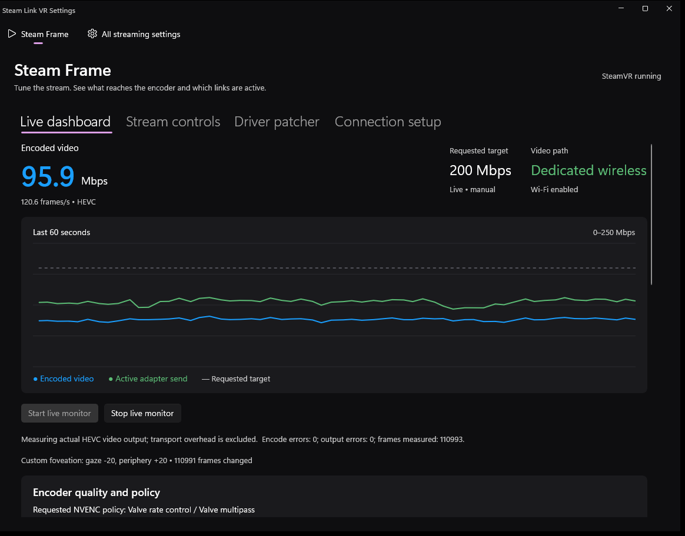

# Steam Link VR Settings — Steam Frame edition

A Windows app for tuning and diagnosing **Steam Frame** streaming from a PC.
It sets the stream's bitrate and foveation, measures what the encoder actually
produces, records streaming faults on both the PC and the headset, and can raise
the SteamVR driver's bitrate ceiling with a fully reversible patch.

It also includes a full editor for every Steam Link VR (`driver_vrlink`) setting,
including the ones SteamVR doesn't show in its own UI.



> **Platform:** Windows 11 x64 · SteamVR with the Steam Link VR driver · NVIDIA GPU
> for encoder measurements and foveation bias (AMD AMF can be enabled, but isn't measured)

## Features

| Area | What it does |
| --- | --- |
| **Stream controls** | Set the video bitrate target, automatic bandwidth, AMD AMF and USB link joining. Changes apply live to running SteamVR, or are saved for its next start. |
| **Foveation bias** | Shift quality between where you look and the periphery on top of Valve's own gaze-tracked map. |
| **Live dashboard** | Graphs actual encoded video Mbps and FPS, the requested target, and adapter traffic over the last 60 seconds. |
| **Streaming issue capture** | Timestamps recovery requests, bad-link events, encoder stalls, PC presentation drops and headset receiver faults, and saves them as JSONL. |
| **Driver patcher** | Raises the driver's 232/350 Mbps ceilings to 500 Mbps and selects HEVC level 6.2, with verified backups and one-click restore. |
| **Connection tools** | Reads headset link status over paired wireless SSH or ADB, and can restart a stalled Frame USB connection. |
| **All streaming settings** | Every known `driver_vrlink` setting, with defaults, reset buttons, and warnings for experimental options. |

## Download and run

1. Download `SteamLinkVRSettings-SteamFrame-win-x64.zip` from the
   [latest release](../../releases/latest).
2. Extract the **whole** folder anywhere. The ZIP bundles the .NET and Windows App SDK
   runtimes, so nothing else needs to be installed.
3. Run `SteamLinkVRSettings.exe`.

The app runs as your normal user account. If an action is denied access, such as
patching a driver in a protected folder, the status bar offers **Restart as
administrator**. Opening the app never launches SteamVR, modifies a driver, or
starts encoder monitoring on its own.

## Quick start

1. Keep Wi-Fi on the Frame enabled and start a VR stream.
2. Open **Stream controls**, choose a bitrate target, and click **Apply stream controls**.
3. On **Live dashboard**, click **Start live monitor** to see the real encoded bitrate.
4. Optionally enable **Custom foveation bias**. **Quality focus** (gaze −4, periphery +8)
   is a good starting point.
5. To request more than 232 Mbps on a stock driver, close SteamVR and use
   **Driver patcher → Install 500 Mbps override** first.

## Documentation

| Guide | Covers |
| --- | --- |
| [Stream controls and foveation](docs/stream-controls.md) | Bitrate, encoders, USB link joining, foveation offsets, how settings are saved |
| [Live dashboard and diagnostics](docs/live-dashboard.md) | Every readout, capture files, recovery traces, PC presentation counters |
| [Driver patcher](docs/driver-patcher.md) | What the patch changes, compatibility checks, backups and restore |
| [Connection setup](docs/connection-setup.md) | Wireless SSH pairing, optional ADB, USB recovery |
| [All streaming settings](docs/settings-editor.md) | The full settings editor, resets, backups, experimental options |
| [Building from source](docs/building.md) | Toolchain, build and package scripts, tests |
| [Encoder probe internals](Native/README.md) · [Compatibility evidence](Native/VERIFICATION.md) | How the NVENC helper works and how it was verified |

## Safety and privacy

- **Reversible by design.** Config saves are atomic and keep both the previous revision and
  your original file. Driver patches keep a hash-verified original and a receipt.
- **Measurement only.** The encoder monitor counts compressed frame sizes and never reads,
  stores or copies video. Log capture stores synthesized events, not raw log lines.
- **No surprises.** Monitoring and patching only happen when you click them. SSH uses strict
  host checking with your own trusted host file and never auto-trusts a device.
- **Nothing personal is shipped.** SSH keys, headset addresses, logs and Valve binaries
  are never packaged. Only patch byte-deltas are included, not Valve's driver.

## Known limitations

- The bitrate target is a request, not a minimum. Simple scenes can encode below it,
  and no filler is added.
- 500 Mbps is a software ceiling. One measured USB 2 connection carried about
  318–325 Mbps of UDP payload; real headroom depends on the link and scene.
- Encoder measurement and foveation bias support NVENC only.
- A future SteamVR driver with a rewritten encoder can disable the patcher or foveation
  until the app is updated. Both refuse layouts they can't verify rather than guessing.

## Project layout

```
SteamLinkVRSettings/   WinUI 3 app (views, view models, services)
  Frame/               Steam Frame runtime, connection, patcher, probe and diagnostics services
Native/                NVENC encoder probe (C++), its tests and vendored MinHook/NVIDIA headers
Tests/                 xUnit test projects
docs/                  User and developer guides
```

Third-party licenses for MinHook/HDE and the NVIDIA Video Codec SDK header live under
`Native/vendor` and are copied into the release package.
