# Steam Frame streaming system map

This map joins independently traced host, receiver and radio paths for the builds
identified in the linked notes. It is an evidence inventory, not a claim that every
instruction, hardware block or firmware state has been understood. An address or
decompiled function alone does not establish a working override.

This research publication includes the notes and the standalone
[encoder lab](../../Native/EncoderLab/README.md). App diagnostics and lifecycle
changes described as local or unreleased are not included in this research
commit or in a new release. Temporary live overrides remain private experiments.

- [Host encoding, transport and feedback](host-stream-map.md)
- [PC shared-texture ownership and handoff](pc-texture-handoff.md)
- [Headset reception, decoding and presentation](receiver-stream-map.md)
- [USB, radio driver and firmware scheduling](radio-stream-map.md)
- [Experiment register: completed tests, failures and untested candidates](experiment-register.md)
- [H.264 and multiple decoder streams: implemented paths and remaining work](codec-stream-options.md)
- [Measurements and encoder experiments](../encoder-and-codec-research.md)

The latest [full-area square H.264 comparison](codec-stream-options.md#full-area-square-h264-isolated-cavlc-capacity-and-cadence-pass)
decoded CAVLC at **350.173 Mbps / 89.997 FPS**, passing its short isolated
capacity/callback-cadence checks. The [native prototype](codec-stream-options.md#native-square-prototype-functional-startup-not-steady-350-mbps)
has only a short 150-Mbps functional startup result; fresh 350 and later warmup
attempts hit receiver startup recovery. Smooth native streaming at 350 Mbps remains unproven.

```mermaid
flowchart LR
    game[Game and SteamVR compositor] --> phase[Host frame scheduling]
    phase --> handoff[Shared-texture handoff]
    handoff --> pack[Foveation and packed eye image]
    pack --> nvenc[NVENC encode]
    nvenc --> fec[Packetization and FEC]
    fec --> tx[UDP send queue]
    tx --> usb[Windows NIC driver and USB]
    usb --> radio[Radio firmware and wireless link]
    radio --> rx[Frame radio and UDP receive]
    rx --> repair[FEC, retries and frame ordering]
    repair --> decoder[V4L2 decoder queues]
    decoder --> render[Image selection and reprojection]
    render --> display[Headset compositor and display]
    repair -. retry requests .-> fec
    decoder -. completion acknowledgement .-> budget[Host bitrate controller]
    rx -. ping feedback .-> budget
    budget --> nvenc
    render -. selected display and query targets .-> phase
```

The diagram separates control feedback from image delivery. A setting can affect
one loop while another remains active. For example, choosing CBR changes NVENC's
rate-control mode; it does not disable the host's queue/ping budget adjustments,
its frame-phase controller, transport repair or receiver image selection.

## What the present evidence establishes

| Question | Established result | Remaining limit |
| --- | --- | --- |
| Is approximately 150 Mbps a fixed Valve cap? | No such cap was found on the traced path. The two researched nominal ceilings are 232/350 Mbps; requested bitrate is additionally modified by feedback and encoder allocation. This machine already uses the supported ceiling patch. | This does not exclude other constraints on another build or hardware path. |
| Can this link carry more than 400 Mbps? | After reception improved, an eight-second UDP trial delivered 450.01 Mbps with no missing sequence numbers. | Sustained video requires parity, headers, timing headroom and decoding. |
| Is selected CBR necessarily active? | No. This GPU lacks dynamic rate-control switching; CBR must be armed before a fresh encoder initialization. | A successful configuration submission still is not a complete hardware-state readback. |
| Does unpadded CBR guarantee a flat graph? | No. The app leaves filler disabled, and Valve normally reconfigures its budget per frame. | Padding can make bytes constant without adding detail; overriding adaptation does not increase network/decoder capacity. |
| Does the SteamVR counter measure only video? | No. It counts assembled transport datagrams over the last second and divides bits by 2^20 despite its `mbps` label. | It includes parity/protocol overhead and is not a receiver delivery counter. |
| Is there a concrete cause for a captured long pause? | In a later capture, a packet timestamp was 1–104 microseconds newer than the retry thread's sampled clock. Unsigned timer arithmetic turned that negative interval into a scan allowance of over 41 million positions, exhausted the 512-entry request list and triggered recovery. | A temporary arithmetic correction passed a short loaded trial with the capacity guard retained, then was restored. A permanent correction needs coordinated state ownership. |
| Does correcting that timer eliminate recovery failures? | No. Separate captures found an ordering-reset/progress-overflow cascade and, more recently, a timed overflow strongly consistent with a reused slot publishing its new identity before its new clocks. | Signed arithmetic and a six-frame ordering window do not make slot initialization atomic or bound every retry build. Neither is a validated permanent fix. |
| Is every captured pause caused by wireless delivery? | No. Two frames waited 100.741 and 347.890 ms before encoder submission while the encoder and send queue were empty. SteamVR logged shared-texture acquisition timeouts in those intervals. | The initial reason for losing texture ownership remains under investigation. A separate transport burst did grow the send queue, so one explanation does not cover every tail. |
| Are all generated parity chunks equally repairable? | In one-parity mode, the host retransmit check uses a sent-chunk count as if parity indices were contiguous. Valid later even indices can be rejected, while some initially unsent odd indices are below that bound. | The mismatch is established in code, but not tied to the captured fault. A fix must avoid serving stale, not-yet-generated slot contents. |
| Does a 17 ms decoder interval imply a 59 FPS ceiling? | No. Submitted frames can overlap, and the interval includes driver/queue/scheduling time until userspace observes completion. | Pure hardware decoder occupancy and execution time are not yet isolated. |
| Does the current path use multiple decoder streams? | It uses one packed HEVC picture/session with four constrained slices. An isolated same-area Main10 comparison completed at 74.494/74.270/71.772 group Hz with one/two/four sessions. | Slices are not sessions. The [codec audit](codec-stream-options.md) finds no measured current-geometry multistream gain or validated replacement preserving native foveation quality. |
| Does `Submit Illumination` prove actual presentation time? | No. The traced receiver sends its chosen future display target before submitting the image. | Physical display timing requires separate compositor/display evidence. |

## Latest isolated decoder results

The new square H.264 workload preserves all 11,075,584 luma positions of the
1664 x 6656 layout by arranging four regions into 3328 x 3328. CAVLC completed
all 900 pictures at **350.173213 useful Mbps / 89.996764 FPS**, with callback
interval p99 **13.497225 ms** and no input deadline misses. CABAC completed all
pictures but reached **346.819546 Mbps / 88.842655 FPS**, with 298 missed input
deadlines and much longer queue residence. Separate linear-output canaries
matched each clip's own first-picture software golden.

The [bounded comparison](codec-stream-options.md#full-area-square-h264-isolated-cavlc-capacity-and-cadence-pass)
is 8-bit synthetic local decoding, without wireless transport, native foveation
or panel presentation. Entropy jobs have different coded pictures and unproven
equal quality; one sequential pair cannot establish a universal CABAC limit.
This supports a native CAVLC prototype, not a released or validated game stream.

The [current-geometry comparison](codec-stream-options.md#current-geometry-comparison-completed-tests-missed-90-hz)
now has generated clips, an exact native ARM64 build and completed headset jobs.
Its synthetic Main10 source preserves total 1664 x 6656 area and four independent
slices per group, with actual coded rates near 350 Mbps and no filler. All 900
groups decoded in each case, but one/two/four sessions reached only
**74.494/74.270/71.772 complete-group Hz** and **290.726/288.780/278.431 coded Mbps**
over their completion windows. Functional completion is not a pacing pass.

Removing active telemetry from an otherwise identical one-session job yielded
74.495895 Hz, essentially unchanged in this one sequential pair. Active video
memory requests differed substantially across session counts, while sampled
MVS0 clock-framework state remained at 600 MHz. These facts do not isolate
engine occupancy, delivered memory bandwidth or a universal hardware limit.
They also do not measure radio throughput or native game image quality.

The [resource and control analysis](radio-stream-map.md#isolated-decoder-resource-votes-and-telemetry-control)
preserves those distinctions. Jobs drained and their visible resources returned
to idle; normal Main10 streaming was restored. The later
[single-session memory-vote control](radio-stream-map.md#completed-single-session-memory-vote-control)
also missed 90 Hz: an added 1,134,000 kB/s software request yielded 74.497800 Hz,
essentially unchanged. Requests and reported clocks do not prove delivered
memory bandwidth, and the new observation profile was not fully matched.

A separate [input-copy/QBUF observation](receiver-stream-map.md#measured-compressed-input-copy-and-qbuf-cost)
found mean synchronous costs of 0.044453 and 0.020230 ms versus 13.424729 ms mean
callback spacing. Those measured operations cannot explain most of the mean
deficit in that run; the result does not identify hardware decoding as its cause.
A [retained 208.075080-Mbps workload](codec-stream-options.md#retained-lower-rate-workload-completed-hardware-test)
has now completed at **90.031369 Hz / 208.043321 coded Mbps**. A second control
replaced only its VPS/SPS with the 350-Mbps clip's parameter sets, preserving
all coded pictures and software-decoded pixels. It reached **90.049625 Hz /
208.085514 Mbps**. The combined level/HRD metadata change did not reproduce
the heavier clip's 74.5-Hz result. Both 208-Mbps runs retain nine roughly
19--21-ms IDR callback gaps; average throughput is not smooth presentation.

The [installed decoder policy audit](receiver-stream-map.md#installed-decoder-arrival-rate-and-control-boundary)
finds an actual input-arrival-rate estimator and a byte-sensitive frequency
model, followed by an explicit 600-MHz supported decoder request. No verified
unused public throughput override was found. This does not identify firmware
service time or a universal hardware ceiling. No new release or permanent
runtime change follows from this research.

## Current connected reference

After the square-native startup experiments, normal HEVC Main10 was restored.
A [20-second passive reference](codec-stream-options.md#restored-normal-hevc-why-400-requested-became-about-240-useful)
measured **240.007 useful Mbps / 89.818 FPS** with the saved 400-Mbps target.
Queue feedback reduced the mean sampled encoder request to 238.157 Mbps;
ping feedback was one. Waterfall averaged 291.487 binary Mib/s, or 305.647 decimal
Mbps, including 54.639 Mbps parity. Receiver interface traffic was 319.722 Mbps
over a different counter window. These are different quantities, not conflicting
measurements of picture detail. One presentation timeout remains; this is not
a smooth result at 350 Mbps of useful video or evidence of a 240-Mbps hardware cap.

The square native 150-Mbps canary proved accepted encoding, capture allocation
16 and bounded progress. It did not independently validate native image
reconstruction or presentation. Two fresh 350 starts and a later 150-Mbps warmup
aborted during receiver startup recovery before any 350 measurement; the planned
warmup-to-350 ramp was not invoked. All completed attempts restored normal
streaming. The source-supported startup clock explanation still needs exact
first-input and return timestamps; no recovery threshold was relaxed.

The preceding completed HEVC allocation experiment used **full-resolution
multipass at a fixed 350 Mbps budget**. It reached measurement, then failed the
unchanged decoder-latency guard: **320.297 useful Mbps at 88.764 FPS** over
3.999390 seconds. Two distinct fresh timing cohorts had decoder-turnaround p99
of 46.195 and 46.931 ms. The sampled queue was below its separate abort threshold;
the delay was not merely old timing history. Those pictures at exactly 90 Hz
would still represent only 324.759 Mbps, so cadence does not explain the whole
useful-byte deficit. This is neither a sustained 350 result nor a smoothness pass.

The [host analysis](host-stream-map.md#full-resolution-multipass-measured-underfill-and-latency-failure)
separates accepted configuration, partial frame pairing, allocation fill and
content confounds. The [receiver analysis](receiver-stream-map.md#full-pass350-fresh-latency-cohorts-and-restoration)
records callback semantics, limited presentation evidence and restoration.
The first full-pass attempt failed before fixed activation because a strict
passive-readback gate received a smaller CLI response. A reviewed revision
separated those interfaces while retaining the full RC checks. Both attempts
restored normal Main10 streaming; the measured attempt also verified original
receiver instructions and all-thread detachment. No experimental helper or
release is shipped by this documentation update.

The preceding scoped quarter-pass retry-prefix repeat was **cadence-aborted**:
153 pictures in 1.999516 seconds delivered **297.881 useful Mbps at 76.519 FPS**.
Its larger average picture would arithmetically need 350.363 Mbps at 90 FPS;
that cadence was not achieved. This differs from the earlier near-90-Hz run's
bitrate underfill. Content/QP-map differences prevent a clean comparison of the
retry strategies, and no successful prefix-branch execution was directly counted.
All experimental instructions and settings were restored after the abort.

The first completed combined retry-prefix attempt was **setup/handoff-aborted**.
A real shared-texture timeout occurred after fixed-budget activation but before
the first useful-video counter baseline. The later ten-second counter interval
was 324.920 useful Mbps at 90.005 FPS, with twelve receiver presentation timeouts;
it is not a successful reliability test. The [phase analysis](host-stream-map.md#retry-prefix-attempt-startup-failure-precedes-the-counter-window)
keeps both scopes instead of discarding the startup fault. The receiver strategy
was restored and a fresh normal Main10 session at the saved 400 Mbps target was
verified. No sustained smooth useful-350 result exists.

The preceding original-codec **350 Mbps budget** trial held approximately 90-Hz
encoding for 78 seconds, then failed on a receiver retry overflow. Its first
77.997863 seconds delivered **325.066 useful Mbps at 89.964 FPS**, not useful
350 Mbps. Receiver counters had already accumulated 65 presentation timeouts
by the 70-second sample. The complete captured 80-second partial window is
319.743 Mbps at 88.502 FPS; its final intervals fall to 46.015 and 16.989 FPS.
It therefore does not establish sustained smooth streaming.

The [receiver trace](receiver-stream-map.md#fixed350-timed-overflow-during-rx-slot-reinitialization)
captured a timed request attempting 560 entries against a 512-entry limit,
before the builder's later 20-ID emission clamp. The initialization and recorded
retry clocks are 25 microseconds apart, but the last-chunk clock almost exactly
matches the previous owner of the same sixteen-slot index. Exact initializer
store ordering supports a partial-publication race. The capture
is non-atomic and does not directly trace that interleaving; it does not show
a 173 ms radio stall or a new decoder hardware ceiling.

The [host analysis](host-stream-map.md#modern-fixed350-reference-near-90-hz-before-a-receiver-repair-failure)
finds normal production cadence up to the fault, followed by decode-ACK stall,
admission holdoff and roughly 300 ms production gaps. Normal Main10 streaming,
the 400 Mbps saved target, original receiver instructions and activity cleanup
were verified afterward. A failed first startup attempt produced no performance
measurement; its disconnected cleanup path was repaired and tested separately.

The preceding two completed fixed-400 screens both failed smoothness:

| Completed screen | Useful encoded video | Encoded cadence | What it established |
| --- | ---: | ---: | --- |
| Matched thirteen-event lock/PM observation | 304.190 Mbps | 68.526 FPS | Most added receiver residence precedes input-response handling; observed IRQ-thread contention and PM spans are too small to account for the broad increase. |
| Minimum coding unit 32, with unchanged CTU32 grid | 307.791 Mbps | 69.019 FPS | The requested minimum-CU change reached the emitted SPS, but did not produce a smooth fixed-400 result. |

Both rate figures cover approximately two seconds before their guards aborted,
not sustained operation. All encoded pictures and useful bytes in each counter
window reconcile with independently observed host frame pairs. Mean pictures
nearly fill the nominal per-picture allocation; lost cadence is the large
wall-clock bitrate deficit. These are separate sessions, not a matched quality
or performance comparison. Normal Main10 streaming and receiver/activity
cleanup were verified afterward. See the [experiment register](experiment-register.md)
for timing cohorts, negative results and the lower-load candidate's status.

The [loaded lock/PM observation](receiver-stream-map.md#matched-thirteen-event-observation-small-observed-lock-and-pm-spans)
had 24,418 retained events and no reported trace loss. Normal preroll and tail
returned about 90 output responses per second; the mixed high-load/cancellation
phase was 71.44. Its median queue-to-input-response residence rose from 13.40 to
54.18 ms, while input-to-output remained about 3.35 ms. The measured PM and
contended-mutex spans narrow those software explanations, but do not isolate
firmware/device service or prove zero observer overhead.

The [minimum-CU screen](host-stream-map.md#minimum32-coding-unit-trial-accepted-and-emitted-but-cadence-still-failed)
verified minimum coding block 32, CTU32, the unchanged 10,816-CTB grid and
cross-slice filtering still enabled. Its 120 strictly overlapping AFTM records
had 4.732 ms median encoder completion, 7.693 ms transport and 61.597 ms decoder
turnaround. That screen had no simultaneous kernel-stage trace. Syntax acceptance
does not establish equal image quality or a decoder throughput improvement.

**Steady useful 350/400 Mbps remains unproved.** The modern 350-budget result
above separates lower-load cadence from its underfilled encoded budget and
receiver reliability failure. The [current-geometry decoder comparison](codec-stream-options.md#current-geometry-comparison-completed-tests-missed-90-hz)
also failed 90-Hz cadence despite complete decoding. No radio, firmware, forced
clock or thermal control changed in these tests; session count did change the
driver's ordinary resource requests.

The timed-prefix backend now has transaction tests and a short live application/
restoration canary, rather than only an offline model. Neither proves successful
branch execution or recovery. A [full-resolution multipass derivative](host-stream-map.md#underfill-readback-and-an-offline-built-full-pass-discriminator)
subsequently reached accepted native configuration and the short failed
measurement above. Its underfilled pictures resemble an earlier quarter-pass
case, but source content, pose and quality-map values were not held equal.
No causal quality or efficiency improvement is established.

The earlier cross-slice-filter screen verified that the requested codec change
reached the actual emitted PPS, but still triggered the fixed-400
decoder-delay/backlog guard:
**336.35 useful Mbps at 82.02 FPS** over about two seconds. Waterfall remained
above 300, at approximately 370.51–421.22 binary Mbps, while its frame counter
was 81–83 FPS. No encoder API errors were counted. This is a failed smoothness
test, not evidence of an improvement over earlier short failures. The normal
Main10 helper, original receiver instructions, detached threads and cleared
activity lease were verified after the abort. The
[host result](host-stream-map.md#phase-specific-cross-slice-filter-trial-and-emitted-pps)
separates accepted requests, same-generation emitted syntax and pacing evidence.

The earlier candidate's startup refusal is now explained by a captured first
initialization: **3200×8192, slice mode/count 0/0**, followed by warm streaming
at **1664×6656**. The first API call succeeded; only the old width/height/slice
predicates failed. An [installed-code capacity audit](host-stream-map.md#observed-first-initialization-and-capacity-versus-active-dimensions)
links the first dimensions to capacity selection/clamping and the later
dimensions to active-frame reconfiguration. It does not imply that the stream
used capacity-sized pictures. The revised guard handles those phases separately
and does not relax automatically after a failure.

A separate [normal lock/PM canary](receiver-stream-map.md#normal-thirteen-event-locking-and-runtime-pm-canary)
validated thirteen existing events and cleanup: 179 output responses over
2.000389 seconds, zero reported trace loss, and approximately 90 FPS in adjacent
host counters. Complete PM calls were at most 5 microseconds and bounded mutex
contentions at most 96 microseconds in that normal capture. Four acquisitions
remain censored. That canary preceded the matched load observation above;
its normal intervals alone do not establish higher-load behavior.
No firmware, thermal, scheduling-priority or clock control was changed.

The preceding matched **400 Mbps** trial added existing IRQ and scheduler events
to the decoder trace. It again failed the guard after about two seconds,
producing **333.91 useful Mbps at 81.54 FPS**. Across normal control, the mixed
override/cancellation interval and the post-cancel tail, output events changed
**89.75 → 83.18 → 89.96 per second**, while median queue-to-input-response
residence changed **11.31 → 40.82 → 11.53 ms**. Input-to-output response handling
stayed near 3.3 ms. These phases are broader than the encoded-counter window;
activation and cancellation are bounded observations, not exact switch times.

The added residence did **not** appear as a comparable final IRQ-thread
runnable delay: the input-response-associated wake-to-switch median during
the mixed interval was 61 microseconds, with p99 1.665 ms and maximum 5.396 ms.
The thread was already using real-time priority 80 on CPU 0. This narrows one
scheduling explanation without identifying pure hardware decode time, the
physical interrupt time, or the effects of earlier HFI/PM/locking stages.
No IRQ was assigned to a frame by proximity. The
[receiver map](receiver-stream-map.md#matched-irq-observation-no-comparable-final-scheduling-delay)
records the full event validation, phase and continuity limits.

The bounded receiver-log slice contained no named recovery failure, but that
does not prove complete logging or valid presentation. Normal budget callbacks,
normal Main10 helper restoration, original receiver instructions, detached
threads, owned trace cleanup and activity-lease clearing were verified
separately. **Steady useful 350/400 Mbps is still not demonstrated.**

The first passive-observation attempt at a fixed **400 Mbps** encoder budget
passed its startup gate, then was stopped after approximately two seconds by
the decoder-turnaround guard. Actual output in that short counter window was
**340.84 Mbps at 84.03 FPS**; all three accepted-budget samples remained at
400 Mbps, and no encoder API errors were counted. Sampled Waterfall values were
419.28–423.88, including transport overhead. This is a **failed transition test**,
not a sustained bitrate or smoothness result. It does not establish whether the
immediate budget step, receiver queueing or a sustained decoder limit caused the
slowdown. The experiment cancelled the fixed budget and verified a successful
normal-controller callback; receiver instruction restoration is verified
separately after the bounded lease. Original instructions, all-thread detachment
and the subsequent restart with the normal encoder helper were all verified.

An immediately preceding 380 Mbps attempt never reached measurement: the stream
failed the excluded 19-second settling gate. No throughput conclusion is drawn
from it. Its original receiver instructions, detached threads and normal helper
were restored. The trial runner now saves each settling sample; the 400 Mbps
attempt recovered within 11.97 seconds before its fixed budget was enabled.

The latest 150-second experiment held a 380 Mbps encoder budget and temporarily
paired the receiver timer correction with a six-frame ordering/drain window.
It produced **327.35 Mbps of useful video at 89.45 FPS**. The sampled SteamVR
Waterfall counter averaged **389.75**, but fell below 300 twice around a pause;
its minimum was 234.02. Four presentation timeouts were counted. No retry-list
overflow or five-frame-window rejection was captured, but the receiver's
300 ms progress watchdog requested a new keyframe and the host reinitialized the
encoder. This result **fails the smoothness goal** despite successful completion
of the measurement. Zero reported socket drops, UDP receive-buffer errors and
encoder API errors do not erase that recovery event.

Frame identity and timestamps locate two important gaps **before** encoding:
100.741 and 347.890 ms between producer release and resource submission. During
both gaps, sampled encoder resources were reusable, the send FIFO was empty,
and retry counters were unchanged. The first aligns with a driver `AcquireSync`
timeout; the second spans compositor acquisition/release failures. Once those
frames reached the encoder, their completion intervals were about 6 ms.
The later 67–72 ms encoder intervals followed recovery. Clock alignment and
present/TX identities were checked; the gaps are not inferred from mismatched
machine clocks. Fixing only these two gaps would still leave about 328.62 Mbps
of useful video in this capture, below a constant 350 Mbps.

The similarly named `WaitForAcquire` warning is a separate five-millisecond
named-event wait. The server signals that event after the driver's `Present`
returns; it is not a measurement of the instant keyed-mutex ownership is gained.
Thousands of suppressed instances occurred during the otherwise 90 Hz portions
of this same capture. It must not be equated with the distinct DXGI
`AcquireSync FAILED` messages or counted as lost headset frames.

A separate burst in the same capture reached 64.594 ms of transport time,
1.291 MB in the host send FIFO and 83 additional retry attempts while the
seven-frame queue holdoff was active. That is distinct from the empty-queue
texture pauses. FIFO-head age includes any limiter wait before enqueue and is
not an independent USB or over-the-air completion timestamp.

The receiver's original instructions, detached thread state, normal encoder
helper and normal controller were verified after this trial. At that checkpoint,
the prepared 400 Mbps coherent-budget helper had passed offline checks; its later
failed transition test is recorded above.
Uncommitted local app changes recognize these shared-texture acquisition failures in both
`vrcompositor.txt` and the `vrlink:` entries in `vrserver.txt`; this diagnostic
change does not repair ownership or change streaming behavior.

Two subsequent 150-second observations used the normal controller and restored
receiver, with helper calls only at the measurement endpoints. During each
window, host counters and queues were read externally; no periodic helper status
thread was created. Both still failed smoothness:

| Normal-controller observation | Useful video / FPS | Sampled Waterfall minimum | Captured recovery |
| --- | --- | --- | --- |
| Endpoint-only baseline | 305.56 Mbps / 89.64 | 230.27 | Frame ordering rejected a successor before the missing predecessor arrived; subsequent admission holdoff lasted about 300 ms. |
| Endpoint-only plus compositor scope sampling | 302.20 Mbps / 89.14 | 22.12 | A retransmission list overflow was followed by progress-watchdog requests and a decoder hard reset. The particular overflow arithmetic branch was not probed in this capture. |

Each observation had four sampled Waterfall values below 300 and no captured
DXGI acquisition/release failure. The first receiver rejection followed frame
7085's completed reception by two microseconds while frame 7080 remained
incomplete; frame 7080 arrived about 18 ms later and was also rejected after
the reset. Its recorded transport interval was 85.911 ms, while its host
release-to-resource interval was about 1.115 ms. The second observation's long
production gaps all followed the first host reset. During those gaps, ACK
progress stopped and admission holdoff was active while encoder resources and
the send FIFO were empty. These are receiver-recovery-driven stalls, distinct
from the earlier PC texture failure. Periodic helper calls are therefore not a
necessary cause of these two recovery failures; the captures do not rule out
all observer effects or prove that polling caused the earlier texture stall.

The compositor's exact-build read-only observer passed a ten-second access test
and then collected 15,500 point samples alongside the second baseline. It checks
the registered render thread against its thread-local watchdog record. Repeated
scope labels are not continuous call durations. No `CGpuTiming::GetDeltas` scope
was sampled, and no new texture-lock failure was captured; this run does not
identify the original texture owner stall. A separate passive encoder-helper
reader also passed a short live check, preserving actual output and accepted
configuration readback without invoking status callbacks during each poll.

Earlier connected references and experiments follow so that a short favorable
window is not mistaken for sustained stability.

The normal Valve controller, a 400 Mbps manual target, 1664-pixel packed stream
width, Main10 HEVC at 90 Hz, CBR without filler and quarter-resolution multipass, synchronous
sending and gaze/periphery offsets −20/−12 produced **320.76 Mbps of encoded video**
at **89.97 FPS** over two minutes. Every sampled Waterfall value exceeded 300
(315.41–406.38, mean 361.37). Six headset presentation timeouts were recorded.
This is improved unattended Home behavior, not a claim of perfect pacing or a
constant 350 Mbps of useful video. Reducing stream width trades spatial resolution
for processing headroom.

A later two-minute observation of the same normal configuration captured an
unrecoverable frame-repair fault followed by a decoder reset. It averaged 321.87
Mbps and 89.03 FPS, but three sampled Waterfall values fell below 300, with one
one-second interval near 5 FPS. The receiver counted 127 presentation timeouts.
This longer-running failure prevents treating the earlier clean window as proof
of sustained smoothness. Encoder API errors remained zero, and interface error
and drop counters remained zero; neither counter rules out a protocol-level gap.

The first temporary receiver arithmetic trial ran at 90 FPS but encoded only
0.91 Mbps because the headset had entered standby and lost its tracked pose.
That trial establishes successful instruction restoration, not behavior under
load. The installed Steam UI's `ExtendActivityTimeout(0, 60)` activity lease
subsequently restored real tracking and substantial image output without
synthesizing poses. Both the lease and a separate temporary host fade override
were cleared afterward.

A second, loaded trial accepted the two-instruction change, but the debugger
attachment coincided with a prolonged reset/backtrack-window cascade. It then
recovered to approximately 90 FPS. The full 90-second measurement averaged
236.00 Mbps and 73.65 FPS, with 1,448 receiver presentation timeouts. No request
overflow was recorded by the two rare-event probes during their 95-second window.
This is not a successful smoothness test: the attachment/recovery boundary
contaminated the fixed eight-second settling window. Original instructions and
all-thread detachment were verified after the lease. A shorter stop and a
measured recovery gate are required before comparing the prototype fairly.

A third trial used a shorter thread-stop backend and verified a loaded recovery
gate before starting its 150-second measurement. It averaged **306.26 Mbps of
encoded video at 89.883 FPS**, with four presentation timeouts, no dropped frames
and no captured retry-list overflow. All sampled Waterfall values exceeded 300
(307.98–411.94, mean 373.62). Applying the two-instruction experiment stopped the
receiver threads for at most 4.02 ms in the measured userspace interval; restoring
the original instructions took 8.90 ms. All threads were verified detached.
This is a successful short loaded trial, not proof of long-term stability or
constant 350 Mbps of useful video.

The nearby unmodified 90-second reference averaged 305.91 Mbps at 89.80 FPS,
with two presentation timeouts. The third trial's higher transport total came
mostly from additional parity: approximately 52.79 to 71.29 Mbps, while coded
video barely changed. Both captures retained queue/presentation throttling even
though the estimated link budget stayed at 400 and the ping factor stayed at one.
The timer correction therefore does not itself remove the remaining changing
encoder budget. These are adjacent observations, not a randomized causal
comparison of repair overhead or smoothness.

The next 150-second experiment enabled a fixed 380 Mbps average/437 Mbps maximum
field/4,855,555-bit VBV only after the normal stream and temporary receiver timer
correction had settled. Every sampled accepted average remained 380 Mbps. Actual
video averaged **327.44 Mbps at 89.65 FPS**; one-second useful output ranged from
301.45 to 337.09 Mbps. Waterfall stayed above 355.66 (mean 398.34), with six
presentation timeouts and no counter-reported dropped frames. Nevertheless,
logs and probes captured a frame-ordering failure followed by four progress-path
repair-list overflows for the same metadata-less frame. None entered the timed
overflow branch. The receiver's 4 MiB provisional size in that recovery state
must not be mistaken for the actual encoded frame size.

This exposes a second recovery path rather than establishing smooth constant
350 Mbps. The pending-frame budget controller continued trying to reduce its
request while the experiment held the copied encoder budget fixed; it was not
disabled globally. Host cancellation was verified by a successful normal-budget
callback, the original receiver instructions and thread detachment were verified,
and the normal helper was restored through a coordinated restart. The startup
attempts that failed the loaded-workload gate are excluded from this result.

The first failure is pinned more narrowly than the later overflow logs: frame
12390 completed reception six frames ahead of last-submitted frame 12384 while
12385 was still incomplete. Its completion timestamp precedes the five-frame
window rejection by three microseconds. Frame 12385 completed about 15 ms after
that rejection, with 117.14 ms of recorded send-to-receive time. Later parity
packets for 12390 then recreated provisional state after reset and exhausted the
progress repair list. This is a transport/repair/order failure; it does not prove
that the hardware decoder spent 117 ms processing that frame, or that RF loss
alone caused the delay. The component maps separate the initial gap from the
subsequent reset cascade.

A later unmodified 30-second observation averaged 314.51 useful Mbps at 89.958
FPS with no presentation timeouts. It additionally checked the connected UDP
socket's drop-counter delta and kernel UDP receive-buffer errors: both remained
zero during that interval. Cumulative errors existed before it and cannot be
assigned retrospectively to the earlier experiment. Future captures include
these socket counters; zero network-interface errors alone was insufficient.

The bounded experiment holding average, peak and VBV budgets fixed at a 350 Mbps
average did not demonstrate a pacing advantage over that normal controller.
Its helper and the subsequent packet-pacing helper were removed by restarting
SteamVR. Neither experiment is a bundled preset or a persistent override.

## Reading timing evidence correctly

The host AFTM record starts its encode interval after `nvEncEncodePicture` returns
and ends it after output lock/copy/unlock and input unmap. Its send-end event marks
completion of packetization/enqueueing, not final airtime transmission. Transport
receive feedback uses Valve's conversion to the host clock. Decoder turnaround
uses two timestamps in the receiver clock: after the input queue call and after
capture dequeue reaches the userspace completion handler.

For the two-minute reference, encoder-completion median/p99 were 5.95/7.72 ms,
send-to-receive 4.63/9.64 ms, and decoder turnaround 17.19/26.51 ms. Transport and
decoder tails reached 41.98 and 47.86 ms. These intervals overlap; do not add
them as independent throughput limits. The maps explain which timestamps include
software scheduling and which values are predictions.

A separate 2,774-frame observation reconstructed overlapping decoder submissions
from the remote start/completion pairs returned in completed-decode feedback.
After clipping both sample boundaries,
one frame was outstanding for 39.73% of the interval, two for 58.55%, three for
1.45% and four for 0.068%; the mean was 1.61. This directly confirms overlap in
the userspace submission/completion lifecycle. Unacknowledged or flushed frames
are not counted: the host receives both timestamps together on completion, so
zero start/end fields do not prove that a frame never entered the decoder.
This is not a count of hardware decode engines or independent video streams.

The local, unreleased recovery-trace changes reflect these meanings. The positive
receiver-versus-host display-target difference is no longer labeled a proven
late submission. Recovery-triggered trace samples also remain distinct from
uninterrupted periodic observation.

The receiver agent continued through the installed compositor client and server
to texture import, selected-image consumption, Vulkan queue-present and
present-wait paths. The field called `DecodeQuery` is the compositor's scheduled
running-start time. Existing trace markers supplied 79 complete sampled
`GetFrameTiming` calls of 1–4 microseconds, with no nested semaphore-wait marker;
these sparse windows do not exclude an unsampled stall. The remaining display
boundary includes per-surface decoder/compositor reuse synchronization and
Vulkan WSI/Mesa/kernel/panel timing.

The radio agent independently verified the live rate-mask and retry-table query
headers and payloads. It also recovered the driver's trace events for host
thermal stage, selected firmware cut and cached firmware version. Those events
are distinct from firmware acceptance or direct observation of its queue-gating
timer. The radio map identifies the exact next observations required, including
which states cannot yet be inferred from a successful SDK query.

The thermal observer passed 17 synthetic tests and a separate, supervised
two-second live canary. It collected 26 events (934 payload bytes, at most
12 events per source-clock second), with no reported event or real-time buffer
loss. None was a selected thermal-stage or firmware-version event: those values
remain unknown. The owned trace session was stopped and the provider was verified
idle. Its shared classic-WPP flag also enables unrelated report and backpressure
messages, including emissions under spin locks; filtering after emission cannot
remove that cost. This short low-volume result does not establish zero overhead
or justify an unbounded trace. An eligible watchdog tick can report the current
host thermal stage; firmware version events occur on load/enable/initialization
and need not appear immediately. Neither event proves the firmware's actual
queue-gating state.

A subsequent USB metadata canary identified the exact dongle bulk-OUT endpoint
and paired 7,999 dispatched/completed requests, with no paired transfer failures
or reported ETW loss. It reached its 16,000-record cap in approximately 0.66 seconds:
this is far too short to establish sustained bus performance or radio delivery.
Observed dispatch-to-completion p99 was 0.324 ms and the maximum was 3.341 ms.
Those are host USB lifecycle intervals, not over-the-air acknowledgements. The
owned trace session was stopped and verified absent. Existing active modern
provider enables and visible session settings were unchanged, but two legacy
pre-enable records disappeared; the strict preservation check therefore failed.
No longer capture is justified by this canary, and the cause of that bookkeeping
change has not been established.

## Reproducibility and control boundaries

Public notes contain original descriptions and addresses, not proprietary
decompilation listings or binaries. Private exact-build analyses, scripts and raw
measurements remain under ignored `artifacts/`. Host memory observers are
read-only, fingerprint/bounds checked, and refuse an incompatible driver.

Working app controls, measured temporary prototypes and proposed future
interventions must be identified separately. The component maps list the
unresolved branches and evidence needed before turning a possible override into
a setting. No thermal, transmit-power or regulatory protection was bypassed.

## Why constant encoder settings can still produce a changing Mbps counter

The passive encoder reader now decodes all 128 bytes of the accepted rate-control
structure already copied by the helper. SDK layout/bitfield checks and a live
normal-controller read found minimum-QP, maximum-QP, initial-RC-QP, lookahead and
spatial/temporal adaptive quantization disabled; the short 400 Mbps attempt
retained those values. These fields therefore do not explain its undershoot.
This is readback of the last successful API request, not a query of undocumented
hardware rate-control state. Static inspection also confirms that ordinary
per-frame reconfiguration clears the explicit encoder-reset flag; it does not
request an RC reset or an IDR on every picture.

There are at least three separately established sources of variation:

1. **Requested versus accepted encoder budget.** Valve updates the encoder's
   average budget using its queue and ping feedback even when NVENC uses CBR.
   Holding only the average fixed leaves the VBV and other reconfiguration fields
   under Valve's control. The bounded coherent-budget trial held those rate/VBV
   fields together; it still did not create exactly constant useful video.
2. **Encoded output versus rate-control target.** Unpadded CBR output depends on
   the coded scene and encoder allocation. Filler can consume the difference but
   cannot increase image detail. Our measurements distinguish NVENC output bytes
   from the requested and accepted budgets.
3. **Encoded video versus repair traffic.** The traced FEC implementation always
   generates the first parity packet for each eight data chunks. It additionally
   sends a second parity packet for ten seconds after initialization or after the
   receiver's pre-FEC sequence-gap success value falls below 99.99%. This changes
   repair overhead from approximately 12.5% to 25%, before other transport bytes.
   A changing SteamVR counter can therefore reflect repair allocation rather
   than an equivalent change in video quality.

The 120-second reference captured parity/video byte ratios from 0.1259 to 0.2525.
In the coherent 350 Mbps budget trial, video counters ranged from 313.41 to 327.45
decimal Mbps while parity counters ranged from 39.53 to 82.10. These counters are
assembled transport records; they do not prove every packet reached the receiver.
The host map identifies the decision field and loss timer for direct observation.

The direct observer subsequently validated the selector on the active
`SVLDataLinkUber` and `SVLFECRAID6` objects, including owner pointers and TX-frame
identity. A below-threshold statistic enabled second parity, and the observed
decision cleared at a loss-timer age of 10.062 seconds. During the later repair
fault, the sampled sequence-gap statistic still read 100% and the second-parity
decision stayed off. The fault therefore cannot be attributed to a contemporaneous
loss-statistic-triggered parity increase. A subsequent capture of a timed request
overflow established a concurrent timestamp update and unsigned arithmetic
underflow, as detailed in the receiver map. The probes were at the overflow
destinations, after the arithmetic and failure decision; they did not widen the
interval between the two clock reads. The later bitmap snapshot was not atomic
and must not be read as a count of persistent radio losses.

The inspected `forceBaselineVideoFEC` setting emits option 31, but neither agent
found a direct consumer among the current host/client registration and getter
xrefs. It is therefore not a verified fixed-parity control. Disabling repair also
would not remove the delivery gaps that prompted it.
