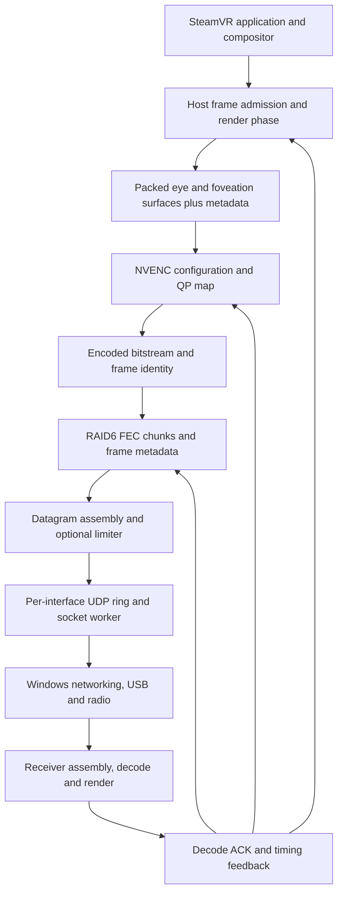

# Host streaming map: SteamVR to the wireless transport

Investigation snapshot: October 13, 2026. This is an implementation map for the
examined build, not a claim that the entire Steam Frame stack has been recovered.
The companion receiver and radio maps cover the boundaries after the host socket.

The main result is that there is no single bandwidth controller to override.
Frame admission, rendering phase, compression, repair, packet queues and feedback
are separate mechanisms. We have located and exercised several of them. We have
not replaced the hardware encoder, Windows networking, USB scheduler, radio
firmware, decoder or compositor with fully controlled implementations.

## Identity and evidence

Host `driver_vrlink.dll` SHA-256:
`34265101d56235e2f87e5b0e2f3fc2340ed1513a9b6d26f03c4fe12bafcbbc03`.
Addresses below are preferred-image virtual addresses for base `0x180000000`;
they are not stable API entry points and require relocation and build validation.

Evidence labels used here:

- **S — static:** a caller, data flow, constant or branch was recovered from this
  binary and, where needed, checked against assembly.
- **L — live:** a bounded measurement exercised the behavior. This does not prove
  that all scenes, refresh rates or network conditions behave identically.
- **C — controlled:** the repository implements the named override with validation
  and restoration. An available control is not a demonstrated performance benefit.
- **U — unresolved:** a specific consumer, dependency, state transition or hardware
  behavior is still missing.

The private host database predates the installed patch. A refreshed comparison of
167 cached host functions found identical machine-code bytes in 165. Two NVENC
functions differ only at the previously identified patch locations:
`0x180A2278E`, `0x180A2278F`, and `0x180A23A44`. The independent float constants at
`0x180C40F0C` and `0x180C40F10` are 232/350 in the database and 500/500 in the
installed file. Accordingly, old decompiler constants are not live readbacks.
This count measures cached evidence, not a percentage of stack coverage.

Private evidence is retained under ignored `artifacts/BitrateTrace/` and
`artifacts/RadioTrace/`. This document contains original analysis; proprietary
functions, firmware and binary extracts are not distributed with it.

## Pipeline and ownership

The return arrows are material: lowering the encoder target can be a response to
late decode acknowledgement even when the radio alone has spare capacity. A
fixed average-bitrate override does not disable frame skipping or change the
remaining encoder parameters, and packet pacing can alter that same feedback.

| Stage | Recovered entry points | Established behavior | Boundary still open |
| --- | --- | --- | --- |
| Frame admission and scheduling | `0x1809ECD40`, `0x1809F2440`, `0x1809F1EC0` | Checks encoder congestion/holdoff, records frame metadata, schedules the next producer release from display timing. **S** | Complete private SteamVR compositor contract and GPU render/copy fence timing. **U** |
| Stream layout and controls | `0x1809EBBC0`, `0x1809E8B20` | Selects foveated/non-foveated width keys, reads bounds and sharpening, publishes target width. **S** | All shader constants and exact eye-region reconstruction equivalence for a changed layout. **U** |
| Encoder factory | `0x1809F5B80` | NVIDIA NVENC and AMD AMF branches; no QSV/software branch established here. **S** | AMD behavior has not been characterized as thoroughly as NVIDIA. **U** |
| NVIDIA lifecycle | `0x180A21B70`, `0x180A22570`, `0x180A234A0` | API 11.1, initialization and reset; HEVC-specific configuration. **S/L** | NVIDIA's internal firmware rate-control decisions. **U** |
| Per-frame request | `0x180A24720`, `0x180A23FF0`, `0x180A1F170` | Derives rate/VBV/frame-rate fields, maps the packed surface, reconfigures, supplies QP map, submits encode. **S/L** | A successful request is not proof of every hardware state transition. **L** |
| Output completion | `0x180A214E0` | Waits for the output event, locks/copies/unlocks bitstream, unmaps input, records completion. **S/L** | GPU start/end timestamps are not supplied by these host CPU stamps. **U** |
| FEC and repair | `0x180A4B0A0`, `0x180A4B680`, `0x180A4BF90`, `0x180A49420`, `0x180A4A510` | Creates RAID6 layout, sends data/parity, accepts retries and decode ACK. **S** | All versioned option interactions and repair-policy outcomes at high rates. **U** |
| Datagram transport | `0x180A3BFD0`, `0x180A39F80`, `0x180A38530` | Packs inner packets, optional rate limit, framing/encryption, redundant eligible links. **S** | Kernel/radio completion does not occur at this boundary. |
| UDP worker | `0x180A34AD0`, `0x180A336E0`, `0x180A33860` | Copies into ring, drains nonblocking `sendto`, handles readiness and receive traffic. **S** | Accepted QoS, actual socket-buffer sizes and driver airtime scheduling. **U** |

## Frame admission is another controller

`0x1809ECD40` can skip submission when the encoder reports more than two occupied
resources, or when its holdoff predicate is active. It updates the skipped-frame
diagnostic rather than submitting unbounded work. A resource ring of six therefore
does not mean six useful frames should accumulate in flight. **S**

The queue predicate runs **before** the current encoder submission. TX ID
allocation happens later, after output completion, through `0x180A21130`,
`0x180A32140` and FEC dispatch `0x180A4A7D0` / `0x180A4A200`. FEC `+3556` is
the next ID, so with no intervening work Q=6 permits a frame six IDs beyond the
latest decoded ACK and advances the cursor to seven beyond it. It does not mean
the new frame itself is seven IDs beyond that ACK. Q omits encoder work not yet
handed to FEC; the separate encoder-resource predicate, concurrent dispatch,
reset sentinels and forced holdoff exit mean this is not a universal six-frame
distance guarantee. Receiver last-submitted ID and host last decoded ACK are
also different progress points. **S**

The same path has a separate recovery condition: roughly 400 ms without another
decoded-frame acknowledgement, more than ten attempted frames, and an additional
state guard can trigger stream recovery. `0x180A00070` updates server `+32368`
only when the incoming acknowledgement's decoded-frame ID at packet offset 2
changes. Duplicate acknowledgements or pose traffic do not establish fresh decode
progress. This is separate from the receiver's approximately 330/800 ms recovery
thresholds; a particular interruption still needs event correlation. **S**

There is an explicit producer phase scheduler. It sleeps for the whole-millisecond
portion of its target interval using a timer event, then spins through the small
remainder. Eliminating that wait would remove intentional synchronization, not
necessarily fix a scheduling defect. **S**

For receiver-advertised feature levels at least nine, `0x1809F2440` examines about three
seconds of AFTM frame records, requires at least ten usable samples, sorts derived
timing slack, and adjusts the next run-start phase. Inputs include decode completion,
the receiver's query-to-display-target interval, the original predicted display
target and the run-start offset used for each frame. The default profile index is
zero. The three table entries at `0x180C352F8` are:

| Profile index | Quantile q | Margin (μs) | Lower / upper bound in frame periods |
| --- | ---: | ---: | --- |
| 0, constructor default | 0.995 | 2,000 | 1 / 4 |
| 1 | 1 | 2,000 | 3 / 4 |
| 2 | 1 | 2,000 | 0.5 / 1 |

These parameters constrain an adjustment calculation; they are not mandatory
decoder queue depths. For a sorted sample vector `x` of size `n`, it selects
`median=x[n/2]`, `tail=x[min(int(n*q),n-1)]` and calculates:

`change = max(lower*T - median, min(upper*T - median, margin - tail))`

Here T is the host frame period in microseconds. Negative changes are limited to
at least `min(-1, T/int(-5000000/T))`, about −24 μs per update at 90 Hz, before
being added to the phase. Therefore this is a slowly adjusting history-based
controller, not a fixed 2 ms sleep. **S**

Each sample compensates for the run-start offset originally used for that frame.
It combines original host display prediction minus actual or estimated decode
completion minus the receiver's query-to-target interval, then adds current phase
and additional-frame offset and subtracts the historical offset. Missing feedback
uses the last usable timing relationship; it is not equivalent to a new actual
decode measurement. **S**

The older branch reads internal `cRunStartO` and `frmTarget` controls, but only for
feature levels below nine. Exposing those keys as universal current-build latency
controls would be incorrect. Constructor `0x1809E31E0` initializes one additional
frame, phase 2,000 μs, and selector zero via a paired write. A scan of explicit
field references throughout the host streaming code found the selector read but
no setting/debug binding or further explicit write. That negative result does
not exclude an indirect bulk write; no safe user-facing selector is established.
**S/U**

Feature level is distinct from strict wire protocol: `0x1809FF8E0` copies incoming
pose packet byte 34 into server `+31912`. It separately copies byte 8 into server
`+472` and explicitly requires strict protocol version 10. Changing an advertised
feature level to reach an older scheduler would also change other protocol and
rendering branches; it is not a latency preset. **S**

## Requested bitrate, accepted budget and coded bytes

For manual bandwidth mode, the recovered final budget is:

`effective Mbps = clamp(requested Mbps × queue factor × ping factor, 1, driver ceiling)`

This occurs in `0x180A1CFE0` after `0x180A1CBE0` updates the queue factor.
Manual mode bypasses the automatic estimate and its historical hitch cap, but
retains both factors and the final ceiling. **S**

| Input | Exact recovered meaning |
| --- | --- |
| Queue distance `Q` | Async pending-frame count plus unsigned 16-bit transmit-cursor minus latest acknowledged **decoded** frame, calculated by `0x180A493A0`. It is not socket bytes, PHY occupancy or a count of hardware decoder instances. |
| Queue factor | At Q=4, multiply by 0.99; Q=5, by 0.95; Q=6, by 0.90. This branch floors the factor at 0.08. Updates occur with the producer path, not on a fixed independent once-per-second timer. |
| Holdoff | Q>6 or an explicit throttle request can hold the producer. A roughly 300 ms forced exit exists. Leaving holdoff additionally scales the factor by `50000/(elapsed_us+50000)`, with a 0.004 floor. |
| Recovery | For Q<4, add `coefficient×0.003`; add another `coefficient×0.01` when Q<3 and another `coefficient×0.02` when Q<2; clamp to one. The setting is `backoffRecoveryCoefficient`. |
| Ping factor | Let `T=1000/Hz` milliseconds and `N=clamp(5-Q,1,4)`. Factor is `clamp(N×T/cPingAMS,0.05,1)` when the timing metric exceeds N×T; otherwise one. |
| Driver ceiling | Stock 232 Mbps when the recognized dongle predicate is true, 350 otherwise; installed patch changes both to 500. Dongle recognition is based on an Up adapter, not USB version. |

`cPingAMS` is a protocol timing estimate from both directions and clock alignment.
It must not be replaced by an ICMP ping reading. The hardware feedback loop can
thus reduce bandwidth because of decode, acknowledgement or clock/scheduling
delay as well as actual network congestion. **S**

Automatic mode additionally uses a network-test result, recent transport-byte and
frame receive timing history, recovery filtering and a historical hitch cap. The
network-test parser at `0x1809EAEC0` evaluates sample distributions, rather than
simply choosing the highest tested number. The live manual experiments do not
fully exercise these automatic-mode branches. **S/U**

`0x180A24720` turns effective Mbps into the NVENC request. Average is in decimal
bits/second; peak is normally approximately 1.15 times average. Default VBV derives
from the previous peak and previous frame-rate numerator, with capability bounds.
The frame-rate parameter comes from submission spacing through `0x180A1BE50`:
the period is bounded between 3,333 μs and the smaller of three display periods or
80,000 μs. It is not a reliable headset refresh readback. **S**

The helper can replace public fields after Valve has built the request. That
creates distinct values: requested slider, Valve budget, helper-modified request,
successful API configuration, actual bitstream and received transport bytes.
Telemetry must preserve this distinction. **C/L**

CBR without filler is not a fixed number of useful bytes in every frame or second.
The current helper explicitly disables filler and picture-timing SEI padding.
Scene complexity, QP map, VBV, resolution, multipass and encoder internals still
affect output, while Valve can keep changing the requested budget. The public
NVENC header also describes `maxBitRate` as inapplicable in CBR; a trial changing
average, peak and VBV together cannot isolate a peak-field effect. **C/S/L**

Two observed cases distinguish these mechanisms:

- At width 2048, target/accepted average 350 Mbps and the earlier quality offsets,
  actual video was about 184 Mbps at approximately 90 encoded fps. The accepted
  average did not fall in that trial. It was encoder utilization, not an unseen
  reduction of that average field. **L**
- A bounded override fixing only average bitrate did not fix the other fields.
  Adding a temporary packet pacer reduced useful output and coincided with lower
  remaining configuration fields. It did not establish that peak alone caused
  the reduction or that packet pacing is intrinsically beneficial. **L**

See the dated measurements in [encoder research](../encoder-and-codec-research.md)
for duration, settings and presentation warnings. These observations do not
establish smooth sustained 400 Mbps video.

### Complete RC readback and the failed 400 Mbps transition

The private passive observer now decodes the complete 128-byte effective
`NV_ENC_RC_PARAMS` copy already stored by the helper. It adds no remote status
thread or target-memory write. Exact helper hashes, a compiler-checked SDK11.1
layout, repeated identical reads, quiescent mutex indicators and agreement with
the separately stored accepted bitrate fields guard the interpretation. These
filters still do not make the publication formally atomic. The values describe
the latest successful API request, not a hardware-normalized configuration. **C/L**

The restored normal session and the subsequent fixed400 trial had minimum-QP,
maximum-QP and initial-RC-QP limits disabled; lookahead/depth, spatial AQ and
temporal AQ were also disabled. The only RC flag was zero-reorder delay. The
accepted map mode was DELTA, quarter-resolution multipass was enabled, and
keyframe scale was 1. The inherited constQP values I25/P28/B31 are initial values
in this CBR mode, not proof of fixed per-picture QP. No exposed enabled QP limit
explained the undershoot in these snapshots. Final block QPs and NVIDIA's
internal RC state remain unobserved. **L/C**

Repeated reconfigure calls do not explicitly reset RC each picture. Installed
driver instruction `0x180A25023` clears the reconfigure `resetEncoder` bit;
the `forceIDR` bit follows encoder `+42824`, a recovery-pending flag. Picture
flags at `0x180A2514E` request parameter-set output; only the pending recovery
branch at `0x180A2517E` adds forced intra/IDR and clears that flag. The helper
preserves these flags. Repeated SPS/PPS output is therefore distinct from
repeated IDR or an explicit RC reset. Actual stream recovery can still recreate
the session. **S/C**

The fixed380 and fixed400 experiments preserve a VBV reservoir of approximately
1.15 picture budgets at 90Hz: 4.856 and 5.111Mbit respectively. An output near
380/1.15 does not prove an internal division by that factor: the helper assigns
380M directly, the SDK says the maximum-bitrate field is ignored in CBR, and no
documented VBV equation establishes that proposed divisor. A correctly paired
normal smoke found only about+0.51% from the arithmetic effect of nominal frame
rate, but its adaptive budget prevents treating that as a fixed-budget causal
test. **C/L/U**

The first fixed400 transition passed its normal-load settling gate, then the
guard stopped it after approximately two seconds for backlog/decoder turnaround.
All three snapshots accepted400Mbps without filler. Actual useful output was
340.84Mbps at 84.03fps, with 507,036 bytes per completed picture on average.
Decoder turnaround median was 41.51ms, transport median6.97ms and encoder
completion median6.03ms. The same picture size at 90fps would arithmetically
require365.07Mbps; this is not a measured90fps outcome. The short failed
transition establishes neither a stable340Mbps limit nor smooth350Mbps
operation. It makes admission/receiver backpressure material to the next
comparison, alongside encoder allocation. **L**

Within that exact short interval,166 of168 completed pictures were associated
with retained nominal-frame-rate requests, covering98.77% of encoded bytes.
Nominal FPS averaged89.61; its denominator variation increased the arithmetic
picture allowance by about 0.46% relative to90/1. The two largest pictures used
85/86FPS requests, so a fixed-rate experiment could still test tails, but this
small average effect does not explain the primary throughput deficit. **L**

CBR target adherence and multipass behavior should be assessed against useful
bytes and latency together. NVIDIA documents filler for strict adherence and
notes that extra encoding passes improve allocation at a performance cost.
[NVIDIA programming guide](https://docs.nvidia.com/video-technologies/video-codec-sdk/13.1/nvenc-video-encoder-api-prog-guide/index.html)

## Foveation and encoder controls

The host carries presentation identity, transforms, predicted display time and
spatial-layout metadata alongside its coded frame. `0x180A1F170` builds a delta-QP
grid from that geometry. For the examined HEVC path it uses 32×32 entries across
the packed image and four consecutive regions: gaze, periphery, gaze, periphery.
Geometry changes and cache keys decide when the map is regenerated. **S/L**

The builder uses inset/transition geometry, clamps stock entries to 0–31, masks
unneeded regions with 31 and protects the first tile of the last row for timing.
Our [`qp_map.h`](../../Native/qp_map.h) applies separate additions to the useful
gaze/periphery entries while preserving those protected values. It changes
compression allocation. It does not enlarge the packed gaze texture or rewrite
the receiver's reconstruction transforms. **S/C**

Consequently, reducing peripheral QP can make a visible low-quality region less
obvious, but a true gaze-region size control needs the packing shader, layout
metadata, overlap policy and receiver unpacking changed consistently. Treating
the current additions as a radius control would overstate what is implemented.
The full shader/layout contract remains a concrete gap. **U**

The NVIDIA implementation uses API 11.1 and preset-derived configuration modified
by Valve. The reset path requests VBR, single pass, no spatial AQ and its QP map.
`CodecSet`/`CodecSetOVR` are internal rate-control selections, not codec selectors.
H.264/HEVC validation exists; this host's H.264 path rejects 10-bit input, and AV1
cannot be enabled merely by substituting a codec GUID. **S**

Public helper controls cover rate control, multipass, QP additions and the
advanced fields described in [advanced controls](../advanced-controls.md).
Acceptance and lifecycle matter. A low maximum-QP request produced large frames
at roughly 40 fps; removing it through successful live reconfiguration did not
restore prior behavior until a new encoder session. The local, unreleased helper change treats
enabling, changing and removing maximum QP as initialization-only. This is direct
evidence that knowing a public field and intercepting its API call does not imply
complete control of NVENC internal state. **C/L**

The mapped foveated HEVC path already requests four constrained slices within
one packed picture. `0x180A1C040` selects four for encoder mode0;
`0x180A234A0` writes slice mode3 (slice count) and that count into the HEVC
configuration, with constrained encoding enabled. `0x180A24720` also supplies
the count and constrained-frame flag on each picture. These are static API
request semantics, not a captured bitstream's slice inventory. They do not
create four decoder sessions: the stock receiver still allocates the
[single codec instance described in the receiver map](receiver-stream-map.md#the-connected-path).
The SDK11.1 HEVC structures expose slice controls but no tile/WPP selector;
actual PPS tile and entropy-sync flags remain unverified until a real stream
header is inspected. Extra slices therefore cannot be proposed on the premise
that this path currently requests only one, or as proof of added hardware
decoder parallelism. **S/C/U**

## Packetization, repair and queue behavior

The RAID6 sender uses 1,024-byte data payloads with eight-byte inner headers.
The examined layout groups eight data chunks with two possible parity chunks and
interleaves groups through 64-data-chunk batches. Frame metadata is repeated
between batches. `0x180A4BF90` computes both parity chunks, always sends the first,
and sends the second only when the transmit frame's byte `+17552` is set. Thus
one-parity mode saves transmission bytes, rather than skipping all second-parity
computation. Full groups carry 12.5% or 25% parity payload overhead, before other
protocol bytes and retransmissions. **S**

The selector is an explicit loss-history rule, not a bitrate or codec threshold.
For each frame, `0x180A4B680` reads the host numeric statistic `cRXpass`, converts
percentage to fraction and compares it with 0.9999. A lower value refreshes FEC
DWORD `+3964` to the current microsecond clock. The frame's second-parity byte is
then set if the signed 32-bit elapsed time is less than 10,000,000 μs. Constructor
`0x180A4B0A0` initializes this timestamp to the current time, so a newly constructed
sender starts with two parity chunks for at least ten seconds. A low statistic
that remains cached keeps refreshing the hold; ten seconds must elapse after the
last send that observed it before the second parity stops. **S**

Receiver `0x42618` publishes `cRXpass` about once per second while packets arrive:
`100*(expected_sequence_count - missing_count)/expected_sequence_count`. Its
sequence accountant `0x427F8`, checked in assembly, adds a forward sequence delta
to the denominator and delta minus one to missing packets, with a 1,000-packet
gap bound. `0x42F98` can add explicit receive errors to that missing count.
Consequently this is a transport sequence-gap statistic before video FEC and
decode, not a percentage of successfully displayed frames. Successful parity
repair does not erase the loss signal driving additional parity. **S**

The live Waterfall counter split corroborates both regimes: observed parity/video
ratios cluster near 0.126 and 0.252, with partial groups and protocol accounting
making them slightly larger than ideal 1/8 and 2/8. Near-steady coded video can
therefore coexist with a visibly changing aggregate Waterfall rate. That is
separate from variation caused by adaptive encoder requests or scene complexity.
**L**

At 400 Mbps useful video, this alone needs 450–500 Mbps data-plus-parity payload.
A 450 Mbps raw UDP test is therefore useful capacity evidence, but is not a proof
of 400 Mbps game-stream delivery under the higher-repair condition.

`0x180A3BFD0` packs inner packets into outer datagrams, initially limited to 1,376
bytes. Two full video chunks do not fit; control traffic may share a datagram.
`0x180A38530` adds the selected framing/encryption. `reqEncMode` describes this
transport choice, not codec compression. **S**

`allowMultipleLinks` allows multiple eligible transfers, up to sixteen. The same
finalized datagram is offered to each, and the receiver suppresses duplicates.
This is redundancy, not bandwidth striping and not multiple video decoders. **S**

Each Windows UDP transfer uses a 24 MiB ring and a nonblocking socket. Its worker
drains individual `sendto` calls, handling receive traffic as well. A blocked
socket retains its current head packet. More than fifty other successive send
failures can suspend the transfer until maintenance retries it. Old datagrams
can be purged; decoded-frame acknowledgements advance a purge threshold. The
enqueue function can return success without a copy when space is insufficient.
Counters at assembly or enqueue therefore do not prove kernel or receiver
delivery. **S**

The host requests a 1 MiB socket send buffer and 128 KiB receive buffer. Their
accepted values, provider behavior and actual occupancy remain unmeasured in
this map. `enableQoS` requests OS/provider support and has fallback paths; a true
saved setting is not proof of priority over the radio. **S/U**

The receiver can ask for missing frame metadata, data and parity. The host keeps
sixteen transmit-frame slots and enforces a roughly 3 ms per-packet retransmission
guard in `0x180A49420`. An overwritten slot cannot repair its old frame. Timed
retry is only one request source; disabling it leaves progress-driven repair.
FEC and retries are not interchangeable. **S**

Repair has no priority lane in the examined host chain. `0x180A4A510` validates
the requested frame against its sixteen-slot cache; `0x180A49420` walks the
requested chunk IDs in order and sends accepted chunks through the ordinary link
assembler `0x180A3BFD0`. They append to the same per-interface FIFO ring as new
video. The socket worker `0x180A33860` services both send and receive traffic,
including a send-drain phase before receiving pending messages. Queueing and
request-processing delay are therefore possible without RF loss. Cache retention
is sixteen frame identities, not a fixed millisecond duration; its slot is reused
at ID+16. These are mechanisms, not measurements of a particular repair delay.
**S**

A separate parity-repair inconsistency is statically established. The sender
stores parity packets at indices `2048+2*g` and `2048+2*g+1` for group g, generating
both before selectively sending the second. TX-frame WORD `+28` is initialized
to zero and incremented once per parity packet initially sent; WORD `+30` records
the total potential parity count. In one-parity mode, `+28` therefore becomes the
number of groups, while sent parity positions are sparse even indices. But
`0x180A49420` serves a parity request only when `requestedIndex-2048 < +28`, using
that count as a contiguous index bound. The receiver requests missing parity
indices across both positions per group in `0x52BD0`. **S**

For 55 groups, the host initially sends parity positions 0, 2, ..., 108 but its
retry check permits only positions 0 through 54. Later valid first-parity
positions are rejected; lower odd positions can be served even though those
second parity packets were generated but not initially sent. With two parity
packets, all 110 positions and the count agree. Assembly confirms the zero write
at `0x180A4B98F`, increments at `0x180A4C1DC` / `0x180A4C2B6`, and comparison at
`0x180A4962C`. No further TX-count writer was found in the FEC code scan. This is
a stored-count/index mismatch; the captured abort is not proof that it exercised
this mismatch. Data repair is still available. **S/U**

A possible host repair would validate the actual generated parity extent instead
of the number initially sent. Simply substituting `+30` is insufficient during
frame generation: later parity storage may still contain the preceding frame's
bytes. An offline model instead normalizes the bound after each consecutive
producer batch finishes. Each group generates both payloads before its first
count increment, so intermediate increments remain within generated storage.
All 2,048 legal data-chunk counts in both initial-parity modes passed that model.
No runtime repair has been implemented or tested. **S/U**

The field audit includes TX constructors/destructors, all three TX virtual
methods, sync/async dispatch, ACK/retry dispatch, stream reset and a binary-wide
scan for explicit word operands at displacement 28. The only identified TX+28
value consumer is the retry comparison; producer increments also read/modify it.
The constructor clears it through a wider QWORD+24 write. Byte accounting uses
the producer's returned sent-byte total. Other FEC readers of offset 28 belong
to RX prefix fields. This is a bounded source audit, not a proof against every
possible pointer alias. **S**

A private exact-build observation helper now exists, with full function-body
guards, expiring pass-through hooks and tests. It certifies a generated prefix
only after observing consecutive batches from zero, checks the current ring
slot and generation, validates stored chunk headers, and distinguishes ready
positions outside the stock bound from unverified or rate-limited requests.
Offline tests cover pass-through behavior, stale generations, changed geometry
and expiry. It has not been loaded into SteamVR; live timing cost and actual
rejection frequency remain unmeasured. Any repair still needs frame/chunk
identity, generation, capacity and retransmission-spacing guards. **U**

The normal 400-Mbps capture exposed a separate, precise recovery limit. Receiver
`0x52BD0` and its host counterpart `0x180A48F60` assemble missing chunk indices in
a 512-entry uint16 list. An attempted 513th entry flags the entire FEC stream as
unrecoverable. A missing-metadata sentinel also consumes an entry. Both the timed
and group-progress paths have this guard; timed mode truncates its eventual
request to twenty entries **after** enumeration, so that smaller send cap does
not prevent this earlier abort. The logged identifier is the video TX/frame ID,
despite the log calling it a packet number. **S/L**

This is not a 512-chunk encoded-frame limit or proof that 513 UDP packets were
lost. The request can include missing data, potential parity and metadata. For
example, a fully missing known extent of 409 data chunks entails 104 potential
parity chunks in this layout, already exceeding the request list. Smaller missing
subsets of much larger frames remain representable. An unknown/stale expected
extent, delayed group progression or missing data could each affect enumeration;
the failing call's metadata, bitmap and group argument were not captured. **S/U**

In the observed failure, the receiver logged this abort for TX 47646, then
reported stalled codec progress and performed a hard reset about one second
later. The sampled loss statistic remained at 100% and second parity was off.
Host feedback stopped advancing after decoded TX 47644 even though complete
receive feedback arrived for subsequent IDs. Neither observation establishes RF
loss as the trigger. Receiver acceptance precedes ordered codec submission, and
host AFTM receives both decode-start and decode-end values with decoded-frame
feedback. Zero values can therefore mean missing completion feedback for a
frame already in flight, rather than no decoder activity. **L/S**

The host map was checked against its stock automatic CSV and feedback writer:
`0x1809DEAD0` clears each new timing row; `0x1809DE850` binds the full TX ID;
`0x1809DF5F0` validates that ID before writing Receive. Stream reset does not
immediately reset the TX cursor. The stock CSV independently confirms complete
Receive with absent decode feedback for TX 47650. However the private sampler
did not retain the raw receive timestamps for TX 47645/47646, so precise ordering
of their acceptance and the abort remains unresolved. Host and receiver wall
clocks must not be compared without synchronization. **S/L/U**

A bounded recovery candidate is to retain the array guard but stop enumeration
and emit the collected subset instead of declaring the stream unrecoverable.
Timed requests must retain their twenty-entry cap. This must leave receive
bitmaps, contiguous prefixes, completion flags and frame identities unchanged;
later repair must progress from actual packets or successful FEC reconstruction.
The skipped-frame caller marks its one-shot request flag even after a partial
request, so effective timed retry must be enabled for the remainder to be
retried. Host per-packet retransmission spacing, sixteen-frame retention, the
receiver's five-frame backtrack condition and codec watchdogs still apply.
This candidate is **not implemented or validated**. Exact-build branch analysis
is retained privately; first trace the offending call's state so a request cap
does not merely hide a stale-size or ordering defect. **S/U**

### Fixed-budget trial: admission still holds, recovery can cascade

A later 150-second matched trial used the private 380-Mbps coherent encoder
tuple with the receiver's timed-retry arithmetic correction. It delivered
327.442 Mbps useful video at 89.652 fps. The accepted encoder average remained
380 Mbps in every sampled status, while Valve's original per-frame budget
averaged 82.685 Mbps, median 64.891. This establishes that the override replaced
a substantial attempted backoff; it does not establish that the override caused
the initial delivery gap. It is not evidence of smooth fixed 400-Mbps operation.
**L**

TX 12385 completed receipt later than successors 12386–12390. Its transport
interval reached 117.141 ms, while its encoder completion was 6.039 ms and
packetization/enqueue was 0.263 ms. The receiver logged a 49-ID repair request
for 12385, then a backtrack-window reset 29.058 ms later. TX 12390's complete
receive timestamp precedes that reset by only 3 μs, directly demonstrating that
complete receive ACK is queued before ordered-submit validation. TX 12385 finally
completed 44.419 ms after the logged request, after the reset. Subsequent codec
empty-buffer errors prevent treating its short decode feedback as proof of a
successfully decoded image. **L/S**

At this boundary, the host's last decoded ACK was 12384. Frame 12390 was six IDs
beyond it, consistent with the host admitting Q=6 before allocating that frame.
The receiver's complete-frame guard rejected a distance greater than five from
its last submitted ID. Changing one constant is not yet a validated repair:
its forward-drain endpoint is a separate condition, and the host admission
distance is not an absolute pipeline bound as described above. **S/L/U**

The four subsequent progress-branch request-list overflows for 12390 occurred
after the first reset. Receiver state analysis finds that late parity can
reinitialize a cleared slot with an unknown-size placeholder; group seven then
enumerates metadata plus 448 data and 112 parity indices, overflowing the
512-entry list. The captured failures fit that sequence. This distinguishes a
secondary reset cascade from the original delay and from the earlier timed
arithmetic underflow. See the receiver map for the reset/history details. **S/L**

Host budgets before the gap follow the exact Q=4,5,6 multipliers: 0.99, 0.95 and
0.90. It then logs 66.797-ms and 22.165-ms holdoffs. Applying the recovered
`50000/(holdoff_us+50000)` rule reproduces budgets of 44.330 and 30.714 Mbps;
producer-release gaps are respectively 77.789 and 33.394 ms. The private override
kept 380-Mbps encoder requests but did not bypass these frame holds. Removing
smaller-frame backoff while retaining holds can still create pacing variation.
**L/S**

Second parity was already enabled before the gap. The interval containing the
fault accounts for about 1.246 MB of retransmission traffic, and the sampled
pre-FEC success statistic falls below 100%. That establishes repair activity,
not its physical origin or the fate of each requested chunk. The known sparse
one-parity retry bound is not demonstrated in this event. No per-request host
arrival, enqueue, send or receiver chunk-arrival timestamps divide the
44.419-ms repair interval among FIFO/kernel/USB/radio and receiver work. Neither
all 117.141 ms of transport time nor the repair interval can be labeled RF loss
from this evidence. Host and receiver wall clocks also differ and must not be
compared literally. **L/U**

### Negotiated options and read-only FEC state

`0x180A31550` sends `forceBaselineVideoFEC` as inverted int32 option 31; the host
also publishes `maxVideoQueueLatencyUs` as option 36 in `0x1809EBBC0`. These are
generic value-transport records, not demonstrated parity or queue overrides.
The examined host constructor `0x180A305A0` always allocates `SVLFECRAID6` with
format byte 32. Link initialization `0x180A4E350` announces that format; host
`HandleFECChange` at `0x180A314F0` only stores the peer's format byte at link `+24`.
It does not replace the FEC object or select one versus two parity chunks. **S**

A focused audit of every direct reference to host callback registration
`0x180A558D0` and cached-value getters `0x180A559F0`, `0x180A55AB0`,
`0x180A55B40` found no option 31 or 36 consumer. An independent receiver audit of
its registration `0x616C8` and getter `0x60950` likewise found neither. An indirect
or raw-cache consumer is not disproved by these searches, but no effective
current-build action has been established for either key. Therefore the app
must not promise parity-off, fixed parity or an effective queue limit from these
settings. The recovered adaptive-FEC decision above has no dependency on either
option in its examined call chain. **S/U**

For a read-only observer, server `+392` points to the active link and link `+16`
to its FEC object. Validate RTTI `SVLDataLinkUber` (or the legacy
`SVLDataLinkUDP`), `SVLFECRAID6` and the reciprocal FEC `+3568` server pointer.
The sixteen TX-frame pointers start at FEC `+472`. FEC DWORD `+3556` is the
**next** transmit ID: sync `0x180A4A7D0` and async `0x180A4A200` increment it
before processing the selected slot. Read last ID `(cursor-1)&65535`, use its
low four bits for the slot, and validate frame WORD `+8`, RTTI
`SVLFECRAID6TXFrame` and its FEC backpointer `+17472`. The byte `+17552` is the
actual frame decision. Re-read identity/cursor around a snapshot because the
sender can be modifying that slot concurrently. **S**

FEC timestamp `+3964` stores low 32 bits of `0x180A297B0`, whose clock is
`QueryPerformanceCounter()*1000000/QueryPerformanceFrequency()`. Elapsed-time
comparison uses signed 32-bit subtraction; it must handle wrap, not compare
absolute unsigned timestamps. This observer distinguishes actual parity
selection from an inference based only on traffic ratios. No live FEC mutation
or user-facing fixed-parity control is established by this map. **S/U**

The outer receive ordering window is 2,048 packets, with an approximately 100 ms
timeout for missing control ordering. Video, acknowledgements and particular
pose/bookend packets have an immediate path. That timeout must not be described
as mandatory video buffering. Video assembly and codec reference order still
apply after the outer fast path. **S**

## Debug limiter and MTU controls

The optional limiter is separate from the bandwidth slider. `0x180A321A0` reads
`gLimitMBPS` from the internal numeric map and copies it into each link's limiter
field. `0x180A3F800` is its debug-control callback, with a 0–500 scale.
`0x180A39F80` charges datagram bytes plus a 100-byte allowance, permits approximately
20 KB of credit, then waits for debt. Its wait uses whole milliseconds; it runs
while the assembly mutex is held. The constructor disables it. **S**

This is a recovered override point, not a validated low-jitter pacer. Holding a
shared mutex while waiting can delay other packet producers. A separate bounded
500 Mbps per-worker pacing experiment did not improve the live stream. **L**

`0x180A3FD10` toggles the Uber MTU-growth flag. Maintenance at `0x180A3B7D0`
probes 12, 1,376, 2,212 and 3,152-byte datagrams. Larger probes do not mean normal
video uses larger packets. On a 1,500-byte IP path, larger datagrams can fragment;
losing one fragment can lose multiple packed video chunks. Matching receiver
support, fragmentation and loss behavior need measurement before exposing this
as an optimization. No MTU override is established as beneficial. **S/U**

## Timing record semantics and correlation

The AFTM history starts at `SVLServer+65416`, with 4,096 records of 120 bytes.
Presentation-ID and transport-ID lookup tables point to records; both identity
checks are needed to avoid interpreting an overwritten slot. The CSV writer is
`0x1809E0CC0`; its decompiler loses varargs, so assembly and writer callers are
the evidence for layout. Times are mostly wrapping 32-bit microseconds.

| DWORD / byte offset | Meaning and writer | Interpretation |
| --- | --- | --- |
| 0 / 0 | Present ID, `0x1809DEAD0` | Source frame identity, distinct from TX ID. |
| 1 / 4 | Producer release timestamp, `0x1809DEAD0` | CPU-side release after scheduling; CSV calls it WGP Release. |
| 2 / 8 | App-submit-side timestamp, `0x1809DE800` | Host graphics flush/release has already occurred. |
| 3 / 12 | CSV Encode Start, `0x1809DE830` | In NVIDIA path, written **after** `nvEncEncodePicture` returns. Not GPU hardware start. |
| 4 / 16 | CSV Encode End, `0x1809DEB90` | Written after output lock, bitstream copy, unlock and input unmap in `0x180A214E0`. |
| 5 / 20 | Send Start, `0x1809DE850` | Start of RAID6 frame packetization. |
| 6 / 24 | Send End, `0x180A056D0` | End of RAID6 assembly/enqueue at `0x180A4B680`; not final socket, USB or airtime completion. |
| 7 / 28; 22 / 88 | Frame receive timestamp, converted / raw remote | Type 4/subtype 15 feedback receive-ID and packet offset 12. Includes frame assembly completion, not first radio packet. |
| 8 / 32; 23 / 92 | Decode start, converted / raw remote | Feedback decoded-ID with offset 40 on the newer packet layout. Older feedback falls back to receive time. |
| 9 / 36; 24 / 96 | Decode end, converted / raw remote | Feedback decoded-ID with offset 8. Raw remote difference is preferable for decode duration. |
| 10 / 40; 25 / 100 | Receiver-selected display target, converted / raw remote | Feedback ID at offset 16, time at offset 20. CSV's Submit Illumination label is misleading; this is recorded before actual image submission. |
| 11 / 44 | Original host predicted display target | `0x1809DE800`, from outgoing frame metadata offset 224. |
| 12 / 48; 26 / 104 | Receiver compositor-query-associated time, converted / raw remote | Feedback ID at offset 24, time at offset 28. Exact private compositor member names remain unresolved. |
| 13 / 52 | Run-start offset used for producer release | Phase plus additional frame-period contribution. |
| 14 / 56 | Protocol `cPingAMS` at send start, in μs | Historical feedback input, not ICMP. |
| 15 / 60 | Sum of two directional timing estimates | Captured by `0x180A055D0` at send start. |
| 16 / 64 | Upstream timing estimate at send start | Server `+484`; do not relabel as measured one-way RF latency. |
| 18–19 / 72 | 64-bit host realtime producer-release timestamp | Useful for age filtering; not interchangeable with the 32-bit monotonic fields. |
| 20–21 / 80 | 64-bit remote realtime receive timestamp | Present only in sufficiently long feedback packets. |
| 27 / 108 | TX frame ID | Initialized invalid, associated at Send Start. |
| 28 / 112 | Decode-feedback-seen flag | A flag, not an independent timestamp. |
| 29 / 116 | Effective pre-helper bitrate as float Mbps | `0x180A1C3B0` copies encoder `+308`; parse float bits, not integer. |

Host feedback handler `0x1809DF5F0` preserves raw remote timestamps and converts
copies through `0x180A4FBE0`. The conversion uses directional timing estimates;
cross-machine one-way intervals inherit that synchronization error. Same-clock
decode duration is more direct. The receiver's `0x35B40` → `0x43788` chain supplies
a future display target and compositor-query time **before** `SubmitImage`.
Thus target-minus-decode-end is a prediction lead, not a measured queue wait;
target-minus-host-prediction is target disagreement, not proof of late scanout.

Useful per-frame correlation is now possible without changing the stream:
effective budget, protocol timing inputs, encode-output interval, packetization
interval, completed-frame receive, decode duration and predicted target can be
joined by present/TX identity. Missing feedback must remain missing; it cannot be
silently converted into a measured drop or substituted with an actual scanout.

The static pointer bridge for a further **read-only** scheduler observer is
server `+32496` → `SVLDriver` context, context `+912` → HMD object. The HMD backpointer
at `+2384` should equal that context and context `+904` should equal the server.
Validate runtime type information and the complete-object adjustment before
reading HMD `+2328` (additional periods), `+2332` (phase μs), `+2336` (profile).
The constructor and callers establish this layout. A subsequent read-only live
check matched both backpointers and RTTI `SVLHMDDriverD3D11`, with complete-object
offset zero. That snapshot reported additional periods 3, phase 7,563 μs and
profile 0; the server reported feature level 13 and wire protocol 10. It validates
the observer bridge for this session, not a setter or a universal fixed phase.
Recheck process/session identity and pointers around each snapshot. **S/L**

SteamVR Waterfall's bitrate is another separate ring. `0x180A403B0` sums the last
second of completed datagram accounting, then multiplies bytes by eight and
`2^-20` despite its `mbps` label. It includes protocol and repair bytes, not just
video. Its FPS is completed frame-ring count. It cannot prove physical receiver
delivery or smooth presentation. **S/L**

## Control inventory and what remains to map

| Control family | Current authority | Consequence / remaining requirement |
| --- | --- | --- |
| Manual target, automatic mode, width, sharpening, async send | OpenVR settings, consumers recovered | Read back accepted dimensions and actual encoder/transport results. These switches affect different stages. |
| Two software ceilings | Installed build-checked patch | Removes only those ceilings. It does not change feedback, radio or decoder limits. |
| Rate control, multipass, QP additions, supported advanced fields | Validated helper hooks at public NVENC API boundary | Preserve initialization-only fields and request/applied distinction; supported ABI/capabilities required. |
| Constant average/full budget | Private, expiring research helpers | No shipping validated fixed-rate mode. Removing latency feedback can overload another stage. |
| Radio packet pacer | Private, expiring research helper | Attempt counts prove interception only. Trial did not show benefit. |
| Built-in limiter / MTU growth | Internal debug map/callback locations recovered | Not normal public settings, not validated optimizations. |
| More decoder streams | Separate coordinated implementation required | No host flag here partitions eyes/frames or reconciles receiver surfaces and timing. |
| Full hardware behavior | Outside these application callbacks | NVIDIA internals, Windows/USB scheduling, radio firmware, receiver decode and compositor require their own evidence. |

High-value next traces, in order:

1. **Join ACK age and actual socket events to each frame.** Current AFTM Send End
   is enqueue completion. Add successful send count, would-block, purge and
   insufficient-ring-space counters with queue age. This separates producer
   bursts from Windows/radio drainage without increasing buffers blindly.
   At the retransmission abort, also capture request-list count, expected extent,
   metadata flag, group argument, missing bitmap and raw receive/decode IDs. The
   known 512-entry guard does not by itself identify why those entries are absent.
2. **Trace the complete host scheduling profile selector and feedback history.**
   Locate indirect writes to HMD `+2336`, identify the advertised feature level and
   capture `dRunStart`, additional-frame count, effective budget and raw remote
   timing together. Legacy debug keys do not control the newer branch.
3. **Correlate FEC selection with transport loss and timing.** Observe `cRXpass`,
   the last-loss hold and each frame's second-parity flag alongside video/parity
   counters, receive completion and decode feedback. Direct option-table audits
   found no 31/36 consumer; proving an indirect consumer or establishing that they
   are obsolete requires following raw cache access, not guessing from key names.
4. **Finish the spatial-layout contract.** Identify packing shader parameters,
   crop/overlap metadata and receiver reconstruction for both eyes. Test identity,
   pose and gaze transitions before implementing a region-size or multistream mode.
5. **Resolve output resource and recovery state transitions.** Join encoder ring
   occupancy, 100 ms output-event timeout, 50 ms encoder reset gate, 400 ms host
   feedback watchdog and receiver recovery by frame/session identity. This avoids
   blaming every pause on a single bitrate controller.
6. **Exercise alternate branches deliberately.** Automatic bandwidth/resolution,
   AMF, non-foveated mode, transport encryption choices and link failover have
   static evidence but lack the same live coverage as the current HEVC/dongle
   path. `qualitySharpeningThresholdMbit` has a recovered read/default, but its
   complete effective consumer remains unresolved.

Decompilation provides a map of host decisions and candidate control points. Live
measurements determine which decisions are active, what opaque hardware accepts,
and whether an override actually improves latency and useful image quality.

## Matched fixed-400 trace: admission pressure without a sustained producer stall

The [matched Iris trial](receiver-stream-map.md#matched-fixed-400-iris-trace-delay-precedes-input-return-handling)
failed its guard at 333.126 useful Mbps and 79.525 fps over 1.999362 seconds.
All three accepted encoder samples remained Main10 at the requested 400/460
Mbps and fixed VBV tuple, with no new encoder/API errors. In 56 consistently
published host samples, pending encoder count was one, active encoding slots
were zero or one, FEC pending was zero, and reset-pending was false. Admission
Q was mostly five or six; holdoff and several Q-seven samples remained active.
The budget override did not remove frame admission.

Of 73 consistent transfer-cursor samples, 70 had an empty FIFO. One of the
remaining heads was 20.911 ms old during the later delivery spike. Two hundred
compositor samples showed no old heartbeat beyond 10.657 ms, and captured
host logs contained no AcquireSync/ReleaseSync failure. These sparse reads
show no sustained producer or texture-handoff stall in the counter window;
they cannot exclude short or unsampled delays. Repeated WaitForPresent labels
remain recurring states rather than measured continuous waits.

Per-picture nominal-rate pairing covered 158 of 159 encoded pictures and
99.387% of useful bytes. Nominal rate averaged 89.538 fps, ranging from 86 to
93; the arithmetic 400M/rate allocation averaged only 0.526% above fixed 90.
Nominal-rate variation alone is therefore a weak explanation for the sustained
roughly 80 Hz output in this capture. It was still not a fixed-90 experiment.
The longer 122/125-second host observers mostly followed restored normal
control and do not extend the fixed-400 result.

## Actual production HEVC headers and available codec controls

A bounded read of the real production stream recovered its startup VPS/SPS/PPS
before the next fixed-400 override was activated. This was a fresh host process
with the experimental rate lease dormant. The reader examined one retained
frame's first 8 KiB, kept complete parameter sets and minimal slice-header
prefixes, and saved no coded picture bodies. It performed no target writes or
NVENC callbacks. Independent FFmpeg syntax parsing agreed with the local
structural parser; the headers-only check was not a picture decode test.

The emitted stream was **Main10, 1664×6656, 4:2:0**, with minimum 16×16 coding
units and 32×32 CTUs. Tiles and wavefront parallel processing were disabled;
slice segments were independent. SAO, ordinary deblocking, and filtering
across slice boundaries were enabled. The prefix contained three IDR slice
starts at CTU addresses 0, 2704, and 5408, consistent with quarter-height
placement. No fourth start was captured within the saved prefix, so the actual
complete slice count remains unproved by this capture.

A separate read of Valve's retained original request found four constrained
slices, CU16–32, infinite GOP/IDR, no B pictures, and an automatic reference-count
request. It came from a different process generation. This original request
is not the helper's accepted configuration: for example, it retained VBR while
the helper had successfully requested CBR. The emitted parameter sets signaled
a five-picture DPB bound and default active reference counts of one; those are
different quantities and do not prove actual steady-state reference use.

One available single-field experiment is to request
`disableDeblockAcrossSliceBoundary=1` in a fresh session and preserve it in
each reconfiguration. That could remove the observed filter dependency while
retaining dimensions, color precision and slice layout. Its benefit is
unproved, it can affect slice-edge appearance, and cancellation of a bitrate
lease alone does not restore an initialization-time codec setting. Successful
API-request telemetry and a new emitted PPS are required before a performance
comparison; normal restoration requires a fresh session.

The installed SDK 11.1 interface has no HEVC tile-grid, WPP, or SAO-disable
selector. A syntax field's presence does not imply an available application
control or prove that firmware executes slices in parallel. More slices,
larger minimum coding units, and a smaller reference bound are separate
experiments with compression or image-quality tradeoffs. None establishes
smooth 350/400 Mbps without a measured pacing result.

## Startup guard refusal and first-initialization ordering

The first cross-slice-filter candidate did not reach a valid codec comparison.
In its second startup attempt, the saved status records show **zero candidate
NVENC initialization/reconfiguration attempts and zero candidate API
rejections**. The helper's own eligibility guard stopped the experiment before
the candidate API call. The untouched original initialization fallback
succeeded, and later callbacks continued through fallback because candidate
initialization had never succeeded. The emitted PPS still permitted filtering
across slices. This is a guard refusal, not evidence that NVENC rejected the
setting or that the setting failed to improve performance. Normal restoration
was verified separately.

An offline audit of the exact installed driver bytes identifies a difference
between its first initialization request and later retained configuration:

1. Initialization at `0x180A22570` first writes slice mode 3 and the requested
   count into the retained configuration.
2. It obtains a preset configuration, then copies all `0xE00` bytes over that
   retained configuration at `0x180A2278D`. The installed copy stub also applies
   the researched level override. This replaces the earlier slice fields with
   the preset's values.
3. Depth, profile, no-B-picture behavior and constrained encoding are reapplied
   before the public initialize call. Slice mode/count are not rewritten there.
4. The later reset path at `0x180A234A0` reinstates slice mode 3 and the requested
   count before subsequent per-frame reconfiguration.

Consequently a warm retained request or emitted startup picture can show four
slices without proving that the first initialize call requested that same
layout. The candidate required mode 3/count 4 at that first call. This is a
concrete possible mismatch, but **that audit had not captured the actual
first-call values or failing predicate**. They could not be inferred to be zero, one or
four. Other preset-derived first-call fields also remain unobserved. The audit
used installed bytes for the copy target because the older cached decompilation
does not match that local call operand.

The next proposed diagnostic was to record the original first initialization
request, the normal post-policy copied request and the returned API status,
without assigning any codec field or allowing fixed-budget activation. A
capture-once record plus later-initialization detection would distinguish this
missing first-call evidence from warm state. It would require a fresh process,
exact helper identity and bounded passive readback. No such diagnostic result,
relaxed guard or successful cross-slice-filter performance comparison was
established by that offline audit. The subsequent observation below closes the
first-call gap without treating the earlier refusal as an API rejection.

## Observed first initialization and capacity versus active dimensions

A separate observation-only helper captured the first original initialization
request, its normal post-policy copy, and the first/fallback/final API outcomes.
It could not arm the fixed-budget lease or change codec fields. Its 440-byte
capture-once record retained the first call and counted later initialization
entries separately. Native fixtures checked forwarding bytes, input immutability,
fallback outcomes and passive decoder layout. The bounded passive read verified
the exact helper and loaded executable bytes; two equal copies under observed
free-mutex states are race filters, not an atomic publication protocol.

The live record contained exactly **one initialization, NVENC success, no
fallback and no later initialization**. Both recorded request shapes were
**3200×8192, 90/1, Main10/P2, CBR with quarter-resolution multipass**, with
slice mode/count **0/0** and zero average, maximum and VBV fields. The
retrospective guard mask was `0x30300`: only width, height, slice mode and
slice count differed from the original candidate's warm-state requirements.
These are accepted API request fields, not hardware-normalized settings or
the dimensions of an emitted picture.

The same process later reported **1664×6656** after 188 reconfiguration calls.
Its latest accepted rate-control request was 400000000/459999999/5111111
average/max-field/VBV, with 186 completed output frames. The first diagnostic
coordinator incorrectly required warm dimensions in its validation and therefore
reported failure; it preserved the raw capture and restored normal streaming.
A separate offline assessment corrected that interpretation without replacing
the original failed report. The error was in the observer's expectation, not
the recorded NVENC result.

The exact installed driver explains the distinction. Its constructor sets a
capacity of 3200×12800. A mode updater selects among 6400×6400, 3200×6400 and
3200×12800, after which positive NVENC maximum-width/height capability results
can reduce each dimension. First initialization copies those capacity fields
to encode dimensions and maximum encode dimensions. The observed 8192 height
is consistent with that capability clamp; the capability return and selected
mode were not separately captured. Later reset/per-frame code uses the active
dimensions and restores slice mode 3 and the requested count. The preset copy
described above explains how the first effective slice request can be 0/0.
This does not imply that pictures were streamed at the capacity dimensions.

## Phase-specific cross-slice-filter trial and emitted PPS

The revised private candidate kept separate predicates for the two phases:

| Phase | Required request shape | Additional limits |
| --- | --- | --- |
| First initialization | 3200×8192, 90/1, slice mode/count 0/0 | Zero average, max-field and VBV; one candidate initialization |
| Warm reconfiguration | 1664×6656, positive rate numerator over 1, slice mode/count 3/4 | Same accepted encoder session; no earlier guard/API/fallback failure |

Both retain the Main10/P2, constrained encoding, no filler/picture-timing SEI,
CBR/quarter-multipass, quality and disabled advanced-override checks. The sole
candidate codec assignment is `disableDeblockAcrossSliceBoundary=1` in the
copied configuration. It does not change dimensions, slice count, startup
budgets or nominal frame rate. A separate 216-byte first-failure diagnostic
records the refused phase, predicate mask and request shape before bit mutation.
Any failure stops fixed-budget readiness; it does not progressively relax the
guards. Cancel or expiry returns the adaptive budget but preserves the accepted
initialization property until a fresh normal session replaces it.

A fresh production-prefix capture from the actual candidate generation
recovered complete VPS/SPS/PPS. The emitted PPS reported
**`pps_loop_filter_across_slices_enabled_flag=false`**. Dimensions remained
1664×6656, 10-bit 4:2:0 with 32×32 CTUs, independent slice segments, and tiles
and WPP disabled. This proves the requested syntax change reached the emitted
stream in that session. The 8 KiB prefix contained only the first slice start;
it does not prove a complete slice count, decode correctness, hardware slice
parallelism or performance improvement. API acceptance and emitted syntax were
checked separately and linked by fresh process identity.

The resulting fixed-400 screen still triggered the combined persistent-backlog
or decoder-turnaround-above-40-ms guard after about two seconds:
**336.35 useful Mbps at 82.02 FPS**, with no new NVENC encode,
lock or rejected-API errors. The three Waterfall samples were approximately
370.51–421.22 binary Mbps at 81–83 FPS. A graph above 300 therefore did not
meet the smooth-streaming objective. Across the broader retained 312-frame
timing history, median decoder turnaround was 45.464 ms, transport 6.895 ms
and encoder completion 6.079 ms. That timing history is not identical to the
two-second encoded-counter interval, and decoder turnaround is not pure
hardware execution time.

The screen used the existing temporary receiver timer correction and six-frame
ordering/drain window. It did not run the new thirteen-event lock/PM observer.
Low cadence demonstrates the performance failure, but cadence itself was not
the condition that triggered this particular guard.

The exact counter interval contained 164 frames and 84,062,854 useful bytes
over 1.9994355 seconds. Matching frame IDs restrict the AFTM comparison to
144 of those 164 pictures: decoder-turnaround median 46.226 ms, transport
median 6.652 ms and encoder-completion median 6.079 ms. The 20 newest missing
timing rows are consistent with the observer's deliberate newest-row exclusion;
they are not automatically lost pictures. Sparse host samples in this interval
showed no reset, retry-send increment or sampled send failure, while admission
queues and holdoff remained active. They cannot exclude unsampled stalls.

Per-picture nominal-rate pairing covered all 164 encoded pictures and all
useful bytes. The nominal field ranged from 86 to 94 FPS, averaging 89.470.
The hypothetical allocation `400000000 / (8 * nominal_fps)` averaged only
0.611% above the same arithmetic at fixed 90. Actual bytes were 91.704% of
that allocation sum. Unpadded CBR does not guarantee this arithmetic allocation
for every picture, so the remainder is not evidence of a hidden cap or a
particular VBV factor. The small mean nominal-rate effect does not explain
the much lower observed output cadence, and does not establish a fixed-90 fix.

The small difference from earlier short fixed-400 failures is not an isolated
or randomized comparison. It is not evidence of a gain, regression or precise
throughput ceiling. Disabling this filter alone did not restore 90 Hz in the
observed screen; useful 350 Mbps with smooth pacing remains unproved.

After the guard abort, the coordinator verified restoration of the normal
Main10 helper/session. The bounded receiver lease reported original instruction
state, all threads detached and no cleanup errors; the activity lease was
explicitly cleared. These are separate cleanup checks, not evidence that the
failed performance window met its goal.

## Bounded startup discovery for production-header observation

The first candidate header-observation attempt encountered Windows module
snapshot error 299 before reading target memory. Its failure did not establish
a codec or streaming failure. The observer was adjusted to retry only module
discovery errors 24 or 299 while no module base had been accepted and no graph
had been pinned, within the existing maximum 60-second startup deadline. It
requires a 64-bit observer. Once the exact module is found, path/size identity
and executable-byte guards still apply; a failed code read or guard remains
fatal and cannot reopen module discovery. Error counts are retained.

The existing pre-pin object-discovery path still treats selected incomplete
startup graph reads as pending. Thus this change does not make every pre-pin
memory read fatal, nor does it permit recovery by retargeting an already pinned
process or graph. Twenty-five offline tests passed. The successful subsequent
header capture needed no snapshot retry. No observer source or experimental
helper is included in this research publication.

### Private evidence provenance for the startup and codec observations

These source/capture identifiers and SHA-256 digests identify the retained local
evidence. The files remain under ignored `artifacts/`; raw captures, local
identifiers, executable binaries and installed-code extracts are not published.

| Private file | SHA-256 |
| --- | --- |
| `RadioTrace/InitDiag1/source-manifest.json` | `e2ed61fd66c5d06624d85308d7522d871830817a6cbe9dbe89ebfd8e66e7ce34` |
| `RepairTrial/initdiag-first-1-coordination.json` | `8a102ae4b37b77846080eeab96e34919c92ed169578df74b7424055da2abfc70` |
| `RadioTrace/Coherent400NoCrossFilterv2/source-manifest.json` | `b309cbc89aa36d655b537d86d54116771681b1edf89fa91dc58f907ec7a66700` |
| `RadioTrace/Coherent400NoCrossFilterv2/installed-capacity-provenance.json` | `3055f7db90ba714c4b0a4e5b07a6ea42dbdce45c16684c907e8b732d51ad8cb9` |
| `RepairTrial/production-hevc-no-cross-filter-v2-2.json` | `c27d33552ee0de58037ea07a514d1267291220d0fdf5dc9f7b6b0c42a6e43027` |
| `RepairTrial/coherent400-no-cross-filter-v2-2-stream.json` | `1767510532991cf90f987d32d25e37187d561187b688735a166aeba9fc8cbeab` |
| `RepairTrial/coherent400-no-cross-filter-v2-2-coordination.json` | `422bc59c9cca9601f0958c4f13f154eed835ba5ca64468f29fec59017f318853` |
| `RepairTrial/coherent400-no-cross-filter-v2-2-assessment.json` | `f5ef44861de26b3b35ab40db0796a43fe1f098e64d6e158fdc7d573594452958` |
| `RepairTrial/coherent400-no-cross-filter-v2-2-host-review.json` | `a9df0e1a5c3cdb93694e1c2e09fbd3dfef5e04c3e19b9d6463e7f831ff204dd2` |
| `RepairTrial/coherent400-no-cross-filter-v2-2-host-review.py` | `1b4e12e5540b6b587590ce879eb054e69aadc3fdaf99dc5710270b44ea786d84` |

The observation-only helper hash is
`890ba51d2c7c08ad83f77e077176b1d7972e31a586dddfb42cf9df0c4ef83110`;
the revised codec helper hash is
`21f1ffeca01c24b1a090378c2d9a121472f78af8ec22235f9a0623217cebac7e`.
The latter's accepted request and emitted syntax checks remain separate from
the failed performance result.

## Loaded lock/PM trial: full pictures but insufficient cadence

The later matched thirteen-event experiment held the accepted encoder tuple at
400,000,000 average, 460,000,000 peak and 5,111,111 VBV bits, Main10 1664 x 6656,
P2, unpadded CBR and quarter-resolution multipass. Its exact 1.999240-second
counter interval contains **137 pictures and 76,018,645 useful bytes**:
**304.190 Mbps at 68.526 FPS**. Every picture and byte reconciles with the
independent host-slot pairs. The guard aborted; this is not a sustained result.

Mean picture size was 554,881 bytes. Original nominal frame-rate requests span
85--94, mean 89.613. Their `400M/(8*FPS)` allocation averages only 0.449% above
fixed-90 arithmetic; encoded bytes total 99.432% of that nominal allocation.
The same mean picture size at 90 FPS would imply 399.514 Mbps arithmetically.
That is not a capacity measurement, but it shows why low wall-clock rate here
is primarily associated with reduced cadence rather than undersized pictures.

The 120 retained AFTM records overlapping those 137 pictures have medians of
6.155 ms encoder completion, 0.307 ms packetization/enqueue, 7.840 ms transport
and 57.726 ms decoder turnaround. Maximum transport is 15.873 ms; maximum
turnaround is 75.256 ms. All host preparation-to-packetization intervals are
6.215--6.931 ms. There are no new encode, lock or rejected-API counters. Forty-two
of 136 consecutive generated-picture intervals exceed 16.667 ms, although
their present IDs remain contiguous; this is not evidence of lost application
present IDs.

Of 80 queue observations, 69 passed publication checks. Queue depth was six
in 39 and seven in 12, with holdoff in 19. No reset or FEC-pending work was
observed in those stable samples. The native controller requested a median
32 Mbps in the strict AFTM cohort while the experiment kept accepted 400.
The unchanged admission controller still reacts to delayed decode feedback.
It was not disabled by the encoder budget override.

The send ring was empty in 54 of 79 stable cursor observations; occupied head
age was at most 5.128 ms. Retry-send count did not increase in the exact counter
window, and no consecutive-send failure was sampled. The [radio follow-up](radio-stream-map.md#loaded-follow-ups-do-not-show-a-sustained-host-send-backlog)
separates earlier delivery excursions from the initial receiver backlog.
The [receiver phase analysis](receiver-stream-map.md#matched-thirteen-event-observation-small-observed-lock-and-pm-spans)
uses a longer trace and must not be substituted for this two-second cohort.

## Minimum32 coding-unit trial: accepted and emitted but cadence still failed

A separate fresh-session experiment changed only the copied HEVC minimum coding
unit from the SDK's 16 enum to its 32 enum beyond the existing normal policy.
Maximum CU32, cross-slice filtering and the QP-map implementation stayed
unchanged. Initial capacity and warm-frame guards were kept distinct. Initial
or later API rejection, reinitialization, session mismatch or guard failure
stops fixed-budget eligibility. Cancellation restores the adaptive budget,
but the initialized codec property requires a new normal encoder session.

Separate 160-byte accepted-request telemetry and a 216-byte first-failure
diagnostic leave the ordinary Stats layout unchanged. Five native fixtures
matched the pure decoder; exact build/export/descriptor and buffer-size checks
were independently reviewed. The minimum-CU and cross-slice-filter experiments
cannot be selected together. These are private experiment safeguards, not
shipped application controls or evidence of a performance benefit.

One initialization and the subsequent warm reconfigurations were accepted
without guard, API or fallback failures. Same-generation emitted parameter
sets were reparsed from their bytes: Main10 1664 x 6656, minimum coding block
32, CTU32, 52 x 208 = **10,816 CTBs**, with cross-slice filtering enabled.
Tiles, WPP and dependent-slice segments remained disabled. This verifies the
intended syntax change, not full-picture validity, complete slice coverage,
image-quality equivalence or hardware parallelism.

The fixed-400 interval still failed its cadence guard: **138 pictures and
76,926,754 bytes over 1.9994545 seconds**, or **307.791 useful Mbps at
69.019 FPS**. All picture identities and bytes reconcile. Mean picture size
was 557,440 bytes; nominal FPS was 84--94, mean 89.507. Denominator variation
adds only 0.574% to average nominal allocation, and encoded bytes fill 99.767%
of that arithmetic allocation. At 90 FPS the same mean size would imply
401.357 Mbps; this is expressly not a demonstrated sustainable rate.

The strict 120-of-138 AFTM overlap has median encoder completion **4.732 ms**,
packetization/enqueue 0.383 ms, transport **7.693 ms** and decoder turnaround
**61.597 ms**. Maximum transport is 14.614 ms and turnaround 75.657 ms. No
simultaneous kernel-stage trace was collected, so total turnaround cannot be
assigned to a particular decoder engine or firmware stage. Shorter encoding
than earlier screens does not establish a causal improvement across changed
scenes, sessions and coded structure.

Stable samples again show admission pressure: queue six in 40, seven in 16
and five in seven, with holdoff in 15 of 63. Forty-eight of 76 send-ring samples
are empty, maximum occupied head age is 3.910 ms, and no send failure is sampled.
The retry-send counter increases by three. Waterfall remains about
379.59--382.08 binary Mbps at 69 FPS: its high byte counter does not satisfy the
smoothness goal. Normal Main10 helper restart, original receiver instructions,
thread detachment and activity cleanup were verified after the abort.

The source/capture hashes and exact comparison scopes are recorded in the
[experiment register](experiment-register.md#private-evidence-provenance).

The later Coherent350v2 result below remains distinct from measured useful
350 Mbps: its accepted lower budget did not become that many encoded bits.

## Modern fixed350 reference: near 90 Hz before a receiver repair failure

`coherent350-v2-matched-2` exercised the original codec/QP path with Main10
1664 x 6656, P2, unpadded CBR and quarter-resolution multipass. Its accepted
tuple remained **350,000,000 / 402,500,000 / 4,472,222** average/peak/VBV,
with no encoder, bitstream-lock or rejected-API counter increments. The helper
starts dormant, requires explicit activation, and has a nonrenewing 300-second
lease; it does not alter the initial encoder budget. Valve's saved target was
350 for warmup and canceled normal callbacks, then restored to 400.

The first **77.997863 seconds** contain 7,017 pictures and 3,169,309,435 useful
bytes: **325.066 Mbps at 89.964 FPS**. One-second intervals span
316.777--329.464 Mbps and 88.983--91.011 FPS. This is approximately 90-Hz
encoding, not uninterrupted presentation: the receiver counted 65 presentation
timeouts by the 70-second sample. The full approximately 80-second partial
capture aborts after an unrecoverable receiver repair error.

Independent pairing covers 6,990 pictures, 99.612% of counter bytes. The 27
unpaired pictures are excluded from allocation statistics. Paired mean size is
451,647 bytes; encoded bytes are **92.408%** of the summed
`350,000,000 / (8 * nominal_fps)` allocation. Requested nominal FPS ranges
74--197, but its mean allocation effect is only **+0.544%** versus fixed 90.
Those request outliers are not observed 197-FPS output. Nominal-rate variation
alone does not explain the remaining byte shortfall. Unpadded CBR, content,
VBV and quality behavior still do not promise exact arithmetic filling.

All 6,990 paired pictures have retained completed timing: median encode
5.938 ms, enqueue 0.247 ms, transport **6.521 ms**, decoder turnaround
**18.682 ms**, with decoder p99 35.083 ms and maximum 44.138 ms. This differs
from the immediate sustained 40--60 ms residence in the short fixed400 screens.
It does not isolate decoder hardware time or establish visually smooth output.

Before the terminal fault, admission queue depth is usually three or four;
holdoff occurs in only two of 2,627 stable samples. The send FIFO is empty in
2,029 of 3,005 stable cursor samples; occupied-head age is at most 8.790 ms.
No consecutive send failure is sampled. Retry-send count increases by 257
over that prefix, so normal cadence is not evidence of no repair traffic.

TX9519 contains 457,561 coded bytes and is produced on ordinary cadence.
The 23 generation intervals from TX9499 through TX9522 are 10.260--11.872 ms.
After the [receiver overflow](receiver-stream-map.md#fixed350-timed-overflow-during-rx-slot-reinitialization),
decoded acknowledgement stays at TX9516, queue depth and holdoff increase,
and approximately 312/321/318 ms gaps appear before preparation of subsequent
pictures. The encoder and transport FIFO are empty in the retained holdoff
samples. Those pauses follow downstream recovery/admission pressure; they are
not measured 300 ms NVENC API calls. The compositor log append contains no
texture warning, with no simultaneous texture-scope trace to prove every handoff.

The last two seconds contain 63 pictures and 28,044,327 bytes, falling to
46.015 then 16.989 FPS. The guard's immediate reason is the reported receiver
repair/reset failure, not encoder rejection. Whole-capture averages are
319.743 Mbps and 88.502 FPS and must not replace the prefix/failure distinction.

### Startup failure and bounded restoration

The first attempt timed out while arming the helper, before fixed activation,
receiver patching or measurement. It supplies no bitrate result. An OpenVR
disconnected-headset error then prevented the initial target restore and normal
restart. After automatic reconnection, the 400 Mbps target and a separately
invoked fresh normal Main10 session were verified. The coordinator's private
cleanup now retains that first restore error while attempting normal
reconnection, retries the target write/readback
once, then starts another normal session at 400. Persistent failure is raised
and saved instead of reported as restored. Ten offline integration tests and
four independent cleanup-fault cases passed; this is experimental coordinator
work, not a released app change.

The measured second attempt verified successful cancellation, restoration of
the 400 Mbps target and Main10 stream, original receiver instructions, detached threads and activity
cleanup. Source/capture identities and offline reproducers are indexed in the
[experiment register](experiment-register.md#private-evidence-provenance).

## Retry-prefix attempt: startup failure precedes the counter window

The completed `coherent350-prefix20-1` attempt combined the existing fixed350
helper with signed timer arithmetic, a 20-ID timed-prefix bound and the six-frame
ordering window. It remains **setup/handoff-aborted**, despite the later counter
interval returning approximately 90 FPS. The fixed budget was already active
when SteamVR logged a new AcquireSync timeout and ReleaseSync `0x887a0001`.

The log append starts at measurement-script entry; the script establishes its
counter-loop marker after constructing the observers. The DXGI failure is
188.921 ms after script entry and **753.843 ms before** that later marker. AFTM
independently shows a 111.122 ms producer gap enclosing the log timestamp, also
before the first counter baseline. It is a real fault in this attempt, not an
old log line. Coincidence with observer setup does not establish that observation
caused it. The corresponding 99.961 ms display-target shift is a selected-target
measurement, not physical presentation time.

The actual counter delta spans **9.9994405 seconds**, 900 pictures and 406,127,369
useful bytes: **324.920 Mbps and 90.005 FPS**. One-second cadence ranges
89.978--90.071 FPS; accepted average/peak/VBV remains 350M/402.5M/4,472,222 with
no NVENC/API error increments. The separate receiver counter interval contains
twelve presentation timeouts. These descriptive numbers do not override the
whole-attempt failure or establish improved retry reliability.

The retained AFTM history contains 1,049 rows, of which 171 precede the marker.
The 878 later rows have producer-interval median 11.113 ms, p99 11.144 ms and
maximum 11.941 ms; decoder turnaround median 16.072 ms and maximum 22.969 ms.
This is a host-wall-marker subset, not exact membership in the first-to-last
counter interval, and the sampler excludes the newest 250 ms. The initial
Waterfall value covers the preceding second and includes the startup gap.
Neither should be averaged into an unqualified counter-window claim.

No later failed DXGI acquire/release appears in the retained counter-window log.
A separate WaitForAcquire warning refers to the previously mapped event wait,
not by itself to a failed DXGI acquire. The strict guard correctly rejects the
attempt; phase attribution and delayed log consumption need clearer handling.
A future measurement change must retain startup faults after activation and
reject ambiguous, rotated or incomplete evidence, rather than resetting offsets
to erase those faults. No such measurement change is claimed here.

Final receipts verify cancellation, restoration of original receiver instructions,
all-thread detachment, fresh normal Main10 streaming and the 400 Mbps saved
target. Activity cleanup was also confirmed.

### Scoped repeat: larger pictures, lower cadence

The completed `coherent350-prefix20-scope-2` repeat failed its cadence guard.
Its 153 encoded pictures and 74,452,209 bytes over 1.999516 seconds give
**297.881 useful Mbps at 76.519 FPS**. Mean picture size is 486,616 bytes,
equivalent to 350.363 Mbps at a hypothetical 90 FPS. That arithmetic is not an
observed performance result. Unlike the earlier underfilled near-90-Hz prefix,
the immediate wall-clock deficit here is mainly lost cadence with growing
decoder turnaround. Independent pairs reconcile all 153 pictures and every
counter byte; they fill 99.493% of the summed nominal picture allocation.
Nominal-FPS variation adds only 0.614% to that allocation versus fixed 90.

The 135 same-TX completed timings have median encode completion 6.100 ms,
transport 6.915 ms and decoder turnaround 52.880 ms; the newest eighteen
pictures have no retained completed timing. Host queue depth is five to seven,
with sampled admission holdoff and unchanged retry-send count. The matched
compositor scope has no long sampled heartbeat age, but it begins after the
decoder rise already visible in retained startup history. It cannot locate the
onset or exclude every earlier handoff pause.

The nominal target, accepted tuple, Main10 geometry, quarter-pass policy and
quality offsets match the earlier attempt, but source/QP-map details differ.
The first retained protected-tile counts are 232 versus 883, despite unchanged
5,408 center tiles. This is not a same-content causal test of the prefix change
or of encoder efficiency. Decoder turnaround includes queueing and observation;
the counter window has no new hardware-stage timestamp.

Final receipts verify cancellation, normal callback acceptance, original receiver
instructions, all-thread detachment, fresh normal Main10/400-target streaming
and activity cleanup. The 12,500-sample scope and zero-event fatal observer
outlive the two-second counter interval. Their full duration must not be called
a sustained fixed350 trial, and zero fatal events still do not prove successful
prefix execution.

## Underfill readback and a source-only full-pass discriminator

The earlier 78-second fixed350 prefix now has a complete RC/QP audit. All 79
retained effective RC snapshots are identical: CBR, 350M average, 402.5M maximum
field, 4,472,222-bit VBV, zero initial delay, quarter-resolution multipass and
DELTA map. QP bounds, initial-QP control, CQ, AQ and lookahead are disabled;
only zero-reorder is enabled. These are last successful API requests, not
hardware-normalized encoder internals. In this SDK the maximum field is ignored
for CBR.

Exactly 7,017 returned `frameAvgQP` samples sum to 84,858, giving **12.0932**.
This is the SDK's reported average frame QP, not a per-block histogram or proof
of a hardware quantization floor. Center/periphery additions remain -20/-12;
retained software map-clamp and protected-mismatch counters are zero. Those
offsets are the helper's validated range endpoints, not NVENC's proven lower
quantization limit. Some blocks could still be clipped internally. The known
92.408% nominal allocation fill remains separate from receiver reliability.

The prepared private `Coherent350Fullv1` source changes quarter-resolution to
full-resolution multipass while retaining the 350M/402.5M/4,472,222 tuple,
Main10 geometry, original QP map, offsets, preset and no filler. It is an
allocation discriminator without an intentional format or quality reduction;
it does not guarantee equal image quality, more useful bits or acceptable
latency. Extra encoder work must be checked alongside useful bytes, returned QP,
encode tails, receiver turnaround and cadence under the same bounded guards.

The original fixed350 lease requires packed policy 10 and NVENC quarter-pass
enum 1. The derivative explicitly expects policy 14 and full-pass enum 2; a
CLI-only mode switch would otherwise make the old lease ineligible. At this
cutoff the derivative is **source-only preparation**, not a compiled, loaded or
accepted configuration. Its source manifest supplies provenance without implying
native-test or runtime success.

At unchanged efficiency and cadence, simple proportional arithmetic would put
350 useful Mbps near a 376.85 Mbps budget. That is a hypothesis, not an encoder
law or a measured capacity. Earlier 380/400 runs have different failure/quality
conditions. Padding could flatten traffic without adding useful image detail;
neither filler nor max-bitrate-only changes establish a quality-preserving fix.
