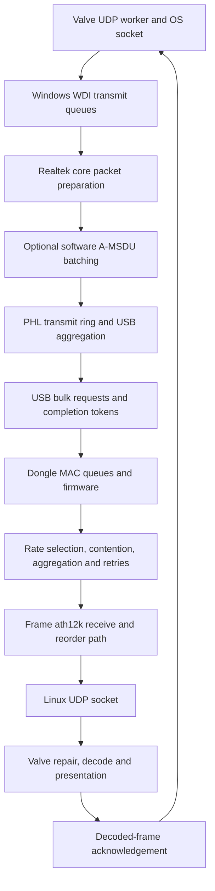

# Steam Frame radio, USB and firmware map

Evidence reviewed on October 13, 2026. This map covers the dedicated dongle and
the headset's wireless receive boundary. The encoder, application transport,
decoder and presentation loops are separate layers; see
[the encoder and transport research](../encoder-and-codec-research.md).

We have traced several real control paths through the driver and one firmware
scheduler. We have **not** recovered the entire radio implementation or established
complete control of its running state. Decompiling a handler proves that a path
exists in this build. It does not prove that the path is active, that its input is
the installed registry value, or that a successful setter changes hardware in the
way a performance experiment requires.

## Build scope and evidence types

| Component | Exact scope | What is established |
| --- | --- | --- |
| Windows dongle driver | `rtwlanuval.sys` 5.32.908.2026, SHA-256 `378ffaee3b782b9a7f5382c294a846e7c4b3b952717991fd1fd93795c5a85612`; image base `0x140000000` | Targeted x64 disassembly and decompilation, registry descriptor tables, selected NDIS/WDI, aggregation, USB, retry and thermal paths. The database has 12,685 function boundaries; exported pseudocode is a subset, not a coverage certificate. |
| Realtek SDK | `RealtekWiFi64.dll`, SHA-256 `a1fd6efdb278d94f1bdeefee67c30d62b0a10ae8b8c810b559f6b332d8e3f8e7`; image base `0x180000000` | Export and request tracing; read-only performance, thermal-range and configuration observations. The mask/retry query responses were independently validated through WLAN notifications. |
| Embedded dongle firmware | Four RTL8852C normal/WoW candidates, two silicon-cut branches; advertised 0.29.123.4, commit `8fd5840c` | Extracted containers and static RISC-V analysis. The cut-2 normal image has SHA-256 `1a377d6f0ebd6be49aa1f8c00fce460c3caab9442b70aab9de7fbc78b1045602`. These are candidate images, not running-firmware readback. |
| Headset wireless driver | Observed `ath12k_pci`, PCI vendor/device `17cb:1107` | Interface, station and datapath snapshots. A matching installed driver/firmware implementation has not been fully analyzed in this investigation. |

All addresses below belong to those exact builds. Private binary copies,
pseudocode, assembly and captures remain under ignored `artifacts/RadioTrace/`.
This document contains original descriptions, not redistributed implementation
code. A focused continuation performed bounded read-only mask/retry queries and
observed their WLAN response headers. No radio setting change or throughput test
was performed by this mapping agent.

## Data flow and queue boundaries

The diagram identifies boundaries, not an assertion that every arrow is fully
traced instruction by instruction. In particular, Windows socket scheduling,
xHCI bus arbitration, the complete dongle airtime scheduler and the exact headset
firmware remain partially or wholly outside the recovered paths.

### WDI and software packet preparation

`0x14000CA20`, identified by its `N6UsbWdi_TxDataSend` diagnostic, obtains packets
from WDI callbacks according to available core resources, validates adapter state,
prepares packet descriptors and enters `0x14004D57C`. Resource depletion has its
own accounting and flow-control path. This is a separate queue from Valve's
decoded-frame acknowledgement queue.

`wdi_tx_priority_queueing`, registry field +4384, is a real input: it changes
metadata handling and whether the no-packet notification addresses a particular
peer/queue or a broad mask. `0x14000EB48` also uses it when adding a datapath peer;
`0x14000DE5C` includes it in initial data-path parameters. The descriptor-table
fallback is 1. We have not yet resolved every callback's formal WDI type or
verified the active traffic class of streamed video. Therefore this setting is
not proof of accepted QoS or favorable over-the-air priority.

`CoreAMSDU`, field +4338, gates the software A-MSDU path in `0x14004D57C`.
The batching routine `0x1401070EC` maintains per-class lists, applies a peer-dependent
packet-count limit, and flushes or arms a timer. Length negotiation is in
`0x140107E60`. Peer capability and the `tx_amsdu_len` selector limit the aggregate;
a nonzero `custom_tx_amsdu_len` imposes an additional minimum. Selector classes
include 3,895, 7,991 and 11,454 bytes on the applicable peer path. These are not
universally available sizes for every association.

The reviewed installed settings had `CoreAMSDU=0`, length selector 0 and custom
length 3,100. That says nothing by itself about hardware A-MPDU aggregation.
`tx_amsdu_num` has a table fallback of 10; `tx_amsdu_timeout` has a fallback of 1.
`0x140002564` converts the latter into a relative NDIS timer using 10,000
100-nanosecond units per setting unit: **milliseconds**.

`0x140006E34` is a distinct USB software-aggregation flush routine. It checks
`usb_timer_flush_amsdu`, traffic conditions and elapsed time, then flushes ten
classes or arms the same timer. USB completion can call it. A similarly named
INF value such as `SendPacketByTimer` is not a demonstrated alias for this flag.

### USB aggregation and bus submission

`0x14014C00C`, identified as `_phl_handle_xmit_ring_usb`, walks a transmit ring,
packs descriptor/payload data with eight-byte alignment, and stops when resource,
buffer-length or aggregation constraints apply. It also handles USB packet-boundary
conditions. Its limits come through HAL accessors, including a 16-bit aggregation
limit read by `0x1401CF9D8`; the current numeric limit was not measured. When more
than one eligible item is packed, `0x1401A917C` invokes the USB aggregation
configuration callback. This is an additional aggregation stage, distinct from
software A-MSDU and over-the-air A-MPDU.

The normal data path and `0x14014B740` both reach `0x140008C80`
(`pltfm_usb_out_token_send`). It obtains an available transfer token, chooses the
bulk pipe, formats the request, installs completion `0x140006950`, puts the token
on a pending list and submits the request. `UsbBulkOutTimeout`, field +3072,
is converted to a relative timeout by multiplication by −10,000. Its descriptor
fallback is zero; the precise framework meaning of zero should be checked before
presenting this as a timeout control in the app.

Completion `0x140006950` removes the pending item, tracks failing status and time,
compares consecutive failures with `UsbFailCntTH`, recycles resources and signals
drain completion as appropriate. Successful completion may trigger the software
aggregation flush. A USB completion is not an acknowledgement that the headset
received or decoded a video frame.

USB-mode policy is also separate from achieved bus speed. `ForcedUsbMode` is
copied by `0x140077EC8` into a mode-switch context. `0x1400779B8` compares desired
and reported mode; `0x140077FA4` persists transition state and schedules the switch.
`0x140078614` reads current mode/capability and handles prior transition results.
The reviewed saved value was 2. None of this guarantees successful SuperSpeed
enumeration through a particular hub or cable.

The app's `UsbDongleConnection` uses the hub's **operating** flags from the V2
connection query, not merely advertised capability or the adapter's PHY rate.
Historical captures showed High-Speed; a later unplug/replug on the user's existing
USB 3.1 hub resulted in SuperSpeed. There was no demonstrated software setting that
transformed a USB 2 connection into USB 3. The useful recovery advice is to reseat
the connection and verify its actual operating speed, then isolate hub/cable/port
negotiation if it remains High-Speed.

## Rate selection, retries and SDK controls

The SDK request bridge and driver dispatcher `0x1401F6240` expose more information
than a single advertised link speed. These formats are build-specific, not a
stable documented API:

| Request | Traced implementation | Meaning and remaining limits |
| --- | --- | --- |
| `0x8035`, 149 bytes | SDK `SDK_GetPerfMetrics` at `0x180022AD0`; driver `0x1401F3834` | One count plus at most two 74-byte link records. Peer address at 0, RSSI byte at 6 with driver conversion `raw − 110`, TX rate string at 7, RX rate string at 39. Read-only measurements succeeded. |
| `0x8051`, 1 byte | SDK `GetTherRange`; driver `0x1401F56FC` | Reads radio-context byte +43780. It is **not** the thermal-duty stage at +43776 and is not a verified temperature. |
| `0x8022`, 4 bytes | SDK `GetTxMCSRateMasking` → `0x180029440`; driver `0x1401F2B4C` | Extracts a peer's mask from the rate state at +128, shifted right by 12. Iteration can overwrite the output across peers/links, so it is not a per-peer inventory. A validated live response contained zero; see the traversal caveat below. |
| `0x8024`, 28 bytes | SDK `GetTxRateRetryTable` → `0x180029850`; driver `0x1401F2CBC` | Returns an enable DWORD and 24 policy bytes stored in the custom-VR context. This is configuration, not retry event counters. The live response header and payload were validated independently. |
| `0x8021` / `0x8023` | Driver `0x1401F4DA8` / `0x1401F4FF8` | Set the MCS mask / retry policy respectively. Mask setter preserves the low 12 state bits; retry setter also calls the HAL path. Exact rate-index meanings and acceptance by the running firmware need further tracing. These setters were not used. |
| `0x8053` / `0x8054` | Core dispatcher `0x14012AFF0` → `0x14012A1FC` / `0x14012A2D4` | Set ordinary / special-packet retry bytes in the packed runtime retry-limit field. These are separate from the 24-entry rate retry policy. These setters were not used. |

The older global SDK wrappers depend on initialization state. The previously used
instance-based observer verifies the DLL identity and paired adapter before reading,
checks sizes/status and destroys its instance afterward. Finding another query
opcode is not a reason to call initialization or undocumented setters blindly.

The bounded read-only observer reuses that instance's request context at
`handle + 16` and bridge at SDK base + `0x2D8A0`. Its Windows x64 argument sequence
is context pointer, 32-bit opcode, 32-bit type 3, 32-bit selector 1, input pointer,
32-bit input length, output pointer, 32-bit output capacity and signed 32-bit
timeout in milliseconds. Pass a zero-initialized four-byte input for `0x8022`, or
28-byte input for `0x8024`, with separate output storage of the same size. These
getters do not consume additional input selector fields. Driver validator
`0x1401F1DD4` requires an active VR context, a role pointer and adequate input size.
Serialize requests and retain raw output alongside decoded fields. Neither query
should be combined with a setter or SDK global initialization.

The bridge's status checking has an important limit. It returns 6 for missing
required pointers, 7 on its dispatch/allocation-failure path, and 9 for response
timeout. However, mismatched response opcode/type/length only produces diagnostics;
it does **not** force a nonzero result. `0x18002E4B0` copies the smaller of returned
length and output capacity. Thus a successful return and a four-byte buffer do not
prove a four-byte response. Sentinel storage detects untouched or partial output,
but the response header must also be observed. The MCS mask remains configured
allowed-rate state even after those checks; it is not the selected recent transmit
MCS reported by the performance record.

### Independently validated query response envelope

The SDK subscribes to IHV notifications with `WlanRegisterNotification`, source
`0x40`, through `0x18002CB60`. Callback `0x18002D140` parses the custom response.
A separate client handle can observe that same notification without patching the
SDK; the API supports per-handle subscriptions and explicit cleanup.
[Microsoft's notification contract](https://learn.microsoft.com/en-us/windows/win32/api/wlanapi/nf-wlanapi-wlanregisternotification)
describes this registration mechanism. The SDK's public callback registration
does not expose these query replies: its adapter at `0x180021B40` forwards a
different, one-byte notification.

The successful observer, ignored `read_radio_config_verified.py`, checked the
SDK SHA-256 and exact paired-adapter GUID, then subscribed using its own WLAN
handle. It issued only the two serialized getters, with a one-second request
timeout and at most one further second waiting for a matching notification.
Unrelated notification payloads were discarded. Its matching response layout was:

| Offset in IHV data | Size | Checked meaning |
| --- | --- | --- |
| 8 | 4 | Wrapper tag `0x270000`. |
| 12 | 4 | Wrapper capacity 1044, including the 20-byte custom header. |
| 16 | 4 | Exact requested opcode, `0x8022` or `0x8024`. |
| 20 | 4 | Type 3. |
| 24 | 4 | Selector 1. |
| 28 | 4 | Header DWORD 3, observed zero; not established as a sequence number. |
| 32 | 4 | Exact used payload length: 4 or 28. |
| 36 | 4 or 28 | Matching query payload. |

Both notifications had total size 1060 and notification code zero. The outer
wrapper reports its full **1024-byte payload capacity**, not the used payload
length. The observer validates the fixed outer envelope and the exact inner
length separately, retains the raw 20-byte header and used payload, compares that
payload with the SDK output, and checks output-buffer canaries. Its final run
completed both queries in approximately eight milliseconds each; all cleanup
statuses were zero and no callback error occurred. The private evidence is
`radio-config-verified-live.json`.

This closes the earlier response-header uncertainty, with one correlation limit:
the SDK semaphore key is `selector | (8 * (opcode XOR type))`, from
`0x18002CB40` / `0x18002E090`. Header DWORD 3 is not used by this matching path.
There is no demonstrated unique transaction identifier. Another client's identical
query within the same short interval cannot be uniquely distinguished. A valid
driver response also does not prove that the firmware applied a prior setter.

`tx_data_cnt` is a misleading registry name: `0x1400B2754` copies it into the
16-bit retry-limit field. `0x14004BAC0` consumes the low byte for normal data;
`0x140049D5C` consumes the high byte for special packets. Each has a fallback of
16 when its byte is zero. The observed value 7 is **not seven packets per aggregate**.
Runtime requests can supersede the saved registry value.

### Rate-mask layout and retry-table normalization

The mask is consumed by the rate-adaptation registration/update paths
`0x14026C400` / `0x14026CE64`, through `0x14026AC18` (`halbb_ramask_mod`). That
routine intersects the requested bits with mode and spatial-stream restrictions,
then applies RSSI-dependent pruning through `0x14026AB10`. Its output is packed
by `0x14026B250` for the firmware rate-adaptation command. The custom-VR mask is
therefore an input to further filtering, not necessarily the final firmware mask.

For the HE layout, native mask bits 0–11 are the legacy-rate region and each
subsequent group of twelve bits describes one spatial stream's MCS 0–11. After
the custom-VR getter's right shift of twelve, returned bits 0–11 correspond to
1SS MCS 0–11 and bits 12–23 to 2SS MCS 0–11. The Windows routine's mode-specific
constants and stream-count masks establish that twelve-bit layout; it also matches
the separately maintained [Linux rtw89 HE mask construction](https://github.com/torvalds/linux/blob/master/drivers/net/wireless/realtek/rtw89/phy.c).
The Linux source is a cross-check, not evidence that the Windows firmware uses
every Linux policy. HT and VHT share the twelve-bit spacing but have fewer valid
MCS bits; EHT follows a different layout and should not use this decoder.

The getter's peer traversal can leave the result at its initialized zero when
there is no eligible entry, and can overwrite it across links. A zero readback
must not be interpreted as “all rates disabled.” Likewise, a mask allowing MCS 11
does not force MCS 11 or override channel conditions. Recent selected rate remains
the separate performance record, formatted by `0x1401C7BD0`.

The 24-byte retry-policy payload has a further transformation absent from the
readback: `0x1401F4FF8` stores the supplied enable DWORD plus 24 bytes, then calls
`0x140297038` → `0x1401E35FC` → `0x14026A354`. The final routine emits an enable
byte followed by the 24 entries, replacing **each zero entry with 4**, and hands
a 28-byte command to `0x140260BC4` with command selector 7 and class selector 1.
Consequently, zeros in the stored policy do not mean a zero-retry firmware request.
The getter returns the stored policy, before this normalization.

The focused trace stops at this baseband H2C boundary. The exact firmware consumer
and interpretation of each of the 24 entries have not been recovered. Their
count is compatible with two groups of twelve HE rates, but that is insufficient
to label entry indices as per-MCS retry counts or to assert whether values include
the first transmit attempt. The ordinary/special packet retry caps and the
rate-adaptation retry table are separate controls, so their interaction also needs
the firmware consumer. Increasing entries cannot yet be recommended as a fix for
throughput or late-frame tails.

A parallel root-agent capture, `radio-config-live.json`, first observed an enabled
retry table with the sequence `2,2,2,2,1,1,1,1,1,1,1,1` repeated twice, and a zero
mask while the separate recent rate was `2SS MCS9`. The subsequent independent
notification capture returned the same values and verified both headers and
payloads as described above. This establishes driver-returned configuration, not
firmware acceptance or a known throughput-limiting default. The nonzero table
entries would pass through the mapped normalization unchanged if sent by that
setter. No policy was written for either capture or this mapping pass.

The final three bytes of a performance record are now traced to sources, but are
still deliberately not labeled with guessed units:

- Bytes 71 and 72 come through `0x14019A630` → `0x1401E11B0` → `0x14027F174`.
  They are offsets 2 and 18 in a 96-byte background environment-monitor result
  copied from baseband context +5996. The conversion accepts a specific validity
  pattern first.
- Byte 73 comes through `0x140296E90` → `0x1401E26BC` → `0x140295E0C`.
  It is byte 11 of an 18-byte `halbb_query_phy_utility_info` snapshot at baseband
  context +14676.

Those source chains establish that the bytes are not the separately queried
thermal range. Writer/structure recovery and validity semantics are still required
before naming them channel utilization, noise, packet error rate or temperature.

## Thermal duty scheduler: a complete path, incomplete live state

The thermal path is traced further than most of the airtime scheduler:

1. `min_tx_duty` and `thermal_threshold` populate radio configuration. Reviewed
   installed values were 40 and 53. The threshold's conversion to Celsius has not
   been established.
2. The 8852C comparison at `0x14038AD08` includes per-path correction and a two-unit
   hysteresis region. `0x1401C3EC8` updates protection level 0 through 5.
3. `0x140164EF8` calculates a duty decrement of `(100 − minimumDuty) / 5`, with a
   minimum step of one. For minimum 40, nonzero stages imply 88, 76, 64, 52 and 40
   percent. This is a duty policy, not a fixed Mbps cap.
4. `0x1401C4118` splits a period into on/off portions. `0x1402BA1E0` packages two
   16-bit duration fields and a control word. H2C builder `0x1402E9B7C` uses category
   1, class 9, function 24.
5. The analyzed cut-2 normal firmware dispatch at `0x20124C56` passes the eight-byte
   payload to `0x20123FC8`, which creates/configures `Tx_Duty_timer`.
6. Callback `0x20123ED8` alternates state 1/2, selects the corresponding duration,
   calls `0x20123E8E` and rearms the timer.
7. `0x20123E8E` → `0x2010DC34` alternates mask `0xFF` between zero and all ones
   in the selected MAC-bank transmit-enable register (`0xC348` / `0xE348`). This
   gates the eight data queues; management/beacon bits are outside the mask.

The timer functions are indirect calls through a table outside the extracted
loadable sections. Their exact time unit is unresolved. The current firmware cut,
loaded image, duty level, timer phase and actual on/off durations were not read
back. The driver can also load external firmware. Consequently neither an embedded
image match nor a thermal-range query returning zero proves that this scheduler
is inactive on the running dongle.

Other airtime scheduling mechanisms remain unresolved: complete rate adaptation,
EDCA/TXOP behavior, aggregation density and limits, power-save/coexistence scheduling,
firmware resource credits, and the exact effect of every retry table entry. No
firmware patch, thermal bypass or power/regulatory change was made.

### Live thermal and firmware observability boundary

No running duty-stage or firmware-version getter was found in the reviewed SDK
exports and custom query handlers. `SDK_GetHWID` is not such a getter: it uses
`0x8050` to read two efuse regions. Query `0x8051` returns the separate thermal-range
byte and cannot stand in for duty stage. Neither a zero range nor the last three
performance bytes answers whether the duty timer is active.

The driver does contain an existing WPP observation path. Initialization at
`0x14000DC00` assigns the PHL/MAC control block the provider GUID
`16d085d0-69ad-41fd-94e1-77667c0c6664`; `0x1412B1198` resolves
`EtwRegisterClassicProvider` and `WmiTraceMessage`, and `0x1412B1110` registers the
control blocks. The enabling callback `0x14000E560` stores the logger handle,
level and flags. This enable-provider GUID is distinct from the message GUIDs:

| Observation | Filter and message identity | Payload and evidentiary limit |
| --- | --- | --- |
| Host thermal duty stage | Flag `0x1`, level at least 4; message GUID `4c52b82d-4ef2-39df-90f2-000e22b005f4`, IDs 11 / 12 / 13 | `0x1401C3EC8` emits old stage, comparator result and, on change, new stage. Each payload is two NUL-terminated ASCII strings followed by one four-byte value. This reads host stage +43776 without confusing it with range +43780. |
| Selected firmware version and download-state qualification | Flag `0x1`, nonzero level; message GUID `1208d636-008a-30ec-90cb-824ca03c292d`, ID 56 | `0x1401CF5F8` emits four NUL-terminated strings: prefix, function name, formatted version and a state qualifier. The qualifier is empty when MAC state byte +97 equals 4 and `Not ` otherwise. |
| Firmware selector's chip/cut/image-kind inputs | Flag `0x8`, nonzero level; message GUID `20d388f1-1a9b-3bae-c212-38c0c6141c37`, IDs 226 / 227 / 228 | `0x140485740` emits chip selector, cached silicon cut and requested firmware kind as four-byte values when it selects an image. These describe a selection event, not a continuously available firmware query. |

The version cache's origin is now established. `0x1404862D0` copies the four
version bytes from firmware image header +4 into MAC object +403 before download
in `0x1404845A0` / `0x140484D50`. `0x1401D4D84` formats that cache. The version log
is reached after successful initialization/download/enable wrappers, including
`0x1401D63C4`, `0x1401D41A4`, `0x1401D4238` and `0x1401D3B54`. Capturing a successful
load sequence would identify the selected version and cut with substantially
better evidence than inspecting embedded candidates. It still would not be an
independent firmware-reported version or hash attestation.

These WPP paths have been resolved statically. A two-second live canary of the
named provider received other driver messages but no thermal/version messages;
the target payload layout is therefore still unverified at runtime. Thermal events can reveal a host stage
while the watchdog evaluates it. Missing events alone do not prove stage zero:
the watchdog has additional eligibility checks and skips this path when minimum
duty is 100. Version/cut events require a corresponding load/selection event and
cannot be assumed to replay on demand. Even a nonzero host stage does not confirm
the firmware timer's accepted durations, phase or actual queue-gating duty cycle;
that final boundary still requires firmware acknowledgement or timing evidence.

### WPP overhead and snapshot limits

The thermal flag is shared with other PHL/MAC diagnostics. A wider static gate
inventory found 1,215 candidate functions with a literal flag-1 test, not 1,215
runtime events. Normal USB transmit detail in the reviewed path uses level 5 or
flag 4, but level 4 / flag 1 includes repeating error/backpressure paths and
successful custom frame-stat report messages, some emitted under spin locks.
This provider cannot be assumed cheap during the very stalls being investigated.

It uses classic WPP. The enable callback takes only logger, level and flags;
consumer filtering cannot remove unrelated producer cost. Microsoft's
[classic-provider filtering contract](https://learn.microsoft.com/en-us/windows/win32/api/evntrace/nf-evntrace-enabletraceex2)
also permits only one receiving session per classic provider, so an observer
must not take over a provider already enabled by another controller.

Thermal message 11 can expose current host stage on each future eligible
watchdog evaluation, without waiting for a change or restarting the adapter.
No event is inconclusive because the watchdog can skip that evaluation.
Firmware-version message 56 is emitted by load/enable/init paths; starting a
trace supplies no current-version snapshot or replay. No validated runtime
getter fills that gap, and SDK thermal range remains distinct from duty stage.

A private bounded observer and 17 synthetic parser checks are under
`artifacts/RadioTrace/ThermalWpp/`. Its first two-second canary ran after an
untraced streaming baseline, with the running driver service and adapter matched
to the analyzed installed-file SHA. The provider was registered and idle before
enable. The observer received **26 events / 934 payload bytes**, including two
ETW infrastructure records, with at most 12 events in one source-QPC second.
Reported event and real-time-buffer losses were both zero. No thermal or version
message was selected, rejected or saved; the current stage and selected firmware
version remain unknown. These ETW loss counters do not describe radio delivery.

The observer stopped its uniquely named session successfully. The supervisor
and an independent five-second cleanup guard both confirmed the session absent,
and a final provider query confirmed it idle. A deliberate child-process failure
tested cleanup routing before capture without enabling ETW; failure while an
active provider was enabled was not injected. Only the two-second normal capture
exercised an actual active-session stop. No adapter restart or driver/radio
setting change was made.

This was a low-volume window, not a quantified overhead comparison or proof
that longer tracing is harmless under backpressure. Target payload envelopes
remain unverified because none appeared. Details, raw counts and cleanup results
are in `artifacts/RadioTrace/thermal-canary-1-report.md` and the accompanying
`thermal-canary-1-live-*` files; static gates remain in
`artifacts/RadioTrace/thermal-wpp-observation-plan.md`.

## Headset receive and coexistence boundary

The current capture path uses `wlanap` on the dedicated 6 GHz, 160 MHz link (channel 37,
center 6185 MHz), with `wlan0` also associated to a 2.4 GHz router. The two interface
names do not establish two independent radios or decode streams. Their firmware
time-sharing and scan/coexistence policy has not been recovered.

The saved ath12k datapath snapshot exposes receive/reorder/error-ring and transmit
completion statistics. It recorded 23 descriptor-address-zero reorder errors,
zero listed RXDMA overflow/FCS/decrypt errors, zero TCL-ring-full failures and zero
pending radio transmit work at the snapshot. These are cumulative, device-wide
values. Without before/after deltas and timestamps they cannot be assigned to a
particular streaming interruption. Reported zero station retry/signal fields also
do not prove perfect RF; some fields were uninformative in this build.

A previous bounded router-disconnection trial restored the router association and
did not fix the weak-link throughput problem. It does not rule out every coexistence
condition, nor does it justify leaving the user's router link disabled.

## What the measured link establishes

Earlier weak-link observations were approximately −76 dBm with TX `1SS MCS6` or
`2SS MCS4`. Isolated UDP tests delivered roughly 332–364 Mbps; sender calls could
stall for 67 ms or longer. A reversible `CoreAMSDU=1` comparison did not improve
the result and restored 0. Registry readback did not independently prove aggregates
were emitted on air.

After conditions improved, the read-only SDK showed approximately −64/−63 dBm and
TX `2SS MCS9`; Frame last-ACK reception was approximately −45 dBm. With unchanged
USB 3, driver, thermal and power settings, the same eight-second test delivered
450.01 Mbps, all 432,692 sequence-numbered packets, no UDP receive-buffer errors,
and maximum sender-call time 0.174 ms.

This rules out a universal 330–360 Mbps ceiling for this hardware. It does not
prove sustained 400 Mbps video with repair overhead, low tail latency and decoder
headroom. A 400 Mbps coded stream can require approximately 450–500 Mbps of
data-plus-parity payload before other overhead. The raw UDP trial is a capacity
measurement, not a video quality or smoothness test.

### Later game-stream captures distinguish payload from parity

The saved awake-reference and receiver-timer trial-3 captures delivered almost
the same actual NVENC output: 305.91 and 306.26 Mbps, at 89.80 and 89.88 encoded
FPS. Mean Waterfall traffic nevertheless rose from 372.41 to 391.76 decimal
Mbps, principally because its parity counter rose from 52.79 to 71.29 Mbps.
Headset interface receive rate rose from 388.14 to 408.05 Mbps. These distinct
accounting boundaries must not be labeled 400 Mbps of useful encoded video.

In both captures the sampled link estimate stayed at 400 and the ping factor
stayed at one. The queue/presentation-feedback factor continued reducing the
encoder budget; trial 3 still had per-frame controller budgets as low as 122.16
Mbps. Host bad-link messages preserved `400 → 400` in manual mode. Receiver
arithmetic repair therefore did not remove the upstream budget controller.
The trial's smaller timing tails and lack of recorded overflow events are useful
observations, but these sequential captures do not isolate a causal improvement.

Neither file contains USB completion events, firmware duty-state readback or
airtime/retry measurements that locate the remaining transport tails inside the
radio path. Their absence prevents assigning those tails to a radio scheduler
or clearing that scheduler. The private, reproducible comparison is
`artifacts/RadioTrace/repair-trial-comparison.json` with accompanying prose.

## Packet size and aggregation are separate boundaries

The current FEC implementation uses a fixed 1024-byte payload per chunk. Host
`0x180A4B680` and receiver `0x533D0` use that width for placement; completion,
retry and recovery also depend on it. Host `0x180A3BFD0` and receiver `0x47EE8`
limit an individual inner packet to 1032 bytes including its header. Changing
chunk width requires coordinated sender and receiver changes.

Several unchanged complete chunks in one UDP datagram are already supported.
The host packer and the receiver's repeated inner-packet parser can carry pairs
or triples. Host maintenance `0x180A3B7D0` has 1376/2212/3152-byte packing steps,
gated by an internal MTU-growth flag that the constructor leaves off. Successful
size-probe echoes establish UDP delivery after any reassembly, not an
unfragmented path. Two full chunks in the encrypted session format occupy 2080
UDP bytes, or 2108 bytes including ordinary IPv4/UDP headers.

The driver boundary is concrete. Its WDI adapter-capability callback
`0x140512A40` → `0x14000E930` → `0x140010E50` invokes `0x14001075C`, which
unconditionally advertises MTU **1500**. The serialized field matches Microsoft's
[WDI interface-capability definition](https://learn.microsoft.com/en-us/windows-hardware/drivers/network/wdi-tlv-interface-capabilities).
Per-PHY construction at `0x140010B24` also advertises maximum MPDU length 1500.
The separate generic `OID_GEN_MAXIMUM_TOTAL_SIZE` handler reads common-object
`+896`, initialized to 2342 in `0x140034388`; that medium-specific total-length
value must not be presented as the active IP MTU. NDIS handles maximum-frame-size
queries for modern miniports from their advertised initialization capabilities.
[NDIS query contract](https://learn.microsoft.com/en-us/windows-hardware/drivers/network/oid-gen-maximum-frame-size).

A read-only Frame metadata query reports `wlanap` current MTU 1500, minimum 256
and maximum 2304. Two-chunk packets fit that advertised range; three full chunks
would need approximately 3148-byte IPv4 packets and exceed it. The Frame range
does not prove firmware delivery at its maximum. No supported way to raise the
Windows driver's advertised 1500 limit was found, so unfragmented pair packing
is not currently an app-only setting. This is an advertised driver limit, not
proof of an immutable radio-hardware limit.

A-MSDU, A-MPDU and USB TX aggregation operate at different layers and can retain
the existing application chunk size. They must be measured independently from
larger UDP packing. The private call-path and size analysis is
`artifacts/RadioTrace/packet-overhead-boundaries.md`; no MTU or aggregation change
was applied in this pass.

## Next traces that close specific gaps

### A concrete low-volume candidate for USB timing

A later coherent-budget capture contains a separate 64.594 ms transport tail
with roughly 6 ms encoder completion. The host FIFO reaches 1.29 MB while
admission holds at seven unacknowledged frames; retry attempts increase by 83.
This is distinct from the capture's longer shared-texture handoff interruption.
FIFO timestamp age includes earlier limiter waiting, so it does not isolate
USB or airtime. Current samples still lack an exact socket-send or USB boundary.

The installed Windows UCX manifest exposes bulk-transfer dispatch event26 and
completion event27 under `HeadersBusTrace` (0x40), level4. These include pipe,
IRP/URB identities, transfer length and completion status without transfer data.
XHCI device rundown plus UCX device/endpoint rundown can identify the dongle's
bulk-OUT pipes. This is a better first boundary observation than the Realtek
core USB WPP category, whose ordinary messages lack a unique request identity
and emit several records per transfer. A private observer uses strict device/pipe
mapping, bounded events, a two-second deadline and independent owned-session
cleanup. Its single live canary identified the exact dongle and bulk-OUT endpoint,
then reached the 16,000-record cap after approximately 0.66 seconds.
[Microsoft USB trace modes](https://learn.microsoft.com/en-us/windows-hardware/drivers/usbcon/how-to-capture-a-usb-event-trace).

The first canary attempts stopped at preflight: these manifest providers are
already enabled by existing diagnostic sessions. Read-only inspection confirms
modern active registrations, for which ETW supports multiple independent
sessions. The initial idle-only guard was overly restrictive. The private
coexistence implementation now validates modern registrations and capacity,
preserves and compares existing enable tuples, and enables only its own new
session. Cleanup uses its created handle or verifies the random name and GUID
before fallback stop. Synthetic preservation/failure tests pass. One existing
XHCI logger's identity is not visible with current query access; its enable
records remain part of the preservation check. No existing session was disabled.
During the canary, all active modern enable tuples and accessible session settings
remained unchanged, with no new reported losses. However, a legacy PRE_ENABLE
record disappeared for each provider. The strict preservation check correctly
failed; this before/after observation does not establish who changed those records.
The observer stopped only its own session and verified it absent. It did not try
to restore another controller's records.
[Manifest session coexistence](https://learn.microsoft.com/en-us/windows/win32/etw/configuring-and-starting-an-event-tracing-session).

The canary received 16,686 events with zero reported event or real-time-buffer
loss. It paired 7,999 transfer dispatches and completions on endpoint `0x0B`, with
no failed paired completion, two requests still outstanding at cutoff, and up to
four outstanding requests. Dispatch-to-completion median/p99/maximum were
0.066/0.324/3.341 ms. Median/max completed request lengths were 3,498/19,858 bytes;
these are USB request sizes, not IP MTUs or useful-video sizes. The short retained
span corresponds to approximately 24,856 events/s. A timestamp-second counter
reported only 9,629 because the capture crossed a bucket boundary; it was not a
valid rate guard. The replacement fixed-origin elapsed budget allows 512 startup
events plus 10,000 events per elapsed second and has offline boundary/overflow
tests. It has not been used in another live trace.

Correlating outstanding USB requests with the existing queues can distinguish
delay before USB submission, delayed USB completion, and delivery tails after
prompt USB completion. A USB completion is not a radio ACK: firmware credits
and device backpressure can also affect USB timing. This canary neither sampled
the rare 60–85 ms delivery tails nor established negligible producer overhead.
Its high event volume and failed strict preservation check leave a longer trace
unjustified without another design review. Per-datagram AFD tracing is a second choice because
it could approach100,000 events/s at this packet rate and its exact pairing
semantics remain unverified. SDK performance polling and configured retry
readback do not replace per-attempt radio telemetry.

A later normal-controller baseline with no periodic helper calls still shows
an85.911 ms frame-delivery tail followed by two backtrack resets. Later frames
reach the receiver before the delayed frame; the subsequent Q8/unchanged-ACK
holdoff lasts roughly 300 ms with empty send FIFO and reusable encoder slots.
The saved logs contain no texture-sync error, and matched release-to-slot time
never exceeds1.731 ms in this capture. This distinguishes delivery/repair
recovery from the earlier texture-handoff pause, but does not identify RF versus
USB/firmware as the delivery cause. Different budgets, repair policies and
sequential conditions prevent attributing that distinction to helper polling.

The private contract audit and proposed limits are in
`artifacts/RadioTrace/transport-scheduling-observation-plan.md`.

| Priority | Missing fact | Concrete next observation or static trace | Decision it enables |
| --- | --- | --- | --- |
| 1 | Location of rare delivery stalls | Correlate host send duration, USB submission/completion timestamps, Frame receive deltas, repair requests and decoded-frame ACK on one timeline | Distinguishes USB/token starvation, radio delivery, packet repair and decoder delay. |
| 1 | Running firmware and thermal state | Capture the identified PHL/MAC WPP stage and load/selection events; correlate them with command completion and timing instead of interpreting thermal-range +43780 | Determines whether the recovered host duty policy is relevant to a failing interval; firmware timer state remains a separate boundary. |
| 1 | Actual runtime radio policy | The two configuration responses are now header-validated; next trace ordinary retry-limit readback and firmware consumption of the 24 entries | Prevents driver configuration from being mislabeled as observed firmware behavior. |
| 2 | Actual aggregation | Resolve HAL callback table targets and current count/size limits; capture per-transfer and over-the-air aggregate distributions | Tests packet efficiency against added batching delay. |
| 2 | Opaque SDK metric units | Recover writers for background monitor offsets 2/18 and PHY utility offset 11, including validity and sample period | Adds useful RF diagnostics without misleading labels. |
| 2 | Headset radio service gaps | Acquire matching ath12k module/firmware identities, trace receive/reorder service and scan/coexistence events | Tests whether the second association or receive servicing causes correlated gaps. |
| 3 | Full firmware scheduling | Resolve the ROM/OS function table, rate-control updates, retry-entry encoding and queue/TXOP arbitration | Makes a scheduling change specific and testable; does not by itself prove a safe improvement. |

Useful app controls should expose requested, accepted and observed state separately.
At present the justified additions are better radio/USB diagnostics and trace
correlation. A broad “override Valve” switch would conflate several independent
queues and controllers whose running behavior is not yet fully measured.

## Matched Iris trial: a later delivery spike did not start the decoder backlog

The [matched fixed-400 trace](receiver-stream-map.md#matched-fixed-400-iris-trace-delay-precedes-input-return-handling)
already showed about 80 Hz output and 44.098 ms median kernel
queue-to-output-response residence across 60 consecutive frames before TX 2758.
That frame then had a 56.894 ms complete-frame transport interval; TX 2759
followed at 45.146 ms. Encoder completion remained about 6.2 ms and packetization
enqueue about 0.3 ms for both. A 68.200 ms kernel input gap was followed by
those two inputs just 35 microseconds apart. Their queue-to-output intervals
temporarily fell, consistent with the delivery interruption draining some
existing backlog. Later output returned to roughly 80 Hz and 44 ms residence.
The transport spike therefore does not explain the onset of this backlog.

The host retained a 20.911 ms-old FIFO head, admission holdoff and increasing
retry-send counts around the episode. A later stable-descriptor receiver-log
read independently found a substantive 27-packet repair request for TX 2758,
with TX 2757 last submitted. This supports a real repair episode, but does not
divide its delay among host scheduling, USB, radio, receiver delivery and
retransmission. The log read lacked a pretrial inode/offset boundary; it is
corroborating evidence rather than proof of complete same-window logging.

Only one receiver socket/UDP snapshot preceded the early guard stop. Its
cumulative drop count is not a loss delta. The dedicated overflow observer
reported no overflow event and cleaned up, but that does not establish
loss-free radio delivery. This failed two-second performance trial supplies
neither a radio-only diagnosis nor a smooth 350/400 Mbps result.

## Matched IRQ trace narrows the receiver scheduling boundary

The subsequent [matched IRQ/Iris experiment](receiver-stream-map.md#matched-irq-observation-no-comparable-final-scheduling-delay)
again failed the fixed-400 transition, measuring 333.908 useful Mbps at
81.540 fps in its short counter window. Its lossless 24,996-event trace shows
median queue-to-input-return residence rising from 11.311 to 40.816 ms in the
mixed accepted-through-post-cancel phase, then returning to 11.530 ms. The
final observed wake-to-input-response median was only 171, 125 and
36 microseconds respectively. A comparable final IRQ-thread dispatch delay
therefore does not explain the added residence; time before that final wake
is still not automatically hardware decode time.

Scheduled-running duty increased from 4.70% to 15.84% and returned to 4.70%.
The mixed phase's 188 running segments longer than 1 ms contain 604.211 ms of
residency. Some occurs after an input or output response has already been
reported; 71 long output-only segments contain 122.188 ms after their output
event. These are context-switch-bounded CPU intervals, not individual Iris
handler calls or pure Iris execution: nested unrelated interrupts and other
kernel work are included. Handler-return/oneshot timing, internal
response-queue service, PM/mutex waits and firmware/device service remain
unresolved. The thread was already realtime priority 80 on CPU 0, so this
result provides no basis for a priority increase.

This identifies another boundary distinct from the earlier radio delivery
spikes. It does not rule out radio tails in other captures, establish an exact
decoder ceiling, or demonstrate smooth sustained useful 350/400 Mbps. The
middle phase includes uncertain cancellation and recovery, and the retained
frame history differs from the short encoded-counter window.

## Subsequent codec and lock/PM observations do not isolate a radio limit

The [phase-specific codec experiment](host-stream-map.md#phase-specific-cross-slice-filter-trial-and-emitted-pps)
subsequently verified a fresh emitted PPS with cross-slice filtering disabled.
Its fixed-400 screen still failed near 82 FPS, with 336.35 useful Mbps and no
encoder API error increments. Across its broader retained timing history,
median transport was 6.895 ms, encoder completion 6.079 ms and decoder turnaround
45.464 ms. Those medians are not all from the exact two-second encoded-counter
window; turnaround includes queueing and software observation. The result does
not establish a radio throughput ceiling or prove this codec field improved
anything. No radio, USB, aggregation or firmware setting changed for that screen.

The separate [normal thirteen-event canary](receiver-stream-map.md#normal-thirteen-event-locking-and-runtime-pm-canary)
validated scoped IRQ-thread mutex and runtime-PM events without a cadence
failure. It preserved root trace state and removed its owned instance; foreign
instances were not written, but their full state was not compared. Fast normal
PM/lock intervals do not eliminate those stages under the higher load. The later
matched observation retained the measured event caps, phase coverage and
first-acquisition censoring. The completed observation below narrows that boundary,
while firmware response readiness, exact command publication and rare wireless
delivery tails remain distinct unresolved measurements.

## Loaded follow-ups do not show a sustained host send backlog

The [loaded lock/PM trial](receiver-stream-map.md#matched-thirteen-event-observation-small-observed-lock-and-pm-spans)
failed at 304.190 useful Mbps and 68.526 FPS. Its exact 137-picture counter
window has 120 retained completed timings: transport median 7.840 ms,
maximum 15.873 ms, versus decoder turnaround median 57.726 ms. The send ring
is empty in 54 of 79 stable cursor samples, with occupied head age at most
5.128 ms. Retry-send count is unchanged in that window and no consecutive
send failure is sampled. These facts do not show a sustained host send backlog.
They do not measure queues below the socket or 802.11 retry counts.

The broader retained history includes a 43.404 ms transport excursion before
the counter window, after receiver residence had already risen. Turnaround
temporarily falls from 65.175 ms on the preceding picture to 33.287 ms on that
picture and 29.056 ms on the next. A later 24.930 ms delivery excursion has a
pre-window increase of 20 host retry sends. Those are real separate delivery
tails, but their ordering does not explain initial sustained receiver backlog.
The 121.98-second queue file mostly follows cancellation; its aggregate retry
delta must not be labeled a fixed-400 result.

The later [minimum32-CU screen](host-stream-map.md#minimum32-coding-unit-trial-accepted-and-emitted-but-cadence-still-failed)
also fails cadence, at 307.791 Mbps and 69.019 FPS. Its strict transport median
is 7.693 ms, maximum 14.614 ms, while decoder turnaround median is 61.597 ms.
The send ring is empty in 48 of 76 stable observations; occupied head age is
at most 3.910 ms and retry-send count increases by three. Neither screen changed
radio/USB/aggregation/firmware controls or isolates a radio capacity ceiling.

Both fixed-rate tests continue to show admission holdoff and a native controller
request near 32 Mbps while the accepted encoder budget remains 400. Their
individual pictures nearly fill nominal allocation, but reduced cadence lowers
useful bytes per wall-clock second. Their high Waterfall counters include parity
and protocol overhead and cannot substitute for useful-video cadence.

Normal preroll and post-cancel output near 90 Hz under the same thirteen-event
observer argue against a constant observer-induced low-FPS ceiling. They do not
exclude workload-dependent instrumentation cost. The trials are not randomized,
same-content comparisons; differing frame sizes and codec settings prevent
attributing their rate differences to trace overhead or wireless behavior.
The [experiment register](experiment-register.md) preserves those scope limits.

## Modern350 recovery failure is not a measured radio stall

The later [original-codec 350-budget trial](host-stream-map.md#modern-fixed350-reference-near-90-hz-before-a-receiver-repair-failure)
delivered 325.066 useful Mbps at 89.964 FPS for its first 77.998 seconds, then
aborted. Complete-frame transport has a 6.521 ms median in the paired prefix;
the host produces the faulting frame on ordinary approximately 11 ms cadence.
The send FIFO is usually empty and no consecutive send failure is sampled.
Interface errors/drops, UDP receive-buffer errors and streaming-socket drops
have zero recorded deltas. These counters do not exclude wireless loss or
identify every repair request.

The [receiver rare-branch trace](receiver-stream-map.md#fixed350-timed-overflow-during-rx-slot-reinitialization)
instead captures a timed retry-list capacity abort. Its stale last-chunk clock
is within 7 microseconds of the previous owner of the same modulo16 slot, while
the new initialization clock is only 25 microseconds before the timer clock.
Unsynchronized initialization can expose exactly that combination. Interpreting
the computed 173 ms age as actual RF inactivity would ignore the stronger
slot-generation evidence. The inline fields are still non-atomic, so the exact
interleaving is supported rather than directly observed.

Long host production gaps and admission holdoff follow the receiver fault and
stalled decode acknowledgement. This case therefore supplies a concrete
software-state boundary separate from radio/USB completion and the earlier
fixed400 decoder residence. It neither establishes a radio capacity ceiling
nor removes the need to measure rare delivery tails. No radio/firmware control
changed, and no continuous useful350 or smoothness pass was achieved.

## Isolated decoder resource votes and telemetry control

The completed local one/two/four-session comparison bypasses wireless delivery.
All 900 groups decoded, but complete-group rates were 74.494/74.270/71.772 Hz
at measured coded-source rates near 350 Mbps. It supplies a receiver-side
capacity observation for this synthetic workload, not a radio throughput result.
The [codec map](codec-stream-options.md#current-geometry-comparison-completed-tests-missed-90-hz)
explains why independent pictures and native game streaming are different tests.

Four active snapshots per job showed video-consumer tag-7 average ICC requests
of **1,608,000 / 3,216,000 / 3,304,000 kB/s**, with peak zero. Repeated consumer
rows along the route were deduplicated, not summed; tag 3 remained at 1,000/zero.
The two/four values exceed the conditional default-30-fps preflight prediction.
They numerically match the model's table evaluated at 90 fps, but the snapshots
do not read the driver's internal rate or prove how it was selected. Actual
consumer readbacks take precedence over the earlier conditional prediction.

All twelve active snapshots showed MVS0/MVS0C framework rates of 600/900 MHz,
enable/prepare counts one, active runtime PM and force override zero. MVS1/MVS1C
remained 550/825 MHz before, during and after; that unchanged state does not
identify hardware engines doing useful work. Video-temperature samples ranged
43.2--44.4, 42.8--44.8 and 42.8--46.3 degrees C. No sampled framework downclock
was present, but sparse temperatures/rates do not exclude transient power or
thermal effects. No DDR-residency, delivered-bandwidth or firmware-vote-acceptance
measurement accompanied these jobs.

Four sessions requested about 2.055 times the single-session average vote yet
did not improve cadence. That increase was insufficient for this workload;
it neither proves that delivered bandwidth increased nor rules out memory as
a constraint. Session count changes demand, reference domains and scheduling
too. The later [single-session memory-vote control](#completed-single-session-memory-vote-control)
uses the same clip/workload and now has a completed result. Its device-holder,
format and DDR observations differ from the earlier baseline, so its observer
profile is not fully matched.

The four active reads took a combined 166.5/135.4/149.1 ms per job, with individual
elapsed reads of 31.6--54.0 ms; those are reader durations, not decoder-blocked
time. A same-clip single-session repeat removed active reads entirely. It still
completed at **74.495895 Hz / 290.731973 coded Mbps**, versus 74.494456 Hz /
290.726358 with reads: +0.001439 Hz, or +0.00193%. Both had 855 missed input
deadlines. Thus these sparse reads do not explain the mean deficit in this one
sequential comparison. The control retains before/after reads and the same
decoder harness; it has no active clock/thermal/ICC history and cannot prove
zero cost for every observer.

All four jobs completed and later showed the filtered processes absent, runtime
suspended, MVS0/MVS0C disabled and video-consumer votes zero. Earlier post-exit
reads retained active PM and a 1,000 vote before suspend; this transient alone
was not a session leak. The process scan can miss unrelated holders and does
not acknowledge firmware destruction. Normal Main10 streaming was restored
afterward. No radio, forced-clock or thermal policy changed for this comparison.

## Completed single-session memory-vote control

A bounded private run added a separate tag-7 average request of 1,134,000 kB/s
to the one-session Iris request of 1,608,000, with peak zero. Four active reads
verify both owners across the six expected route nodes; SUM/MAX accounting
matches the saved route totals. The added software request is 70.522% of the
single-session baseline. Confirmed activity bounds enclose the 12.461955-second
child lifetime. This establishes the requested state, not delivered bandwidth
or firmware acceptance.

Independent byte/callback replays match the frozen clip and native binary:
438,073,321 coded bytes over 12.054047251 seconds give **74.497800 Hz /
290.739409 Mbps**. All 900 pictures decode and drain, with 855 late inputs;
capacity/cadence still fail. The difference is only +0.003344 Hz versus the
original sampled baseline and +0.001905 Hz versus its no-active-read control.
The verified added request did not produce a material observed gain in this run.

All four active format/holder checks identify the same decoder and file:
HEVC 1664 x 6656 input, Q10C 1728 x 6656 capture, stride 2304. Framework rates
remain MVS0/MVS0C 600/900 MHz with force zero. Loaded Iris `srcversion` was
unavailable, so the file hash, kernel and QUERYCAP identity must not be called
a hash of all running module memory. Video temperatures were 47.1--50.2 C,
versus 43.2--44.4 C in the earlier baseline; no thermal cause is established.

Six DDR samples reproduce valid before/active/after counter deltas. All reported
frequency-duration increments are at 4224 MHz, with no increase in the recorded
4761-MHz row. The active interval covers 3.189717 seconds of the child lifetime;
idle before/after intervals are not a matched no-vote active workload. Ticks,
not an assumed firmware frequency, are the basis of the calculation. Frequency
and low-power durations are not added together. Unchanged reported residency
does not establish unchanged NoC latency, memory throughput or RPMh acceptance.
Foreign CPU/PMU requests also changed.

This coordinator adds global FD scans, duplicated-FD QUERYCAP/G_FMT and DDR/QMP
refreshes absent from the earlier controls. Its active snapshot bodies take
75.9--106.7 ms, not decoder-blocked time. The old no-active-read control does
not measure this new observation profile. These single sequential runs therefore
do not isolate a causal ICC effect, rule out memory limits or prove a universal
decoder ceiling.

The child was reaped, ordinary removal left the owned module/root device and
consumer rows absent, all after-snapshots had no video-device holders, final
runtime PM was suspended, the watchdog exited cleanly and no new taint bits
appeared. The bounded kernel record contains activation, release and exit only.
This verifies software cleanup, not opaque firmware-state restoration. The
observed run used ordinary removal; expiry was not its primary cleanup path.

## Supported decoder clocks and the later workload control

The [installed-policy audit](receiver-stream-map.md#installed-decoder-arrival-rate-and-control-boundary)
binds the OPP clock-name relocation to `vcodec0_core`. Its supported table is
196, 300, 380, 435, 480, 533.333334 and 600 MHz. The saved clock tree maps this to
`video_cc_mvs0_clk`; the 900-MHz `video_cc_mvs0c_clk` is the separate `core`
branch. They are not contradictory readings of one clock. The ordinary decoder
branch explicitly requests 600 MHz even though an earlier frequency model includes
coded-byte load. No higher supported OPP or safe clock/thermal bypass is
established by these sources.

The bandwidth table is separate: it uses geometry, observed arrival rate and
output format, not the maximum compressed input extent used by that frequency
model. Its arrival rate follows actual nonempty OUTPUT queue time after 30
intervals, not buffer frame timestamps. The completed added-vote control still
provides no material mean gain; framework clocks and consumer requests do not
measure delivered NoC/DDR bandwidth or firmware occupancy.

The later retained 208 and metadata-only 208 jobs reached 90.031369 and 90.049625
output Hz with the same one-session geometry. Their sparse active samples also
report 600 MHz, force 0 and 1,608,000 kB/s video requests. Changing only VPS/SPS to
the heavier clip's level/HRD declarations did not reproduce its 74.5-Hz result.
These isolated jobs contain no wireless transport; the workload dependence
cannot be assigned to a radio limit. Their IDR callback gaps, different sampled
temperatures and lack of hardware service clocks remain explicit limits.
