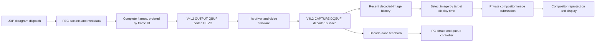

# Frame receiver, decoding and presentation map

Investigation date: 2026-10-13. This is an evidence map of the installed ARM64
receiver, not a claim that every instruction in Valve's stack has been recovered.
Addresses below are ELF virtual addresses before the runtime relocation base.

The principal result is that the receiver's reported decode time is **submission
completion to userspace capture completion**, and its reported “Submit
Illumination” timestamp is a **selected display target**. Neither is a direct
hardware execution or photon timestamp. These distinctions matter when deciding
which delays to override.

## Provenance and confidence

The analyzed `vrlink` SHA-256 is
`31addef0c9553d3770b5570487699e96d70271d4073cd6c03b080fdee6ae2153`.
The private IDA database is `artifacts/BitrateTrace/client.i64`; private extracts,
cross-references and instruction listings are in `artifacts/BitrateTrace/client/`.
The final byte comparison covered 220 extracted functions and found no differences
between those IDA function chunks and the corresponding input ELF bytes. This is
provenance validation, not evidence that every extracted function is understood.

The private compositor-client boundary was then traced in `vrclient.so`, SHA-256
`19b2b9a2b512eb2cb25f0de9c60c20c6b82c78f29384e2fcec4487c507a4e8b0`.
Read-only hashing of `/opt/steamvr/bin/linuxarm64/vrclient.so` on the paired Frame
matched the copied binary. The offline database is
`artifacts/Multistream/integration-research/frame-vrclient.so.i64`; 40 extracted
functions' instruction chunks matched the copied ELF with no differences.
Addresses explicitly labeled `vrclient` below belong to that second binary.

The compositor process itself was subsequently copied through the existing
paired SSH connection without changing the stream. Installed and local
`/opt/steamvr/bin/linuxarm64/vrcompositor` SHA-256 matched:
`0bb148eda6b5e54e2fbed09d475a43671f5ff6fcb6c2b4f48345b1a9fe8d6f96`.
The running compositor's executable link named that installed path. The new
offline database and private evidence are under
`artifacts/Multistream/integration-research/compositor-server/`; 138 extracted
function chunks matched the copied ELF with no differences. Addresses explicitly
labeled `compositor` below belong to this third binary.

“Verified” below means the call, condition, value or store is visible in those
instructions, often supported by Valve's embedded diagnostic names. “Inferred”
means a consequence of that flow rather than a directly observed hardware event.
The kernel/firmware and compositor boundaries are identified explicitly.
The initial static mapping and compositor trace collection made no live receiver,
network or SteamVR setting changes. Later explicitly identified experiments used
bounded receiver instruction leases and host workload/settings trials, with
restoration verified separately from performance results.
No proprietary binary or decompiled source is distributed with this document.

## The connected path

The shipping client creates **one** `SVLCodecV4L2` instance in renderer
initialization at `0x35B48`. It opens one video device descriptor, starts one media
thread, and decodes one packed HEVC elementary stream. Sixteen image surfaces,
sixteen transport receive slots, multiple transport links and encoder multipass
are different concepts; none establishes sixteen or multiple decoder sessions.

## Packet receive, repair and ordering

| Address | Verified role | State or limit that matters |
| --- | --- | --- |
| `0x41720` | Dispatches protocol messages; video type 5 goes to the FEC receiver. Video-description messages update clock/FEC information first. | Audio and control messages take separate branches. A negotiated FEC change is not a decoder count change. |
| `0x53EF8` | `AcceptVideoPacket`: chooses receive slot from frame ID modulo 16, initializes a new slot, dispatches description or data, and asks for repair of skipped preceding frames. | Its submitted/accepted-history duplicate check is conditional on the RX metadata flag. Failed buffer initialization sets an unrecoverable flag. |
| `0x52650` | Initializes a receive frame and acquires the codec's encoded-data buffer through the codec virtual interface. | Rejects expected size above 4 MiB. That allocation guard is not a per-second bitrate cap. |
| `0x52A78` | Accepts the video description and copies the 340-byte frame metadata; establishes the present-ID to transport-frame-ID mapping. | Metadata carries source pose, projections, geometry and target time needed by the renderer, not just coded video. |
| `0x533D0` | Deduplicates and copies 1024-byte coded chunks directly into the acquired input buffer; stores parity separately and invokes group recovery. | Data IDs are 0–2047; parity IDs occupy the following range through 4095. Unknown/out-of-range IDs are rejected. |
| `0x542D0` | Checks available data/parity for a group, reconstructs missing chunks, marks recovery and advances frame completion. | Repair needs the negotiated group geometry and enough independent chunks; parity cannot repair arbitrary loss. |
| `0x52BD0` | Builds retransmission requests from missing chunk IDs. | Timed retry requires roughly 4 ms since the previous retry. Collection aborts before a 513th missing ID; only afterward does the timed path truncate the outgoing request to 20 IDs. |
| `0x53D18` | Requests repair when a later frame exposes an entirely or partly missing earlier frame. | Frame-skip repair is distinct from the timed-retry path. |
| `0x53958` | `InternalAcceptFrameFromRX`: marks a complete frame, queues receive feedback and submits consecutively ready frames to the decoder. | A frame beyond the five-frame backtrack window sets a reset flag. An unresolved predecessor stops ordered submission. |
| `0x53E10` | Consumes an unrecoverable flag, asks the PC for an I-frame, flushes codec state and clears completed pointers/lengths and RX identities. | It retains the completed/submitted ID history arrays. This is a distinct interruption path before the decoder's 330/800 ms watchdog thresholds. |

The direct copy into a codec-acquired mapping avoids an additional full-frame copy
between FEC completion and decoder submission. It does not eliminate the packet
copy, FEC reconstruction, kernel work or codec queues.

Complete frame arrival is not enough to guarantee immediate decode submission:
ordering waits for preceding frames. Consequently the interval between receive
and decode-start feedback can expose a repair/order delay or a slow synchronous
submission call. In the current ordinary-frame measurements that interval is
small; occasional transport spikes remain a separate question.

The receive-feedback producer has one direct entry path:
`0x541E0` checks positive expected byte count and contiguous received-data index
at least `ceil(expectedBytes / 1024)`, then calls `0x53958`. This is assembled-frame
acceptance, including repaired data. Metadata need not have arrived: `0x533D0`
can learn the expected size from a short final data chunk. Acceptance queues
receive feedback before backtrack/order validation, moves the acquired data
pointer into the completed-frame table and clears the receive slot's pointer.
`0x52BD0` immediately returns for a null data pointer. A frame with receive
feedback but no host-recorded decode pair can be blocked on a predecessor,
rejected by backtrack, or already submitted and then flushed before completion
feedback. The host writes both start and end only when the completed-decode ACK
arrives. A zero host start field therefore does **not** prove that submission
never occurred.
A same-ID receive acknowledgement and later repair overflow require checking
identity, timestamps and slot reinitialization before asserting a race.

In the 2026-10-13 live normal-400 trial, the receiver logged a retransmission-list
overflow for transport frame 47646 at 20:33:45.213, followed by decoder reset
about one second later. The list-capacity branch aborts before the timed request's
20-ID truncation; it is not merely a 20-packet repair budget being exhausted.
The timed scan budget grows with inactivity since the last accepted chunk after
a 4 ms allowance, using 104 microseconds per additional scanned data position and
a parity scan delayed by another 20 positions. `0x533D0` refreshes both receive
slot offset 36 (last chunk) and 40 (retry gate) on packet acceptance; frame
initialization time is offset 32. This is not simply total frame age. New repair
packets therefore reset the inactivity allowance before the next timed batch.
Both timed and group-boundary paths can reach the
512-entry collection guard. These code facts identify the abort mechanism, not
the reason that this particular frame's missing list grew. The capture did not
retain raw remote receive timestamps needed to resolve whether frame 47646
completed after the reset; an earlier in-flight frame may also have been flushed.
Do not infer the ordering of receive, abort and reset solely from populated host
ring fields after the trial.

A subsequent 180-second capture instrumented only the two overflow destinations,
after the timer arithmetic and failure decision. It recorded a timed overflow for
frame 17326: 477,589 expected bytes, 467 data positions, 118 parity positions and
a collected count of 512. The preserved parity allowance register was 41,297,703,
so the preceding division result was 41,297,723. Reversing the integer division
by 104 and the subtraction of 4,000 identifies the sampled clock minus the
last-chunk clock used by that calculation as **between −104 and −1 microseconds**.
The receive timestamp read by the timer was newer than its sampled `now`.
Unsigned subtraction expanded that small negative interval into an enormous
scan allowance. This is direct evidence of a timer-underflow failure in this
captured event, rather than evidence that 512 packets had genuinely remained
lost for a long time. The later bitmap snapshot already contained 214 data and
48 parity positions, including IDs still in the collected request; packet
acceptance continued concurrently, so the fields are not one atomic snapshot.

The focused prototype changes the timer's unsigned multiply/logical
shift at `0x52EEC`/`0x52EF0` to signed multiply/arithmetic shift. For ordinary
nonnegative intervals it preserves the division result. For a negative or
too-young interval, the existing downstream tests skip both data and parity
scanning; the missing-metadata case can still request metadata alone. This
preserves the original request-capacity guard and addresses the observed
arithmetic fault before collection. Any live instruction change must also avoid
stopping a thread between this multiply and shift; attach/restore pauses are
excluded from performance comparisons. The observation establishes this failure
mechanism, not every earlier interruption or an overall radio throughput limit.

A loaded 150-second SteamVR Home trial subsequently exercised this exact
two-instruction change at a requested 400 Mbps. The active setup was HEVC Main10,
1664-pixel stream width, 90 Hz, CBR without filler, quarter-resolution multipass
and the existing quality offsets. It measured **306.255 Mbps of encoded payload
at 89.883 frames/s**. One-second encoded-payload samples ranged from 250.088 to
334.296 Mbps; this is not sustained 350 Mbps, 400 Mbps or constant-rate output.
The adaptive controller's sampled budget averaged 347.014 Mbps and ranged from
177.114 to 400 Mbps even with the 400 Mbps requested target.

The Frame Waterfall counter averaged 373.615 and reached a minimum of 307.980
in its binary-Mbps units, with no samples below 300 on that counter. Its unit and
accounting scope differ from encoded payload, so these numbers must not be
reported as 373.615 Mbps of encoded video. The receiver reported four
presentation timeouts and zero dropped frames. The isolated overflow-only
observer ran for 155.098 seconds and recorded no overflow events or trace drops;
its cleanup left the original tracing configuration intact. Zero events in this
short run does not establish the long-term failure rate or prove the fix removes
every reset cause.

The private per-thread ptrace backend bounded the first-interrupt-to-cleanup
interval at 4.016 ms when applying and 8.898 ms when restoring. These are
conservative stop-window bounds, including final status checks, not every
thread's exact pause time. Both original instructions and detachment were
verified afterward. The earlier GDB-based loaded trial incurred about 183 ms of
operation time and a subsequent reset/backtrack cascade; it cannot be treated as
an equivalent low-perturbation measurement. The successful short trial supports
the arithmetic hypothesis under a real workload while leaving the throughput
target unmet. Private evidence is retained as
`artifacts/RepairTrial/timer-trial-3-stream.json`,
`timer-trial-3-overflow.json` and `timer-trial-3-lease.json`.

The two-instruction experiment is not fully equivalent for arbitrarily old
slots: genuine unsigned inactivity of at least `2^31 + 4000` microseconds
(35 minutes 47.487648 seconds) also produces a negative numerator and skips data
and parity repair. Active sixteen-slot reuse is much faster, but the traced
retry walker does not enforce an explicit slot-age expiry. Decoder watchdogs
alone do not prove that every stale FEC slot is cleared across standby.
A permanent implementation should serialize timer state with packet acceptance,
snapshot the frame generation and both clocks before sampling `now`, validate
both unsigned deltas against the allowance, and retain the original request
bounds. Full-width clocks avoid inventing an idle-frame deadline merely to fix
this arithmetic; stale-frame/resume recovery remains a separate policy.
Snapshotting before the clock sample addresses the observed future-clock read;
without serialization it does not also solve every concurrent state change or
retry-clock overwrite. The short leased trial tests the arithmetic fix,
not this complete lifecycle design.

For a complete implementation, the serialization must include frame creation,
packet and metadata acceptance, FEC bitmap/reconstruction updates, completed-frame
handoff, reset and destruction. A mutex used only by the timer does not coordinate
the existing unmodified writers. A source-level implementation can snapshot a
stream epoch, slot generation, revision, clocks and repair bitmap under a shared
lock; sample the clock after that snapshot; build a bounded request from the copy;
then reacquire the same lock and reject any changed epoch/generation/revision.
At commit it must sample again, recheck age and gate eligibility, update the retry
clock and enqueue an owned request together. This prevents the timer from
overwriting a newer packet timestamp or emitting a request for a reused slot.
Later packets may make already queued requests redundant, which is different
from reading mutable frame state through an obsolete pointer.

Use full 64-bit monotonic time internally and truncate only where the wire format
requires it. Slot expiry also needs a clock that advances during suspend or an
explicit suspend/resume epoch; monotonic-raw timing alone does not account for
time spent suspended, whereas Linux `CLOCK_BOOTTIME` includes it
([clock semantics](https://man7.org/linux/man-pages/man2/clock_gettime.2.html)).
A maximum useful repair lifetime and the existing ordered
frame window should drive explicit expiry/resynchronization rather than allowing
old slots to re-enter the arithmetic after resume. The lifetime value remains a
policy to validate, not a newly established Valve constant.

This is feasible with ownership of the receiver source. In the current binary,
the small arithmetic patch is experimentally feasible, but a complete fix needs
more instructions plus synchronization and lifecycle instrumentation at every
relevant writer. The ownership audit below identifies an existing receive mutex,
but it currently omits the timed walk and one reset entry. There is no proven
spare object storage or code space, and no existing exported setting for this
transaction. A detour that only
resamples the clock can reduce the observed arithmetic race without proving slot
lifetime or retry-clock correctness. No production hook for the complete design
has been implemented.

### Owning lock, actual expiry checks and the permanent alternative

The ordinary Uber receive path does have a concrete owner: `0x48580` holds
**link +1112** while calling `0x47EE8` → `0x41720` → `0x53EF8`. It therefore
serializes normal frame initialization, packet and metadata handling,
reconstruction, progress repair, completion and in-packet reset. The per-slot
mutex at +16968 only protects metadata; initialization releases it before
writing the clocks and bitmap, so using that mutex for timed repair would not
coordinate the relevant writers.

The root event at `0x5B190` schedules its case-1 work approximately every
millisecond. It calls link maintenance, then calls FEC virtual +32 at
`0x5B448`, reaching `0x52890`. Maintenance only briefly uses +1112 and releases
it before this timer call. The sixteen-slot timer walk itself checks an
initialized ID and nonnull coded buffer, with no frame-age expiry.

There is also an uncovered reset entry: UDP receive error at `0x45FDC` calls
`0x471D8` → `0x41700` → FEC virtual +40 → `0x53E10`, outside +1112. A permanent
ownership repair must coordinate this entry as well as the timer. Locking inside
`0x53E10` unconditionally would recursively acquire the normal packet caller's
nonrecursive mutex. The legacy standalone UDP path also calls `0x41700`, so an
exact-build Uber shim must check the actual owner type and layout.

The 800 ms decoder watchdog is **not** a FEC expiry guarantee. `0x31940` is
called during certain buffer-acquisition failures and decoder-submission paths;
it is not an independently scheduled scan of incomplete slots. A metadata-known
1 KiB frame missing its one data and two parity chunks produces only three
requests and cannot trip the 512-entry guard. If control traffic continues but
no new video acquisition/submission occurs, the recovered checks allow that
active slot to survive beyond the signed arithmetic boundary. This is a static
counterexample, not a claim that this idle state occurred in the gameplay tests.
The boundary is per-frame inactivity, not the age of a healthy active session.

The smallest defensible complete design reuses the receive owner for timer and
error-reset state, loads a consistent identity/clock/bitmap snapshot before
sampling time, uses full-width last-chunk and retry clocks, and commits against
the same generation. With `chunkAge < 4000`, allowance is zero; otherwise use
unsigned 64-bit `(chunkAge - 4000) / 104`, bounded by real geometry. Preserve the
512-entry collection limit and 20-entry timed transmission limit. Full-width
time can continue bounded repair of an old active frame without selecting an
arbitrary expiration deadline or misclassifying it at 35 minutes.

Copied request descriptors should leave the receive lock before potentially
blocking send work. Existing progress repair already takes receive +1112 then
send-assembler +1224, but the assembler can sleep for its configured rate limiter.
Serializing an entire sixteen-slot timer walk would extend RX exclusion and
needs its own latency measurement. Read option 26 before entering the receive
lock to avoid introducing an extra option-cache lock order. Shutdown must stop
new timer callbacks and retire descriptors before FEC deletion; joining RX
threads while holding their required receive lock would be unsafe.

A clock-after-load trampoline with an unsigned age guard is a narrower useful
candidate, but repeated identity reads alone do not prevent reset between the
last check and retry-clock write. Nor does a 32-bit timestamp identify arbitrary
ages across a full wrap. No permanent binary shim is implemented. Fifteen new
offline lifetime/admission tests and the existing nineteen transaction tests
pass, including full-width repair without an artificial deadline, reset
generation rejection, and the concrete signed-age counterexample.

### A separate ordering failure and the reset cascade

A later 150-second Home trial with the signed timer repair and an experimental
matched 380 Mbps host budget averaged **327.442 Mbps of encoded video at 89.652
frames/s**. One-second encoded samples ranged from 301.451 to 337.090 Mbps.
Waterfall averaged 398.341 and reached a minimum of 355.663 in its separate
binary-Mbps accounting. There were six presentation timeouts and zero reported
dropped frames, but the receiver logged an ordering reset and four retransmission
overflows. It therefore did **not** pass as uninterrupted or constant-rate
streaming. The overflow-only observer recorded four progress/RX events and no
timed-overflow event; this is a different failure path from the clock underflow.

The saved remote receive timestamps resolve the first fault without assuming
host and receiver wall clocks are identical:

| Transport ID | Assembled receive, receiver time on 2026-10-13 | Relevant result |
| --- | --- | --- |
| 12384 | 21:35:17.402167 | Last clean submitted predecessor; ordinary 18.381 ms callback interval. |
| 12386 | 21:35:17.484660 | Complete, waiting behind missing 12385. |
| 12387 | 21:35:17.490139 | Complete, waiting behind missing 12385. |
| 12388 | 21:35:17.496474 | Complete, waiting behind missing 12385. |
| 12389 | 21:35:17.503705 | Complete, waiting behind missing 12385. |
| 12390 | 21:35:17.509601 | Six ahead of last submitted 12384; backtrack error logged three microseconds later. |
| 12385 | 21:35:17.524965 | Finally complete after 117.141 ms measured transport time, after the reset. |

`0x53958` queues the receive ACK and transfers the completed buffer before its
backtrack guard. Thus 12390 legitimately has receive feedback despite triggering
the reset. The four subsequent progress-overflow events occur at
21:35:17.510221–17.512056. Each captured slot again identifies frame 12390, but
has no metadata and a provisional expected size of 4 MiB. Each contains only one
late parity position: 2160, 2162, 2161 or 2163 respectively. These are repeated
reset/reinitialization states, not four independent large lost frames.

The exact progression is visible in the code. Recovery at `0x53E10` sets last
submitted to −1, flushes the codec, clears the completed-pointer and length
tables, and resets the sixteen RX identities/metadata flags. It does not clear
the completed-ID table at FEC offset 284 or submitted-ID table at 2336. At the
next packet, `0x53EF8` skips its history duplicate check because the metadata flag
is false. A late video payload then initializes that slot with the 4 MiB unknown-
size placeholder. A full-length parity chunk does not refine that size.

The first parity chunk belongs to progress group 7. With the captured data/parity
strides of 64/16, the retry builder requests metadata sentinel 65535, then 448
data positions and 112 parity positions for earlier groups: 561 possible entries.
It aborts while attempting entry 513, ID 2111. This exactly matches the captured
count, next-ID register and request head/tail. The oversized request is a
**consequence of the backtrack reset and provisional state**, not the cause of
the first interruption. The signed timer repair does not address this path.

The retained completed IDs also explain a second recovery hazard. Ordered
submission checks the ID, but does not first require a non-null completed
pointer, and it advances submission history even if the codec rejects the call.
A replay of the original five-frame logic predicts four empty submission
attempts when late 12385 drains the retained identities of 12386–12389. Four
empty-buffer errors were logged at 21:35:17.525031–17.525130. The errors do not
name those four frame IDs, so the individual identities remain a model-supported
attribution rather than a directly logged fact. Buffer-index mismatch errors
follow for 12390 and 12406.

The 1.004 ms callback interval reported for 12385 after reset is **not proof of a
successful 1 ms hardware decode or a displayed image**. It has no reported
selected display target and belongs to this recovery/empty-submission interval.
`0x32878` calls the decoded callback after successful CAPTURE dequeue without
checking the returned buffer's flags or plane payload length on that path.
Conversely, an empty submission error does not itself synthesize that callback:
its `0x3FA00` helper updates codec sequence state. Classifying the post-flush
dequeued output requires the returned buffer status and frame identity; the
current feedback pair alone is insufficient.

### A bounded window candidate, with explicit limits

Two instructions, rather than one, govern the relevant behavior:

| Address | Current behavior | Bounded candidate |
| --- | --- | --- |
| `0x53A4C`, branch at `0x53A50` | Compare unsigned 16-bit distance from last submitted against 5; reject greater. | Compare against 6. |
| `0x53A70` | Set the exclusive forward-drain end to incoming frame ID + 5, modulo 128. | Set that end to incoming frame ID + 6. |

Changing only the guard accepts 12390, but when 12385 arrives the old exclusive
drain end is 12390: that last completed frame waits for another completion to
invoke the drain. Changing both constants to six submits 12385 through 12390 in
order in the fixed-arrival replay. A seven/seven replay also succeeds, but this
event does not require that additional allowance. No live window change was
made for this analysis.

The host's remaining `Q > 6` admission rule explains why the sixth future frame
can enter this pipeline. Host `0x1809ECD40` calls admission before the current
encoder submission and TX-ID allocation. In the direct case with no pending
encoder work, Q = next TX ID − last decoded ACK, so Q = 6 admits the frame six
ahead, then advances the next-ID cursor. That is consistent with 12390 versus
12384. However, the value excludes encoder work not yet handed to FEC, and the
host's last decoded ACK differs from the receiver's last submitted ID. This is
not a proof that every stream's maximum distance is six, or that seven is a
complete bound. See the [host map](host-stream-map.md) for that admission path.

The six-ID cohort fits six distinct entries of the sixteen RX slots and
sixteen per-frame codec mappings, including 16-bit rollover. Completed history
and pointers have 128 entries. No five-element allocation was found along this
path, and the strict successor-ID test remains unchanged. Fourteen offline
checks cover the observed replay, both ring and ID rollover, duplicate and older
IDs, a missing middle frame, exact and exceeded limits, and the overflow request
geometry. These establish bounded control-flow behavior, **not sufficient live
codec capacity**. Each assembling or completed-but-unsubmitted frame already
owns an input buffer; queued older inputs also consume the actual V4L2 pool
until OUTPUT dequeue. The client requests sixteen inputs but honors the driver's
returned count. Accepted count, state occupancy and pending host work must be
observed before treating the candidate as safe under load.

Extra allowed future frames do not introduce mandatory steady-state buffering:
ready successors are still submitted immediately. Under loss, however, the
receiver retains more work while waiting, then can submit a burst of stale
pictures. Its separate renderer rejects images more than five decode completions
behind the newest. Avoiding a reset therefore does not imply every queued image
will be displayed, or eliminate the original 117 ms transport delay. The host's
sixteen-frame retransmission cache still retained 12385 at this point; host
request arrival/send timestamps and receiver chunk arrivals are needed to
partition the 44.419 ms between the 49-packet retry log and completed repair.

A live implementation needs exact-build checks, coordinated changes to both
instructions, short all-thread stop windows, known-word rollback and verified
detachment. Forward application from five/five to six/six is monotonic under
fully stopped writes and instruction-cache synchronization: an already executed
comparison retains flags from the stricter five-frame guard, while its subsequent
drain uses either a previously consumed five or the new six. A comparison first
executed after resume sees six, and its later drain instruction also sees six.
Thus no enlarged mixed bound requires stack unwinding just for forward apply.
An old guard may already have decided to reject a sixth frame, however, and an
old drain end may defer the last completed frame until another arrival. Exclude
settling from the measurement and reject continuing faults.

An invocation can be inside metadata helper `0x538A0` between consuming the
guard and drain limits; its return address is `0x53BAC`. The other helper on this
branch, `0x3FA20`, returns to `0x53BC4`. A strict single-version-invocation check
would need to include this call/return state, rather than just the two modified
PCs. Restoring six/six to five/five is different: a sixth buffered frame can be
stranded or cause the old guard to reset at the next completion. The restoration
lease must still restore the originals; a controlled reconnect outside the
measurement is an explicit recovery policy. A prior quiet sample cannot promise
seamless restoration. These are transition constraints, not a claim that a live
window trial has already passed.

Separate, narrow recovery changes deserve evaluation:

- While metadata and real frame extent are unknown, the progress path can request
  only its existing metadata sentinel instead of scanning the provisional 4 MiB.
  The sentinel is already inserted at `0x52C1C`; the common request emitter starts
  at `0x52D20`. Preserve the timed path's 4 ms gate and arrange repeated metadata
  requests/expiry if the reply is lost. A blanket early branch for every
  metadata-missing call would bypass that gate and is not the proposed change.
  Metadata acceptance at `0x52A78` supplies real size and resumes completion;
  ordinary packet/group or timed repair must resume afterward. A short final
  data chunk can also reveal real size before metadata, so metadata absence and
  unknown extent should be distinguished. This mitigates the secondary cascade;
  it does not fix the first ordering reset.
- Make reset identity, buffer ownership and submission history agree. Merely
  advancing over a null buffer can invalidate inter-frame decoding. A coherent
  reset/resynchronization epoch is required.
- A payload-only duplicate-history check independent of the metadata flag could
  stop late parity recreating an already completed frame. Preserve acceptance of
  genuinely missing metadata, which carries pose/projection information, and
  validate history lifetime and ID rollover before changing the check.

The subsequent cumulative socket-drop count does not attribute this earlier
event. Future capture needs interval drop deltas and repair timing; interface
drop counters alone do not cover socket receive-queue drops. Overflow or receiver
fault logs invalidate a smoothness pass even when average Mbps and the dropped-
frame counter look good. Private evidence and the offline replay are retained
under `artifacts/RepairTrial/coherent380-matched-3-*`,
`backtrack_replay.py`, `test_backtrack_replay.py`,
`backtrack-replay-summary.json` and `backtrack-window-design.md`.

The link publishes `cRXpass`, `cRXerr` and `cRXpps` about once per second at
`0x42618`. Assembly at `0x427F8` compares incoming and previous packet sequence,
masks the difference to the sequence width, caps the accounted gap at 1,000, and
adds the implied missing packets to link offset 76 and cumulative RX errors at
offset 116. Offset 72 accounts for the sequence advance. `cRXpass` is
`100 × (counter72 − counter76) / counter72`, a sequence-gap success measure before
FEC, not a percentage of successfully decoded frames. `0x42F98` can also add an
explicit RX-error count to the missing/error counters. Video
descriptions independently advertise FEC configuration in byte 21, consumed by
`0x41720`. Review of every direct cross-reference to client option registration
`0x616C8` and option getter `0x60950` found no explicit option 31 or 36 consumer.
That bounded negative result does not establish what indirect consumers or other
builds do. A host control being serialized is not proof that this receiver applies
it, and a FEC mode name is not proof that all parity has been removed.

## Decoder and buffer ownership

| Address | Verified operation |
| --- | --- |
| `0x35B48` | Allocates one codec object and initializes it before starting the renderer thread. Requires `IVRClientInternal_XXX`. |
| `0x33248` | Resolves `vrdevice_path video_decode`, opens the device, requests display-delay enable and a delay of zero, subscribes to source-change events, enables OUTPUT and registers the device with epoll. |
| `0x32E38` | Configures coded OUTPUT with HEVC, initial dimensions 1536×6144, requests 16 MMAP input buffers, queries and maps returned buffers. The initial dimensions are not a fixed stream-resolution ceiling. |
| `0x31B00` | Acquires a free coded buffer, changing its state from free (0) to acquired (1); records its index against frame ID modulo 16. |
| `0x31CC0` | Validates that mapping, sets compressed byte count and frame identity, calls OUTPUT `VIDIOC_QBUF`, then marks the input queued (2). |
| `0x32878` | Media thread: blocks in epoll, processes source changes and dequeues OUTPUT/CAPTURE independently. OUTPUT completion frees the coded buffer; CAPTURE completion identifies a decoded image and invokes the renderer callback. |
| `0x32328` | On source change, negotiates capture dimensions/format, requests 16 CAPTURE DMA-buffer slots and initializes corresponding renderer surfaces. Uses Qualcomm compressed 8-bit/10-bit layouts. |
| `0x34740`, `0x342D0` | Create a 16-image renderer pool, allocate Vulkan backing, export DMA-buffer descriptors and register shared textures with the private compositor interface. |
| `0x31040` | Queues a decoded destination surface to CAPTURE, marks its state queued (2), and increments the available queued-destination count. |
| `0x311B0`, `0x31230` | Recycle the oldest completed destination when the queued-destination count falls to four or fewer, topping the queue up to five. |

Startup queues the initially allocated capture surfaces. After enough completions,
the refill policy maintains five queued destinations while retaining recent
completed surfaces for image selection. Those five destinations are **not five
coded frames waiting to decode**. The actual amount of submitted-but-incomplete
video must be measured independently. Reducing allocation or refill counts without
understanding reference-picture and compositor ownership can cause starvation or
overwrite a surface still being consumed.

### Read-only observation of the accepted buffer pools

The private `receiver_queue_observer` reads the actual populated buffer vectors
without attaching a debugger, stopping threads, injecting probes, sending
signals or issuing ioctls. It verifies the explicit PID/starttime, exact receiver
ELF hash and all mapped executable backing files, then locates the codec in a
bounded heap scan. The codec, renderer, client and FEC pointers must form the
expected bidirectional graph, with matching vtables and a real video descriptor.
The first successful observation identified `/dev/video22` in receiver PID 155281,
starttime 1115410.

The actual OUTPUT count is `(codec[144] - codec[136]) / 8`; CAPTURE count is
`(codec[240] - codec[232]) / 8`. These populated vectors follow the driver's
returned allocation count in `0x32E38` and `0x32328`, rather than merely showing
the request for sixteen buffers or vector capacity. Coded-input states are free
(0), acquired (1) and queued (2). CAPTURE state 0 means not queued to the decoder;
it can be a decoded image retained for rendering and must not be called a free
display surface. State 2 means queued. The independently maintained capture
queued counter at codec offset 256 is checked against these records.

An initial two-second, 10 Hz smoke capture contained twenty samples, of which
six passed repeated-value consistency checks. Those six showed actual pools of
**sixteen OUTPUT and sixteen CAPTURE buffers**, with thirteen free coded inputs,
two acquired inputs, one queued input and five queued capture destinations.
They showed at most one frame ahead of last submitted and no FEC fault. One
acquired input, index 0, had no current RX/completed-pointer or frame-map
attribution in those samples. The other acquired input belonged to the current
assembling frame. This is an unattributed acquisition to follow across fresh
sessions, not sufficient evidence of a leak.

Samples remain non-atomic: the receiver runs throughout. The observer repeats
codec/FEC state and buffer reads, excludes visibly changing samples from its
occupancy histogram and retains the raw diagnostic rows. Equal repeated values
still cannot exclude an intervening ABA transition. The initial maximum read
duration was 9.313 ms. Subsequent implementation replaced linear map searches
with binary searches and coalesced nearby allocator records into bounded reads;
its narrow gate omits RX-header clocks. Prefer a bounded 2 Hz full capture to
avoid making queue observation a significant competing workload.

The narrow pre-trial gate requests two consecutive consistent samples within
two seconds at 2 Hz. Its conservative experimental conditions are actual pools
of sixteen, at least eight free coded inputs, at most two acquired and four
queued inputs, at least four queued capture destinations with agreeing counter,
no FEC fault/shutdown, valid last submitted, and no live completed frame more than
five ahead or forward completed identity with a missing buffer. These thresholds
are trial policy, not recovered Valve constants. The gate does not sample all
RX-header-only distances and cannot establish atomic readiness for a later
patch. Fresh identity checks and the codec's allocation/ownership checks remain
necessary. Private implementation, thirteen parser/policy tests and the original
smoke evidence are under `artifacts/RepairTrial/receiver_queue_observer*` and
`receiver-queue-smoke.json`.

After a controlled reconnect, the gate successfully sampled receiver PID 156040,
starttime 1238896. Both samples were repeat-consistent: sixteen buffers in each
pool, fourteen free coded inputs, one acquired, one queued, five queued capture
destinations, no completed frame waiting and no FEC fault. The two read durations
were 0.641 and 0.931 ms; the gate finished after 0.501 seconds. Process identity,
mapped backing files, object graph, original timer/window words and zero tracer
PIDs were verified. This is evidence of sampled pre-trial headroom and lower
observer cost, not a result of the subsequent window trial. The artifact is
`artifacts/RepairTrial/coherent380-window6-1-receiver-gate.json`.

The media thread's successful CAPTURE dequeue records the returned frame identity,
updates the completion sequence, decrements queued destinations, updates watchdog
progress and then calls `DecodeDoneHandler`. The coded OUTPUT dequeue is an
independent event and does not mean that a decoded picture was presented.

The current client **requests** display-delay enable and delay zero; accepted
state differs. During the live reset at 2026-10-13 20:33:46.257, the driver rejected
both `DISPLAY_DELAY_ENABLE` and `DISPLAY_DELAY` with `EINVAL`. Therefore the
initialization code is not evidence that a zero-delay hardware mode was enabled.

The driver below this boundary is the installed Qualcomm `iris` V4L2 driver. Prior
capability and module analysis established H.264/HEVC/VP9 exposure and no installed
AV1 format selection; see [the codec investigation](../encoder-and-codec-research.md).
The client analysis here does not identify exact firmware scheduling time, hardware
engine occupancy or the time a picture first becomes ready inside the kernel.

## What the timing feedback measures

The receiver clock helper `0x39028` uses `CLOCK_MONOTONIC_RAW`, converted to
microseconds. Wire fields are 32-bit, so interval calculations need wrap handling.
Compare remote events to remote events; cross-machine values need the protocol's
clock conversion. `0x5AC60` updates clock/latency estimates, and `0x5AE28` converts
host metadata targets to the receiver clock.

| Reported event | Exact producer | What it does and does not measure |
| --- | --- | --- |
| Receive | `0x53958` obtains the clock and queues it through `0x432F8` before frame ordering/submission. | A complete frame accepted by FEC. It is not the first arriving packet or a radio receive timestamp. |
| Decode Start (remote) | After the codec virtual submit call returns, `0x53958` obtains the clock and stores it with `0x41950`. The actual implementation is `0x31CC0`. | Post-submission timestamp. The coded `VIDIOC_QBUF` call and preceding ordering work have already happened. The caller stamps it even if submission returns failure; correlate with matching completions and errors. |
| Decode End (remote) | `0x34EB0` obtains the clock inside `DecodeDoneHandler`, entered by `0x32878` after CAPTURE dequeue and bookkeeping. | Userspace output callback. For ordinary valid outputs, includes queue residence, firmware/driver work, epoll wakeup and scheduling after submission. This path does not validate dequeued buffer flags/payload length; recovery callbacks need separate qualification. It is not a direct hardware duration or proof of display. |
| Submit Illumination | Renderer `0x35B40` computes a display target from private compositor timing and passes it to `0x43788` before image submission. `vrclient` `0x1CAB50` identifies its source as next-scanout illumination. | Predicted/selected display target. Despite the CSV label, it is not an observed submit, panel illumination or photon timestamp. |
| DecodeQuery | The renderer passes `t[1]` from the timing query to `0x43788`; `vrclient` reads it from shared offset 53076, written by compositor `0x147018`. | Scheduled compositor running-start time. It is neither a decode event nor the observed time the query returned. |
| Predicted Display | Host's original frame metadata target. The receiver uses metadata offset 224 when choosing the decoded image. | The original scheduling target, distinct from the receiver's selected display target. |

### Display-target evidence

At `0x35510` the renderer samples its microsecond clock, then calls
`IVRClientInternal_XXX` vtable offset 464 at `0x35530`. For the returned 64-bit
timing array `t`, it derives:

- selected target: `now_us + (t[3] - t[0]) / 1000`, clamped to `now_us` if
  `t[3] <= t[0]`;
- scheduled running-start time: `now_us + (t[1] - t[0]) / 1000`;
- display interval argument: `t[2] / 1000`.

At `0x35974` it queues these targets with `0x43788`. Its own diagnostic compares
target minus query and target minus decode completion. Actual `SubmitImage`
(`0x34A08`) comes afterward. The matching `vrclient` implementation resolves the
prediction further: private slot 464 calls `0x1CAB50`, whose diagnostic names
`t[3]` as next-scanout illumination and `t[2]` as scanout interval. It computes
`t[3]` from a scanout base, illumination offset and a frame-index difference.
`WaitGetPoses` at `vrclient` `0x1CB280` copies these inputs from compositor shared
memory into the client object; the timing query does not measure a new scanout.

`t[1]` is converted from the shared-memory double at offset 53076. Compositor
`0x147018` writes that from its signal-thread object's offset 104. `UpdateAsync`
(`0x14D248`) calculates this scheduling value; the signal thread (`0x147570`)
explicitly waits until it under its running-start scope, then predicts/publishes
poses. In the active texture-set-owner branch, the value is the app-data target
minus 2 ms. Other branches account for prior work and synchronization. It is a
scheduled running-start value, even if the thread actually wakes later.
`t[0]` is the query's sampled monotonic-raw clock. The code converts compositor
absolute seconds into that clock domain before `vrlink` converts returned deltas
into its own microseconds.

`0x41960` serializes feedback. Packet offsets 8/12 carry decode-end/receive,
offset 20 carries selected display target, offset 28 scheduled running-start time,
and offset 40 decode-start. IDs accompany separate event groups. The host
`0x1809DF5F0` maps packet offset 20 into frame-ring DWORD 25 (remote) and DWORD 10
(host clock); packet offset 28 becomes DWORD 26 and DWORD 12. Thus a positive
“Submit Illumination minus Predicted Display” measures a difference between display
targets. It is **not evidence of submission after a deadline**. Missing such
feedback also does not by itself prove that the panel failed to present a frame.

### Decode feedback also controls the sender

The verified chain is:

`0x32878` CAPTURE dequeue → `0x34EB0` callback → `0x43540` decode-done queue →
`0x41960` feedback packing → `0x269B0` pose/control send → PC feedback processing
at `0x180A4A510` and timestamp mapping at `0x1809DF5F0`.

`0x43540` uses metadata to translate a present ID back to the transport frame ID.
The receive/decode/display feedback queues are bounded: insertion clears an
oversized queue above 64 entries; serialization removes one older entry when more
than one is present and retains the final entry for repeated reporting. A 64-entry
timestamp ring holds decode starts. These histories are not decoder capacity.
The host timestamp handler `0x1809DF5F0` consumes decode start (packet offset 40)
and end (offset 8) together under the completed-decode frame ID. As a result,
host-side intervals exclude submitted frames whose completion ACK was lost,
superseded or prevented by a decoder reset.

Because decode completion reaches the PC through feedback, delayed receiver work
can reduce the sender's bandwidth budget even if Wi-Fi has spare capacity. This
is a causal connection established by the code. Determining which receiver stage
caused a particular delay still requires measurements.

The current normal 400-Mbps-target/1664-width Home observation reported roughly
17 ms median post-submit-to-callback latency while delivering about 90 encoded
frames/s. These are compatible: multiple frames can be in flight simultaneously.
An event sweep of 2,774 matched remote start/end pairs over a clipped 28.83-second
interval measured a mean 1.6145 submitted-but-incomplete frames among frames with
received completion feedback: one frame for
39.7% of the interval, two for 58.5%, three for 1.45% and four for 0.068%.
This is reconstructed post-QBUF-return to callback occupancy, not the count of
hardware engines executing simultaneously. It omits unacknowledged or flushed
in-flight frames, but demonstrates overlap among completed frames within the
existing single decoder session. The measurements and their limitations are in the
[dated live investigation](../encoder-and-codec-research.md).

## Image selection, foveation and compositor handoff

`0x34EB0` looks up matching frame metadata, queues decode feedback and stores frame
ID, callback time and a monotonically increasing completion sequence in the
corresponding decoded-surface record. The renderer is a separate thread.

The render loop (`0x35B40`, with its main body at `0x353C8`) calls public
`IVRCompositor_029::WaitGetPoses`, then queries the private compositor timing.
Its feature-dependent paths are:

- For the root generation field at offset 31800 at most eight, `0x35040` selects
  the newest eligible completed image. Its writer is `0x298A8`, which stores the
  peer's bookend/control DWORD at offset 32. Other thresholds enable pose and
  control-path features; this is an advertised feature-generation level, not an
  independent latency setting. It must not be confused with strict wire protocol
  version 10, which is checked separately on the host.
- Above eight, `0x35150` (`GetBestImage`) scans the 16 surfaces. It excludes images
  older than the previously selected completion sequence, more than five decode
  completions behind the newest, missing valid metadata, or excluded by the
  codec's recovery frame-ID filter (`0x3F9C0`).
- It chooses the eligible image whose host metadata target, converted to the
  receiver clock, is nearest the upcoming compositor display target. If the best
  image's target lies more than half a display interval in the future, it submits
  no new image on that iteration. It does not blindly show the newest completion.

`0x34A08` validates the packed geometry and accepts spatial encoding mode 2. It
derives per-eye texture bounds and gaze-region rectangles from packed dimensions
and per-frame metadata, preserving pose and projection matrices. It calls the
private interface at vtable offset 320 with the selected texture and the pool's
16 registered texture handles, then public `PostPresentHandoff`.

The private interface is resolved in the current `vrclient.so`, extending the map
beyond the receiver executable. Constructor `vrclient` `0x1B9438` registers
`IVRClientInternal_XXX` at object offset 24 using vtable `0x6174E8`:

| Interface slot | Current implementation | Verified operation |
| --- | --- | --- |
| 40 | `0x1C31A8` | Returns the IPC resource-manager interface, backed by vtable `0x620ED0`. |
| 320 | `0x1B4870` → `0x1B46A0` → `0x1C8700` | `SubmitTextureSetInfo`: validates index/count, per-eye descriptors and bounds; publishes the selected index, up to 16 texture handles, poses and target information to compositor shared memory. |
| 464 | `0x1B44D0` → `0x1B44C0` → `0x1CAB50` | Returns the predicted scanout timing described above. |
| 480 | `0x1B44E8` → `0x1B44D8` → `0x1D3918` | Registers/initializes the Vulkan device context used by compositor-client GPU timing and shared textures. |
| 568 | `0x1B51A8` → `0x1B5130` | Writes the current monotonic-raw nanosecond clock into shared memory at offset 50212 under the mapping lock. It does not wait for scanout or GPU completion. |

Slot 568 is called both from the receiver's decode-done path and from its render
path before submission. Its shared timestamp is overwritten by both; observing
that value alone cannot distinguish a decoded frame from a submitted frame.

The shared-resource interface's slot 56 resolves to `vrclient` `0x362178`. It
duplicates the image-plane descriptors, sends them through the shared-FD channel,
serializes image/plane metadata and performs IPC request 565 to obtain a shared
texture handle. Slot 24 (`0x362CE8`) references the resource through IPC request
551. This proves cross-process DMA-buffer resource sharing. It does not by itself
prove the exact downstream acquire/release fence behavior.

`SubmitTextureSetInfo` at `0x1C8700` requires the expected scene-focus process,
copies the submitted texture set and per-eye matrices, serializes composition data
through `0x1D07A0`, then signals the compositor event. It subsequently calls
`0x1C8020` to collect timing and publish frame bookkeeping. Thus shared-memory
publication/signaling and subsequent client return are separate observable
points; neither is the selected illumination target sent to the PC.

### GPU synchronization that can affect the renderer thread

The called timing collector `vrclient` `0x1D0428` checks for a timeline semaphore
and, when present, waits for the last-signaled frame index with a 100 ms timeout.
It then invokes `0x33F370`, which retrieves GPU query-pool results and retries a
not-ready result. This is a concrete conditional wait after submission signaling,
outside the receiver's decode-start/end interval. The code establishes a possible
renderer delay; no live observation yet establishes that it waits significantly
in the measured stream.

The shared-texture implementation allocates/recycles command buffers in
`0x1D2780`, obtains reusable fences through `0x1D0EC0`, and checks completed fences
before recycling associated command-buffer state. `0x1D2C58` finishes and submits
the command buffer with its fence and any configured binary/timeline semaphores;
an optional synchronous branch waits up to 100 ms and reports a GPU timeout.
`WaitGetPoses` can generate GPU-timing command buffers through `0x1D3A50` and
`0x1D31D8`. These findings identify concrete synchronization operations rather
than inferring an active path from generic Vulkan loader strings.

### Compositor consumption and the display boundary

The current compositor closes the shared-memory handoff at `0x7E290`, identified
by its `UpdateCachedTextures` scope. It waits for the new-texture-set event when
configured, locks the shared mapping, compares texture-set owner 53128 against
scene-focus owner 1076, clears the set if they differ, and copies the 2,936-byte
set into local state. It reads the selected index at 53132 and imports/updates the
16 handles beginning at 53136. The helper `0x24E708` releases the prior cached
texture wrapper when a handle changes and asks the renderer to import the new
one; unchanged handles reuse the cache. The per-eye composition data is copied
into a renderer buffer and the selected texture is bound. This is the concrete
consumer of `vrclient`'s submitted index, poses, transforms and texture handles.

The Vulkan importer `0x2BC868` resolves a shared image, caches its handle, creates
the image view and records the imported resource object. Cache reference release
is not equivalent to releasing a surface to the V4L2 decoder on every frame. The
compositor has additional conditional synchronization: `AcquireSync` (`0x71600`
→ `0x2BE0A0`) opens named client/compositor sync objects, imports their shared
semaphores, and queues a Vulkan wait; `ReleaseSync` (`0x75EA0` → `0x2BDE90`)
queues the corresponding signal and signals the shared event when that acquire
state is active. The available code does not establish that this optional global
sync path is the ownership guard for every decoded DMA-buffer slot. A verified
per-surface release-to-CAPTURE relationship remains a stopping point.

`Present` at compositor `0x8C620` calls `UpdateCachedTextures`, performs the
configured GPU synchronization, then dispatches to the display backend. For the
Vulkan swapchain branch, `0x811D8` → `0x2C6870` hands rendered work and semaphores
to the HMD window. `CHmdWindowVulkanWSI` at `0xB5650` increments the present ID,
builds the Vulkan present request and calls `vkQueuePresentKHR`. This active
backend is supported by the current startup log and by live markers from
compositor PID 2540: texture indices 4 and 5 were consumed, followed respectively
by Vulkan present IDs 546005 and 546006. These are observed queue submissions,
not observed photons.

The compositor's `WaitForPresent` (`0x80730`) calls the renderer/backend wait and
queries the latest vblank/frame counter through `0x759A8`. The Vulkan WSI wait
(`0xB5F60`) can call `vkWaitForPresentKHR` for the current present ID with a 15 ms
timeout, or use its configured presentation worker and timing fallback.
`0x2BDCD8` also contains the renderer's fence-based fallback when the HMD window
does not support presentation waiting. These are distinct completion semantics;
a queue-present call, a GPU fence and a vblank estimate must not be collapsed into
one display timestamp. The remaining exact presentation boundary is the Vulkan
WSI/Mesa and kernel display implementation, plus panel illumination timing. This
map does not claim an optical latency measurement.

### Existing observability, with a bounded live check

No hooks are required for the first measurement. In `vrclient`, scope begin/end
helpers `0x250870`/`0x250958` route through `0x2506B0` and `0x250398` to the kernel's
existing `trace_marker`. They emit a context ID, thread/process identity, source
site and detail string. The outer `GetFrameTiming` scope encloses the whole
collector; its nested scope contains the semaphore-wait detail when that branch
runs. `WaitGetPoses`, decode callbacks, image selection, texture-set submission,
compositor texture consumption and Vulkan queue-present markers also exist.

The paired Frame already had tracing enabled with the `nop` tracer, local clock
and a small per-CPU buffer. A 20.01-second check collected 80 non-consuming
`trace` snapshots at four per second, without changing the tracer, buffer or
stream and without reading `trace_pipe`. It deduplicated 859 selected markers
from one persistent receiver process (PID 99487):

| Scope | Complete same-CPU pairs | Observed median | Observed maximum | Coverage caveat |
| --- | ---: | ---: | ---: | --- |
| `GetFrameTiming` | 79 | 2 microseconds | 4 microseconds | One unmatched end excluded; no nested semaphore-wait markers. |
| `WaitGetPoses` | 26 | 11.052 ms | 11.330 ms | 55 missing begins, 58 missing ends and one cross-CPU pair excluded. |
| `DecodeDoneHandler` | 68 across two media-thread IDs | About 6 microseconds | 65 microseconds | Five unmatched ends excluded; these are callback bodies, not whole decoder intervals. |

These are sampled retained windows, not a continuous latency distribution. The
local trace clock warrants excluding cross-CPU pairs; missing boundaries are not
long waits. The observation rules out a significant GPU-timing wait in the
79 complete sampled calls, while leaving rare unsampled stalls unclassified.
It also distinguishes the expected roughly 11 ms pose synchronization from the
reported decode interval and predicted display lead.

Private raw samples and reproducible parsing are saved with
`trace-sample-20261013-203430.json` and its summary beneath the compositor evidence
directory. Further observation can use the same existing markers with frame IDs,
texture handles and present IDs. Increasing capture coverage would need a
separately bounded tracing plan; no such changes were made for this map.

This explains why changing packed image layout or layering a second output image
cannot be treated as a transport-only modification. Both eyes' frame identity,
source pose, projections, gaze rectangles and surface lifetime have to agree with
the compositor. The independent prototype's source explicitly describes itself
as separate from Valve's decoder/protocol; see
[`Frame/Multistream/receiver.cpp`](../../Frame/Multistream/receiver.cpp).

## Controls and where an override would act

| Control or candidate | Verified scope | Status and next validation |
| --- | --- | --- |
| Stream width, 8/10-bit mode, encoded bitrate | Changes incoming coded workload; source change configures capture surfaces accordingly. | Available host-side controls. Check actual encoded dimensions and rate, completion latency and presentation behavior together. |
| `vrlink.targetPhaseInFrame` | Receiver float read at `0x2ACB8`; constructor default approximately 0.7. | Existing setting consumer, not a tested tuning recommendation. A receiver restart/settings reread and accepted-state observation are needed for a controlled trial. |
| Internal `sFramePhase` / `cFramePhase` | Main loop `0x29EA0` prefers `sFramePhase` when present, otherwise `cFramePhase`, and updates the active phase. | Internal numeric-map keys, not interchangeable with ordinary OpenVR setting names. A server override can supersede the local value. |
| Decode-completion phase correction | `0x27F60` computes desired phase×frame interval minus elapsed time since frame sync; `0x27E28` wraps/updates standoff. `0x29EA0` and `0x27110` schedule subsequent pose/control sends. | Candidate for input/frame synchronization work. It is not a hardware decode-speed control or a display-delay setting. |
| Hardware display delay | `0x33248` requests enable=true and delay=0. | Both controls were rejected with `EINVAL` in the current live reset. No confirmed zero-delay override is established by these calls. |
| Input/capture buffer counts | Requests 16 each; renderer pool is also fixed at 16; steady refill threshold is five queued capture destinations. | Constants with several ownership dependencies, not independent safe sliders. Count occupied coded inputs before changing pool sizes. |
| Decoder reset/flush | Flush `0x313A8`; hard reset `0x33810`; “soft” reset `0x30CC0` invokes hard reset. | Recovery actions, not throughput controls. A reset requests an I-frame and changes decoder state. |
| Watchdog thresholds | `0x31940`: checks both last OUTPUT and CAPTURE progress; asks for an I-frame after 330 ms, rate-limits requests to roughly 100 ms, resets after 800 ms. | The “300ms” log is rounded. Lower thresholds may amplify keyframe/reset bursts rather than cure the cause. |
| Decoder sessions | Exactly one allocated by stock renderer initialization. | No stock multi-decoder selector found on this path. Requires a new stream/session layout and coordinated reconstruction, not merely a buffer-count increase. |
| Relative FOV map key `dRelFOV` | Renderer reads it, divides by 100, default 1.0, and passes a scale to image submission. | Does not independently expand the encoded gaze region or add quality. Full compositor effect should be validated before labeling it a quality control. |

The phase path has a concrete effect: `0x27110` schedules four pose/control events
separated by one quarter of the frame interval, plus another event 500 μs after
the base time. A complete scheduling override must preserve this relationship
and the host's time conversion; changing just one timestamp can create poor image
selection even when bytes arrive promptly.

### Unattended measurements require active headset tracking

Compositor rendering, screen power and tracking-driver activity are separate
states. During the first bounded retransmission-timer trial, the stream kept
reporting roughly 90 frames/s but encoded only about 0.9 Mbps. The moving native
test scene reported successful submissions and invalid real head poses. Changing
host fade controls did not restore the scene. Frame's own `vrserver.txt` recorded
device 0 entering standby at 20:57:02 on 2026-10-13, following tracking-world changes
and an IMU fallback transition. That trial cannot establish performance under the
earlier roughly 323 Mbps Home workload, even though its patch restoration was
verified.

The installed Steam UI supplies a legitimate activity extension through its
existing native interface. In the paired Frame's
`/home/steamos/.local/share/Steam/steamui/sp.js`, the VR-dialog effect at character
offset 11324793 invokes `SteamClient.OpenVR.ExtendActivityTimeout(0, 60)` and its
cleanup invokes `SteamClient.OpenVR.ExtendActivityTimeout(0, 0)`. This is the
observed HMD/device-0 activity-extension call, using a 60-second request and a
zero-duration cleanup. The native binding exposes no JavaScript parameter names;
the installed call pattern and live effect are evidence here, rather than a claim
to have recovered every native timeout/arbitration rule.

A bounded host-side lease repeated the 60-second request every 25 seconds for up
to 240 seconds, with the zero-duration call in cleanup. The driver log independently
records device 0 leaving standby at 21:06:24.229 and entering `StateNormal` at
21:06:24.285. Real poses began returning, and the same synthetic moving scene's
encoded output rose from about 0.9 to 245 Mbps. This validates an unattended wake
mechanism for this installed build; the 245 Mbps observation belongs to the
synthetic scene and is not a controlled comparison with SteamVR Home.

Activity extension does not synthesize a pose or guarantee physical tracking.
Tests must still check real pose validity and visible moving content, because
tracking-world resets, obscured cameras or an unsuitable environment can leave
the driver awake without a usable pose. Disabling `power.pauseCompositorOnStandby`
or extending screen-off time alone does not establish that the tracking driver
is awake. Preserve a bounded lease and cleanup instead of permanently changing
power behavior. Private source-call evidence and the read-only driver-log
snapshot are saved as `artifacts/RepairTrial/frame-wake-api-details.json` and
`artifacts/RepairTrial/frame-wake-after.json`.

## Multiple decoders: measured capability versus benefit

The hardware interface can run multiple independently opened sessions, as the
local decoder experiments demonstrated. That does not establish additional total
hardware throughput. The controlled Main10 comparison held aggregate image area
at 2048×8192 and source rate near 300 Mbps:

| Sessions | Source Mbps | Whole-image equivalents/s | Result |
| --- | ---: | ---: | --- |
| One 2048×8192 | 305.37 | 84.33 | All frames drained, paced 90 Hz failed. |
| Two 2048×4096 | 302.94 | About 84.35 | No meaningful throughput gain. |
| Four 2048×2048 | 300.09 | About 78.8 | Slower aggregate result. |

Those were difficult synthetic clips read from Frame-local storage, excluding
wireless and display. Queue-inclusive p99 completion was about 105 ms under
overload, not pure hardware time. The compressed QC10C output was checked for
identity/errors but not independently pixel-verified. These results support one
decoder for the measured HEVC path; they do not prove a universal hardware ceiling
or reveal the firmware's engine topology. Full methodology and source are in
[Frame/HEVC/README.md](../../Frame/HEVC/README.md#one-versus-multiple-hardware-decoders).

## Remaining traces with concrete stopping points

1. **Separate codec queue, kernel and wakeup time.** Match OUTPUT QBUF enter/exit,
   OUTPUT completion, firmware response, CAPTURE completion, epoll return and
   `0x34EB0` by frame identity. The current feedback only bounds this combined
   interval. Existing remote timestamps reconstruct overlap only among frames
   with received completion feedback; include uncompleted submissions with an
   exact-build observer before altering queue sizes.
2. **Close per-surface ownership and display completion.** The shared timestamp
   writer, texture-set consumer and active Vulkan queue-present path are resolved
   above. Establish which acquire/release primitive protects each decoded DMA
   buffer before it returns to CAPTURE, and tie Vulkan present-ID completion to
   kernel display feedback. Existing traces show no significant client timing
   wait in 79 sampled calls; prioritize a loss/reset-correlated capture rather
   than assuming this conditional wait causes the current stalls.
3. **Confirm active feature negotiation.** The writer of receiver field 31800 is
   resolved to bookend DWORD 32. Record its live advertised value and the peer's
   corresponding producer before considering an alternate image-selection path.
   Changing this field also changes other protocol behavior.
4. **Measure phase feedback and overrides.** Capture active `sFramePhase`,
   `cFramePhase`, target phase, standoff and selected display target. A bounded
   phase trial should compare actual presentation timeouts and target mismatches,
   not claim a hardware latency reduction from a prediction timestamp.
5. **Attribute each interruption.** Correlate the failed transport frame, FEC
   retry/reset event, coded-input occupancy, decoded callback and image-selection
   decision. A missed predecessor, a busy decoder and a rejected future image
   lead to different changes even if they all look like an image jump.

We have identifiable override points for transport, encoder policy, client
scheduling and image selection. An address or writable field supplies an
intervention point; it does not establish that the layer below it obeys that
request, or that removing its feedback preserves smooth delivery.

## Windows producer stalls can precede receiver work

The [PC texture-handoff map](pc-texture-handoff.md) now traces the active Windows
compositor → private direct interface → server submit thread → VRLink
Present/PostPresent chain. Both DXGI acquisition functions can continue protected
work after failing to acquire ownership, then call ReleaseSync on an unowned
mutex. This explains a verified secondary failure path; the initial long owner
stall remains unresolved. The separate five-millisecond DriverDirect_Acquired
event is signaled only when driver Present returns and is not a keyed-mutex
result. Its frequent warning is diagnostic, not an automatic smoothness failure.

In the first paired 380/window-six test, pre-encoder producer gaps coincided with
actual DXGI timeout/invalid-release logs even though no repair-list overflow or
ordering reset was captured. Receiver watchdog recovery can therefore be a
consequence of a PC producer interruption. Do not assign every CheckStuck event
to wireless loss or decoder capacity. A validated read-only compositor scope
sampler now supplies paired captures without debugger stops; its samples are
current labels, never standalone proof of a continuous call duration.

The subsequent endpoint-only normal-controller run showed a different sequence:
receiver retransmission-list overflow for TX 42610, then host admission holdoff
and reset recovery. It had no captured DXGI failures and no sampled GetDeltas
scope. All producer gaps exceeding 40 ms followed the first host reset request;
ACK 42608 remained fixed while Q rose and the encoder/FEC/sender queues were
empty. The overflow occurred 5.323 ms before that frame's complete-receive event
on the receiver's own clock. Its log does not identify the timed versus progress
branch, because no overflow operand probe was active. This capture must not be
assigned the earlier texture-timeout cause or the earlier proven timer-underflow
cause solely from a shared symptom.

## Short fixed-400 attempt: receiver completion backlog

The later `coherent400-passive-scope-1` attempt passed initial settling, then its
guard stopped the fixed-400 measurement after two consecutive intervals with
high decoder turnaround. The encoded-counter interval was **1.99936 seconds**:
340.837 Mbps of useful video at 84.027 fps, with zero reported encoder, output
lock or rejected-API errors. The accepted request remained HEVC Main10,
1664×6656, 400 Mbps average; this was a failed short trial, not a sustained-rate
result. The normal controller resumed after cancellation.

The retained AFTM history is a different window: 320 completed feedback records
cover 3.735626 seconds of producer-release stamps, including time before the
first encoded-counter endpoint. Its progression is useful, but its aggregate
must not be labelled a two-second hardware benchmark:

| Retained TX cohort | Median post-QBUF-to-callback interval | Callback rate within cohort | Mean overlapping acknowledged decode intervals |
| --- | --- | --- | --- |
| 1972–2016 | 14.782 ms | 89.04 fps | 1.34 |
| 2017–2039 | 30.302 ms | 83.40 fps | 2.49 |
| 2040–2291 | 43.205 ms | 84.02 fps | 3.63 |

Complete receive to the post-QBUF timestamp was 20 microseconds median and
139 microseconds maximum. Callback order matched TX order. Across the retained
history, transport was 6.975 ms median and 17.814 ms maximum; callback spacing
never exceeded 15.113 ms. The long per-frame intervals therefore developed as
overlapping backlog between accepted coded input and completion, rather than a
single 40–50 ms callback pause. The original controller's target fell toward
32 Mbps while the experiment continued overriding the accepted target to 400;
ordinary admission holdoffs remained active.

This localizes the observed backlog without identifying a hard decoder-engine
limit. The interval includes firmware/driver queues, dequeue scheduling and
userspace callback work. No matching per-stage V4L2 occupancy or firmware clock
capture distinguishes those causes here. The encoder's changing nominal frame
rate also remains coupled to requested bits per picture; the trial does not
isolate that effect. Its longer host queue/scope observer tails mostly ran under
the restored normal controller and must not be presented as a 120-second
fixed-400 test. No sustained 350/400 Mbps smoothness claim follows from this run.

## Installed Iris decoder: format, power and bandwidth requests

A later read-only inspection copied the installed `iris.ko` and verified SHA256
`7a5647a009d60068965a476a887c2c73a51bedcec22727d71f010e9165d64a86` on kernel
`6.18.0-ge66bc2ca6f8c`. This is the installed Valve driver, not the newer upstream
Iris port used by the separate AV1 experiment. The observations below were made
under the restored normal controller, not during the failed fixed-400 interval.

Duplicating the existing receiver's codec descriptor and issuing only
`VIDIOC_G_FMT` confirmed HEVC coded input at 1664×6656 and QC10C compressed
10-bit output (`Q10C`, FourCC `0x43303151`) padded to 1728×6656. The inspection
did not create a decoder session or change its formats or buffers.

The decoder branch of `iris_scale_power` requests 600 MHz, the highest entry in
the installed codec OPP table. Both the successful-request cache and a separate
clock-framework readback showed 600 MHz. Raising the request within that table
therefore offers no additional clock step. Neither readback measures engine
occupancy or establishes the clocks during an earlier trial.

The same routine has a **color-format representation bug in its bandwidth
calculation**. The encoder branch converts the V4L2 FourCC to the driver's
internal color enum before storing the bandwidth input. The decoder's compressed
output branch stores the raw FourCC instead. The bandwidth calculator then calls
`is_10bit_colorformat`, which accepts only internal enum 8; the installed format
mapping maps QC10C to that enum. Raw `0x43303151` cannot satisfy that comparison.

At the active dimensions, even the driver's default 30 fps operating-rate value
selects its highest bandwidth table row:

| Request | Average interconnect bandwidth | Peak request |
| --- | ---: | ---: |
| Current 8-bit column selected for QC10C | 1,608,000 kB/s | 0 |
| Intended 10-bit column | 2,742,000 kB/s | 0 |
| Difference | 1,134,000 kB/s | 0 |

The live interconnect summary agreed with the lower request. These are memory
resource votes, **not wireless Mbps or measured memory throughput**. A real
representation error does not yet prove a performance bottleneck: shared
interconnect resources have other consumers, and their aggregation, firmware
votes and actual clocks must be considered. The subsequent installed-provider
audit below resolves the Linux aggregation and shared BCM path. No bandwidth
correction was applied or measured in this inspection. Adding the entire intended vote
on top of the existing request would double-count part of the allocation.

The installed driver also already requests STAGE 2 and PIPE 4 for a decoder of
this size. Its single-pipe exception is encoder-only. These are firmware work
distribution requests for one session; they do not prove four simultaneously
active hardware engines or four independent decoder streams. The host's four
requested HEVC slices likewise do not establish the emitted PPS tile/WPP flags.
Those production headers remain unverified: a bounded read of a stable recent
P-frame prefix contained no parameter sets and was correctly rejected as
incomplete evidence.

Decoder `G_PARM` and `S_PARM` return `EINVAL` in this build, and its internal
operating-rate capability has no public V4L2 control ID. Changing only that rate
would not select a higher bandwidth row at the current dimensions anyway. The
installed interfaces provide clock controls but no bandwidth override. The
independently owned request described below has now passed a short lifecycle
test using matching kernel build headers and verified removal. It has not
demonstrated a decoding benefit and is not an app setting or shipped fix.

## Main8 diagnostic: short failure at fixed 400 Mbps

The separate `coherent400-main8-scope-1` diagnostic selected 8-bit HEVC before a
fresh session and retained the same 1664×6656 resolution, P2 preset,
quarter-resolution multipass, -20/-12 quality offsets and no filler. The average
and max-field targets were 400/460 Mbps, with a 5,111,111-bit VBV and the same
temporary receiver timer/window-six corrections. All three accepted NVENC
configuration samples confirmed 8-bit HEVC and the 400 Mbps average target.
No contemporaneous receiver `VIDIOC_G_FMT` was captured, so this does not prove
that the decoder's CAPTURE surfaces changed from QC10C to an 8-bit format or
that its memory work decreased. No memory-bandwidth vote was changed.

After initial settling, the guard stopped the measurement after **1.999192
seconds**. Encoded-counter differences were 86,016,301 bytes and 163 frames:
**344.204 Mbps of useful video at 81.533 fps**, below the requested 90 Hz cadence.
Both successive guard intervals had decoder-turnaround p99 above 54 ms against
the 40 ms threshold; sampled admission Q was 6. Encoder, output-lock and
rejected-API error counters did not increase. These bytes exclude transport
headers, parity and retransmissions. A high traffic or encoded-bitrate number
therefore did not establish smooth delivery.

The retained 310-record frame history included frames preceding the encoded
counter window. Its median/p99 turnaround was 40.783/54.648 ms, compared with
7.381/15.151 ms transport and 6.077/7.781 ms encoder completion. Those history
statistics support the decoder-path guard trigger but are not a separate
two-second hardware benchmark. Turnaround still combines firmware/driver
queues, dequeue scheduling and userspace completion; no concurrent Iris event
trace separated them. Observer tails after cancellation used the normal
controller and do not extend the fixed-400 measurement.

This short failed transition neither establishes a hard bitrate ceiling nor
shows that Main8 and Main10 provide matched image quality. The precision change
and different session/workload prevent a controlled quality or performance
comparison with the earlier Main10 run. It establishes only that requesting
8-bit HEVC alone did not resolve pacing in this attempt. Cancellation restored
normal budget control; receiver original bytes and detachment were verified, followed by a
normal-helper restart with accepted **10-bit HEVC**. Main8 was not retained as
the normal preset. Steady 350 Mbps useful video with smooth 90 Hz delivery remains
unverified.

## Installed memory-vote topology: throughput benefit remains unproved

An offline audit of the exact installed boot Image, SHA256
`04b8e90fb582aeaaeaef714c607640e3a67a02c31ae5a90f8d77e494d801059a`,
resolved the video interconnect path through qns_mem_noc_sf, qnm_mnoc_sf,
qns_llcc and ebi. Its provider sums average requests and takes the maximum peak
request. An independently owned compensation would therefore request only the
missing 1,134,000 kB/s average, preserving existing consumers.

On that path, MM1, SH1 and ACV are already-enabled binary BCM votes; additional
average bandwidth would not change their on/off requests. SH0 and MC0 retain
separate proportional average and peak dimensions, so the proposed delta would
increase their computed average values while leaving their peak values intact.
The saved shared peak was 50,000,000 kB/s, including camera consumers. Linux's
calculation does not discard average because that peak is larger, but firmware
could still select the same hardware state. This is not evidence that a higher
vote would improve decoding.

The installed provider's set wrapper also returns success without propagating
the BCM commit result. A successful API call or changed software summary alone
would not prove firmware acceptance or a memory-clock change. Available DDR
statistics are cumulative residency, not a synchronized current-clock reading.
No compensating request was applied in the Main8 test or this topology audit;
the representation bug remains established, its throughput consequence remains
unmeasured.

## Ten-second compensation canary: clean lifecycle, no positive hardware evidence

A subsequent isolated canary used the exact matching kernel build and stock
Iris driver. Six fresh read-only format checks confirmed the same HEVC
1664×6656 input, Q10C 1728×6656 capture, and 16/16 buffer allocations throughout.
The independently owned request added only **1,134,000 kB/s average, peak 0,
tag 7**, with a ten-second TTL. All six route nodes showed that added request;
the Iris request remained 1,608,000 kB/s and the shared downstream peak remained
50,000,000 kB/s. Existing consumers were preserved.

The module reported TTL release about 10.374 seconds after its activation log,
illustrating that expiry is scheduled work rather than a hard real-time
deadline. Ordinary removal then completed, the independent watchdog exited
cleanly and was reaped, and the final readbacks contained no lab module, root
device, or owned request rows. There were no new recorded kernel faults or
taint bits. This verifies the observed **software resource lifecycle**; it does
not prove exact hardware-state restoration or firmware acceptance of either
the added request or its removal.

Recomputed DDR residency differences covered one approximately two-second
interval before activation, two while active, and one after TTL release.
Every interval had valid positive counter progress, entirely in the reported
**4224 MHz** frequency row. No residency shift was observed. These are
cumulative firmware counters, not synchronized instantaneous clock readings
or measurements of memory throughput. CPU, PMU, I2C and UFS requests also varied
during the capture, so the comparison failed its stable-other-consumers gate.

The request and telemetry checks passed, but this was not a throughput or
gameplay benchmark and supplied no positive evidence of a hardware or decoding
improvement. Unchanged DDR residency does not establish unchanged NoC clocks,
nor does it disprove the format-representation error. It does mean this canary
provides no basis for promoting the compensation into a performance setting
or claiming smooth 350/400 Mbps streaming.

## Matched fixed-400 Iris trace: delay precedes input-return handling

The later `coherent400-iris-1` Main10 trial captured the existing Iris queue,
input-response, output-response and done-buffer events across normal control,
activation and cancellation. It retained the 1664×6656 layout, P2 preset,
quarter-resolution multipass, no filler, -20/-12 quality offsets and temporary
receiver timer/window-six corrections. Accepted encoder targets were
400/460 Mbps with a 5,111,111-bit VBV. The separate memory-vote canary had
already been removed; no compensating vote was present in this trial.

The guard again stopped the measurement after **1.999362 seconds**:
83,254,931 useful encoded bytes and 159 pictures, or **333.126 Mbps at
79.525 fps**. Encoder, output-lock and rejected-API error counters did not
increase. This failed the requested cadence and is not a smoothness pass.
The twelve-second kernel trace and much longer host observer tails must not
be reported as twelve or 120 seconds of fixed-400 operation.

The trace retained 6,249 events without reported loss. It paired 1,040
consecutive TX identities and joined all 304 retained AFTM records using the
carried TX identity and receiver monotonic-raw clock. The following phase
medians use transactions whose queue and output events both lie inside each
phase; output rates count all output events inside the phase.

| Phase | Paired transactions | Output events/s | Queue → input-response median | Input → output-response median | Queue → output-response median |
| --- | ---: | ---: | ---: | ---: | ---: |
| Normal control before activation | 197 | 90.35 | 10.857 ms | 3.210 ms | 13.982 ms |
| Accepted override through post-cancel observation, including recovery | 325 | 81.69 | 39.114 ms | 3.346 ms | 42.559 ms |
| Normal control after cancellation | 438 | 90.08 | 11.409 ms | 3.337 ms | 14.588 ms |

Activation was bounded by two remote clock observations 720 ms apart;
cancellation likewise was not assigned an exact receiver timestamp. The middle
row intentionally includes an uncertain recovery tail. It is not a clean
four-second fixed-budget benchmark. The independent host correlation also
finds roughly 80 Hz output before and after the later transport spike.

The added residence is principally **before matched input-buffer return
handling**, while input-to-output handling remains near 3.3 ms. For the 304
AFTM joins, output-response to done-buffer walk and done-walk to userspace
callback medians were only 0.017 and 0.033 ms, respectively. Their tails still
exist; these observations do not imply zero driver or userspace overhead.

These event boundaries are essential. The queue event precedes the core lock
and actual HFI command write. Input response means the driver is handling a
returned input buffer, not hardware decode start. Output response is also a
driver handling timestamp, not hardware finish. The untyped done-buffer event
precedes vb2 completion, and feedback callbacks can include error/empty/flush
paths. No percentage of these intervals is established as pure hardware
decode time, and output events do not prove successful presentation.

Installed registration uses a default primary IRQ handler and an ONESHOT,
level-high threaded Iris handler. That thread performs runtime-PM acquisition,
a core-mutex-protected interrupt clear, HFI queue reading and an instance mutex
before the response events. Firmware/device residence, interrupt delivery,
thread scheduling and those locks remain unresolved inside the growing interval.
Filtered existing IRQ and scheduler events are the next discriminator; changing
priorities or decoder counts is not justified by this trace alone.
A later read-only inventory found the Iris IRQ thread already using SCHED_RR
priority 80 and restricted to CPU 0. That is post-trial configuration evidence,
not a measurement of scheduling delay during the failed interval.

Matching process, codec, descriptor and allocation markers and uninterrupted
TX identities support continuity but are not a unique session-generation proof.
The original two-second capture had only one receiver endpoint, so its empty
failure list did not constitute a same-window receiver-log audit. A later
stable-descriptor read found no reset, stuck-decoder, unrecoverable-frame or
backtrack message in the relevant timestamp span and did confirm the TX 2758
repair request. That read lacked a pretrial inode/offset boundary and cannot
prove complete logging or exclude unlogged recovery. Trace overhead and actual
picture validity also remain unmeasured.

Cancellation restored normal budget control; original receiver instructions
and detachment, owned trace cleanup, normal Main10 helper restoration, and
activity-lease clearing were verified. This experiment localizes a reversible
completion backlog; it establishes neither a hard decoder ceiling nor steady
350/400 Mbps delivery.

## Matched IRQ observation: no comparable final scheduling delay

The subsequent `coherent400-irq-1` trial added filtered existing primary-IRQ and
scheduler events to the same four Iris events. The exact-build observer first
passed a two-second normal-stream canary. The matched experiment again failed
its turnaround guard after about two seconds: **333.908 useful Mbps at
81.540 fps**, despite 337 accepted fixed-budget callbacks and no counted
encoder/lock/API errors. This remains a failed transition test.

All **24,996 events** passed the nine-event format, filter, identity, per-CPU
loss and owned-cleanup checks. The Iris subset paired **1,047 consecutive TX
identities** and joined all 311 retained AFTM records. No capture metadata was
altered to fit the older four-event analyzer; its unchanged pairing rules were
reused only after complete nine-event validation. The AFTM subset reported
44.505 ms median decoder turnaround and 14.500 ms maximum transport time; its
retained history is not exactly the encoded-counter measurement window.

| Phase | Full queue/output transactions | Output events/s | Queue → input-response median | Input → output-response median | Queue → output-response median |
| --- | ---: | ---: | ---: | ---: | ---: |
| Normal control before activation | 194 | 89.75 | 11.311 ms | 3.215 ms | 14.193 ms |
| Accepted override through post-cancel observation, including recovery | 335 | 83.18 | 40.816 ms | 3.335 ms | 43.625 ms |
| Post-cancel tail | 421 | 89.96 | 11.530 ms | 3.335 ms | 14.585 ms |

The activation bracket was 774 ms wide. The middle row includes uncertain
cancellation timing and recovery; it is not a pure four-second fixed-rate
sample. Phase latency cohorts require both queue and output inside the phase,
while cadence counts all outputs. Boundary trims exclude the first 100 ms and
the final 100 ms of the trace, and 100 ms after the post-cancel marker.

For input responses, the median delay from the associated thread wake to
switch-in was **85.5 → 61 → 24 microseconds** across these phases. In the middle
phase its p99/max were **1.665/5.396 ms**. Switch-in to the input-response event
had a **0.016 ms median**, with p99/max **2.461/4.352 ms**. Thus the roughly
29.5 ms increase in median queue-to-input residence did not appear as a
comparable final IRQ-thread runnable delay. This is evidence against that
particular explanation, not proof that all added time was hardware decoding.
Scheduled running time also increased, and includes nested interrupts and
other work; driver/CPU overhead was not zero.

Each response was associated by its exact event identity and time with a
complete observed running interval. Repeated wakes while already running were
retained as ambiguous/non-new wakes, rather than assigned a fresh latency.
No nearest-IRQ-to-frame mapping was made. The associated wake does not prove
when that response became available, and a running interval is not necessarily
an entire handler invocation. Physical interrupt assertion, device/firmware
service, HFI command/response boundaries, runtime-PM and mutex waits remain
unresolved. Endpoint identity checks found the Iris thread already at SCHED_RR
priority 80 on CPU 0; no priority or affinity adjustment was tested.

This trial pinned an open receiver-log descriptor before tracing and read its
appended slice afterwards. File identity remained stable, with no observed
truncation or cap. The two appended messages concerned audio fading; no named
decoder reset, progress-watchdog, backtrack or unrecoverable-frame error was
logged in that slice. This does not prove complete logging, exclude unlogged
recovery or establish picture validity. Matching codec/allocation markers
remain continuity evidence rather than a unique session-generation guarantee.

The post-cancel clock marker itself records only that a cancellation attempt
finished. Separate coordination evidence verified normal budget callbacks and
subsequent normal Main10 helper restoration; the receiver lease verified the
original instructions and detached threads, and trace cleanup and activity-lease
clearing were verified. The next unresolved stage is the longer residence
before input-return handling, not an established need for additional decoder
streams. Smooth, sustained useful 350/400 Mbps remains unproven.

## Offline discriminator for locking, power management and HFI service

The matching Iris module and kernel ELF expose narrower software boundaries
around the added pre-input-response residence. This began as an offline mapping;
the later normal-canary section below records runtime validation of the proposed
event extension. A matched high-load result is not established by that canary.

The threaded handler first takes a separate PM mutex before requesting runtime
resume. It then takes the core mutex, clears the interrupt and releases that
lock before draining responses. After reading a response, instance lookup takes
the core mutex a second time and releases it before response dispatch takes
the instance mutex. Thus a core-lock wait is not uniquely an interrupt-clear
wait. Input/output tracepoints and completed-buffer walks occur after the
instance lock; the debug queue and PM-put work add later stages. None marks
physical interrupt assertion or firmware response readiness.

Submission has additional unmeasured boundaries. QBUF holds the instance mutex
while entering the command path, and some PM/power-scaling work occurs before
the existing Iris queue event. That event itself precedes the core lock, HFI
command assembly, ring publication and doorbell write. A successful command
write would establish software enqueue, not firmware acceptance. The normal
response path releases its lookup core lock before acquiring the instance lock;
this audit does not establish a deadlock or prove contention caused the trial's
backlog.

The matching kernel contains `lock:contention_begin` and
`lock:contention_end` calls in the mutex slow path despite lock-stat/lockdep
acquisition tracing being disabled. **One acquisition can emit repeated begins
when moving from optimistic spinning to sleeping.** A future parser must retain
the first begin and subsequent phase changes, rather than double-counting them
as nested waits. Missing boundaries, unsuccessful returns and ambiguous
overlaps must remain explicit. Intersecting the wall interval with scheduler
state is necessary: the spin flag alone does not prove continuous CPU use.
Printed lock tokens may be hashed and cannot be treated as exact object
addresses or automatically labeled PM/core/instance locks.

Existing `rpm:rpm_resume` and `rpm:rpm_return_int` sites offer a second bounded
discriminator. Their interval excludes the preceding Iris PM mutex and the
wrapper's initial device-power spinlock. Resume can return immediately for an
already-active device; the event name does not prove a hardware power
transition. A future observer needs target-device, thread, return-site and
nesting checks, with paired events preserved under filtering.

The preferred proposed extension is those four existing events, initially
restricted to freshly verified Iris IRQ-thread/device identity, added to the
validated IRQ/Iris observer. Runtime format/filter inventory and a short normal
canary would precede any matched trial. Owned-instance cleanup can preserve
other trace settings, but enabling shared tracepoints still has kernel-wide
instrumentation cost. Event density and cadence must be measured, not assumed.

Function-graph tracing is a possible later discriminator, but several controls
are shared in this exact kernel: `max_graph_depth`, `set_graph_function`,
`set_graph_notrace` and graph options must not be assumed private merely because
an instance directory exposes them. Static evidence supports graph instances
and patchable entries for the selected functions; it does not prove runtime
permission or independent filtering. Ordinary instance function/PID filtering
would need verification before any narrow graph experiment. Global dynamic
probe definitions are likewise outside the current observation plan.

Lock/PM intervals could identify a material software contribution or direct the
next observation toward command publication and response-ring consumption.
They cannot alone assign all overlapping time to an individual TX, isolate pure
decoder execution, or justify firmware, clock or priority changes.

## Normal thirteen-event locking and runtime-PM canary

A separate observer added the four existing lock/PM events to the nine-event
Iris/IRQ/scheduler trace. Runtime event-format hashes were checked before
enabling any event. Both contention events were filtered by the freshly
verified IRQ thread's `common_pid`; both PM events additionally required the
video device name, with the return event restricted to the verified
`rpm_resume` return address. Kernel/module identity, device binding, thread
start time, real-time policy and CPU affinity were checked. No priority,
affinity, clock, power setting, dynamic probe or function-graph control changed.

The worker used its own random trace instance and independent expiry watchdog,
with path/inode identity and terminal cleanup guards. Cleanup covered all
thirteen enables, and root controls/filters/enables were compared before and
after. The observer made no writes to foreign instances; their entire state
was not inventoried, so preservation of every foreign setting was not separately
measured. Shared tracepoint activation still has kernel-wide instrumentation
cost despite private-instance filtering.

The retained two-second normal-stream canary had **5,473 events**, 662,293 trace
bytes and **179 output responses in 2.000389 seconds**, or **89.48 per second**.
All eight CPUs had zero overrun/drop/unread counters, and retained line count
matched kernel read-event accounting. Root trace state was preserved, the
owned instance was removed and its watchdog completed cleanly. Host counters
before/during/after were **89.71/90.21/89.86 FPS** and
**257.89/259.32/261.49 useful Mbps**, with no encode/lock/rejection increments.
The middle host interval includes SSH setup and result collection, not only
the two-second trace. These checks establish a usable normal canary, not
zero observer cost or a high-load performance result.

The first parser rejected a PM return-symbol suffix: the exact ELF's function
size is `0x648`, while the next-symbol/kallsyms span printed by the kernel is
`0x650`. Offline replay accepted only the verified
`rpm_resume+0x140/0x650` form or the exact numeric return address. The required
offset, address, worker and runtime filter did not change. The original failed
assessment and raw record were preserved; replay produced a new assessment
and did not require another trace to obtain the result.

The normal observation contained **536 complete PM calls**, all returning 1,
with median/p99/maximum software intervals of **2/4/5 microseconds**. This is
not evidence of 536 hardware power transitions, and it excludes the preceding
Iris PM mutex and wrapper spinlock. There were **35 fully bounded successful
contention acquisitions**, with median/p99/maximum **11/70/96 microseconds**,
plus four censored acquisitions. Three first task-context spans remain lower
bounds; one interrupt-context span is also censored. The first observed begin
for a token may be a spin/sleep phase update rather than acquisition entry.
The parser preserves repeated phases in one acquisition and does not infer
lock identity or ownership from hashed tokens. Running-state overlap includes
nested interrupts rather than isolated Iris CPU work.

A separate optional matched integration revalidates the entire raw canary,
recomputes its source counters and direct output cadence, and checks PM
coverage before use. The unchanged rule of twice measured density plus a
1,000-event allowance permits **10 seconds at 55,720 events and 6,621,643
bytes**; a 12-second request exceeds the fixed 60,000-event ceiling and is
refused. Caps produce incomplete evidence rather than being silently increased.
Readiness requires the same verified IRQ/PM identities, and completion requires
clock-bracket coverage, session-marker continuity, owned cleanup, full parser
validity and a bounded inode-pinned appended log slice. Neither matching
allocation pointers nor an error-free log slice proves a unique decoder
generation or complete logging. The private runner integration and related
regressions passed 221 offline tests. At that earlier canary checkpoint, no
matched thirteen-event capture had run; the completed follow-up is below.

The [cross-slice-filter screen](host-stream-map.md#phase-specific-cross-slice-filter-trial-and-emitted-pps)
separately verified an emitted PPS change but still ran near 82 FPS. This normal
lock/PM canary was not that fixed-400 screen. Short normal mutex/PM intervals
cannot exclude contention under the higher load, and do not yet explain the
added pre-input-response residence or justify a firmware/priority change.

### Private evidence provenance for the lock/PM observation

The following identifiers are relative to ignored `artifacts/RepairTrial/`.
Only this original synthesis is published; raw trace lines, process/device
identifiers and experimental worker/controller source remain local.

| Private file | SHA-256 |
| --- | --- |
| `iris-lock-pm-canary-2-events.json` | `1281deb5dc2c1ff777a7cc7de18fd2171fd566185e08ce2f626dec534c7bf10b` |
| `iris-lock-pm-canary-2-assessment-replay1.json` | `114a2892592e41c5d4f4f07e09f3349e4b78f82bb913813d6eb24204e70d6210` |
| `iris-lock-pm-canary-2-symbol-span-provenance.json` | `dbe95fd3a10ac44dab5950bff2808162f09c21a26f3314b475045e040f71234f` |
| `iris-lock-pm-postcanary-review1.json` | `37aa9f294ce1b3878b52977a40bdd0f5abe3fd9185896b25543914a7e8eaf435` |
| `iris-lock-pm-matched-freeze1.json` | `58cf4b28e5b5c9bbce7a276dfd2f85407a0b696c78c7b8fac2e4d6ac8129a7e2` |

The unchanged thirteen-event worker hash is
`6b8dace4600d762155a99db3ce78502b86591b0029ea6191d4db573e1f4c4816`;
the corrected parser hash is
`311ca8682c07381166435ffcb8bbc435750737d19df57a06b6aae478d86e688c`.
The source review and normal canary alone do not establish a high-load result.

## Matched thirteen-event observation: small observed lock and PM spans

The completed ten-second record retained **24,418 events** and 2,946,750 trace
bytes over 10.000685 seconds. Exact event formats/filters, source identity,
runtime-PM identity and all-eight-CPU loss accounting passed, with no reported
loss. Root controls/filters/enables were preserved and the owned instance was
removed. The same decoder markers bound the trace; no foreign instance was
written. Successful tracing is separate from stream performance: the host's
short counter interval failed at **304.190 useful Mbps and 68.526 FPS**.

Phase boundaries use receiver monotonic-raw markers and 100 ms outer trims.
Acceptance is bracketed within 774.258 ms; cancellation also has an uncertainty
interval. The middle phase includes cancellation/recovery, so it is not a pure
fixed-rate cohort. Counts and rates use that phase's own time window.

| Phase | Seconds | Full kernel transactions | Output responses/s | Queue to input median | Input to output median |
| --- | ---: | ---: | ---: | ---: | ---: |
| Normal preroll | 2.201423 | 197 | 89.942 | 13.402 ms | 3.373 ms |
| Activation uncertainty | 0.774258 | 56 | 73.619 | 40.370 ms | 3.360 ms |
| Accepted through post-cancel, mixed | 3.975520 | 280 | 71.437 | 54.179 ms | 3.347 ms |
| Post-cancel tail | 2.749484 | 246 | 90.199 | 13.959 ms | 3.374 ms |

Most extra residence precedes input-response handling. This is a buffer-return
event, **not a proven entropy-engine completion boundary**. Device response-ready
time, engine start/finish and presentation remain unobserved.

In the mixed phase, 817 complete PM calls all return 1; median is 2 microseconds,
maximum 5, total union 1.529 ms. This interval excludes the preceding Iris PM
mutex and wrapper spinlock and does not establish hardware power transitions.
There are 69 fully bounded successful task-context mutex acquisitions: median
14 microseconds, p99 211 microseconds and maximum 1.615 ms. Including one
initially censored observed lower-bound span gives a 3.252 ms contention union;
one additional intersecting span remains censored. Printed tokens do not name
the mutexes or their owners.

Combined lock/PM union is **4.781 ms across the 3.976-second mixed phase**.
Temporal overlap with individual queue-to-input intervals has median
29 microseconds and maximum 1.723 ms. Concurrent transactions can overlap the
same scope, so this is not causal per-frame attribution. Nevertheless, these
observed spans do not account for the broad approximately 41 ms median increase.
The added lock/PM and scheduler filters cover the IRQ thread, not the producer
threads, and do not cover uncontended critical sections or all driver work.

Mixed-phase input-response dispatches have median final entry wait 40.5
microseconds, maximum 3.452 ms, and median switch-in-to-input 22 microseconds,
maximum 8.283 ms. Scheduled-running duty changes 7.225% -> 11.687% -> 8.517%.
It includes nested interrupts and other kernel work. A response need not already
exist at a recorded wake, so these are not response-ready delay measurements.
Complete observed scheduler-state coverage is not complete device-state coverage.

The pairing core admits 811 consecutive frame identities. It rejects two
start-boundary keys without unique submissions and thirteen other keys lacking
unique response pairs instead of inventing zero latency. All 261 retained
AFTM rows join uniquely, covering part of activation/high-load history; none
cover preroll or the recovery tail. The kernel trace supports the full phase
comparison. The pinned, bounded appended receiver log contains a 31-packet
repair request, but no named reset/stuck/backtrack/repair-list-overflow event.
That does not establish complete logging or loss-free wireless delivery.

### What the existing producer timestamps already bound

Installed ordering places `vidc_qbuf`'s outer instance mutex, PM and power-scaling
work before the HFI queue trace. The queue trace itself precedes the core mutex,
session packet assembly and synchronous command-ring write/doorbell. The client
records its post-submit timestamp only after the virtual submit call returns.
The existing 261 joins therefore provide a useful bound without another probe:
queue-event to post-submit-return median **18 microseconds**, maximum **94**.
For the strict 120-frame host-counter overlap, maximum is **81 microseconds**.

On the normal synchronous successful path, core-lock acquisition, command
publication, doorbell and QBUF unwind lie in that short interval. The marker
is still recorded on failed submit, so this is a conditional timing bound,
not direct proof of successful QBUF or firmware acceptance. It excludes the
producer's earlier instance-lock, PM, scaling and deferred-admission waits.
No preroll/tail AFTM joins extend that bound to those phases.

The unresolved discriminators are successful command publication and subsequent
message-ring availability/consumption, with exact packet/session correlation.
Existing verified events do not timestamp firmware response readiness. Selected
function-entry support does not establish safe independent graph/probe controls;
no additional instrumentation is declared ready by this finding.

Normal Main10 restoration, original receiver instructions, all-thread detachment
and activity cleanup were independently verified. Observer cost remains a
qualification: clean buffers and 90-Hz preroll/tail do not prove zero added cost
under load. Prior screens used different pictures/conditions, and this run's
mean picture is about 8.4% larger than the preceding nine-event screen. Neither
radio firmware nor the four additional tracepoints can be assigned the
difference without a matched comparison.

See the [experiment register](experiment-register.md#private-evidence-provenance)
for retained input/analysis hashes, and the [codec-route audit](codec-stream-options.md)
for why input-return handling and multiple decoder sessions do not identify
independent hardware engines.

## Fixed350 timed overflow during RX slot reinitialization

The modern `coherent350-v2-matched-2` trial adds a third concrete recovery
mechanism. The first 77.997863 seconds encoded **325.066 Mbps at 89.964 FPS**,
then an unrecoverable repair-list error stopped progress. This is not a smooth
350-Mbps pass: 65 presentation timeouts had already accumulated by the
70-second receiver sample. The whole approximately 80-second partial capture
contains 203 timeouts and one counted drop. No simultaneous Iris-stage trace
was collected in this trial.

### A timed capacity failure, not another negative subtraction

The bounded overflow observer retained exactly one `timed_overflow` followed
by its common `overflow` for TX9519. It ran 125.104 seconds, with zero reported
loss across all eight CPUs, unchanged process identity and root trace settings,
and verified removal of its owned instance/definitions. Cleanup does not make
the stream a pass. No progress-only overflow was captured.

The common event has count 512, absent metadata, expected size 457,561, data
extent 447, parity extent 112 and empty fetched bitmaps. The request starts with
the metadata sentinel 65535; its final 20 retained IDs are 2092--2111. The next
ID register is 2112. These observations exactly match a builder attempting:

`1 metadata + 447 data + 112 parity = 560 entries`.

The first 447 data IDs plus metadata occupy 448 entries; 64 parity IDs then fill
the 512-entry buffer. The next missing parity ID trips the capacity branch.
The timed path's later 20-ID emission clamp has not been reached. It cannot
protect the larger temporary list built before it.

The captured last-chunk clock is 173,231 microseconds before the timer's retry
clock. Its positive allowance is `floor((173231 - 4000) / 104) = 1627`;
subtracting the 20-item bias gives 1607, exactly the retained register value.
Thus the signed arithmetic correction is not expected to prevent this event.
There is no need to posit a negative interval or a 41-million-position allowance.

### Evidence for a partly initialized reused slot

TX9519 and TX9503 are sixteen apart and share the same receive-slot index.
The captured old last-chunk timestamp is just **7 microseconds before TX9503's
recorded complete-frame receive timestamp**. In contrast, the new birth clock
is only **25 microseconds before the timer clock**. The actual host TX9519 size
also matches 457,561 bytes and the host produced it at ordinary cadence.

The exact initializer exposes an intermediate state consistent with that record:

| Installed address | Publication order |
| --- | --- |
| `0x52674` | Store expected size at object offset 16. |
| `0x526E0`, `0x52740` | Sample the first clock and store birth time at 32. |
| `0x52750` | Clear the 512-byte receive bitmap. |
| `0x52768`, `0x5276C` | Publish the new frame ID and metadata=false. |
| `0x52778`, `0x5277C` | Publish parity/data/group cursors. |
| `0x52780`, `0x5279C` | Sample again, then finally store chunk/retry clocks 36/40 together. |

The RX path owns the receive mutex, but the timer walker does not acquire it.
It can see the new ID and empty bitmap before the new clocks are published.
The metadata mutex is not a substitute: it has been released before these
fields change. The description-packet path at `0x53EF8` passes packet size
to initialization before calling the metadata-accept handler. A real-size
extent with metadata=false is therefore possible during initialization; it
does not prove that metadata was already accepted. Data-first initialization
instead starts with the 4-MiB placeholder. A short data chunk can also refine
the extent. Reset clears ID/metadata/buffer but leaves the clocks and extent
storage, making generation ownership important throughout recovery.

The combination strongly supports a **partial slot-publication race**, not a
new frame genuinely waiting 173 ms for radio delivery. It remains an inference
about the live interleaving: the observer did not record initializer entry,
return or lock ownership. Inline uprobe fields are fetched sequentially while
other threads can run, not as an atomic object snapshot. The first breakpoint
is already at the overflow edge and cannot explain taking that branch, but it
can perturb the later field snapshot and recovery timing.

### Recovery, patch boundary and next work

The receiver's complete-frame feedback for TX9519 is 10.805 ms after its logged
overflow. Later receive feedback therefore does not prove that the frame was
already complete when the error occurred. Decode acknowledgement remains at
TX9516, then the host enters holdoff and roughly 300-ms production gaps. The
receiver's subsequent 300/800-ms watchdog messages are recovery consequences,
not evidence that the hardware initially spent 800 ms decoding a picture.
No earlier backtrack error appears in the retained log; logging completeness
is not established. Receiver-owned AFTM clocks and TX identities supply this
alignment, not an assumption that PC and headset wall clocks agree.

The exact-image lease verifies original→patched at application and
patched→original at restoration, with all threads detached and no cleanup
errors. It brackets the failure; the overflow probe itself does not capture
instruction bytes. The active timer-window6 prototype only changes signed
arithmetic at `0x52EEC`/`0x52EF0` and ordering constants at
`0x53A4C`/`0x53A70`. It does not serialize initialization or bound the temporary
request list. The earlier metadata-first **progress-only** proposal would not
cover this timed branch.

A permanent repair needs coherent initialization/snapshot ownership plus bounded
request construction and revalidation before commit. A capacity-only mitigation
would not repair the stale generation/clock or prove liveness. A further bounded
observer could pair initializer publication/return and timed eligibility for
the same slot/generation; its disturbance and non-atomic reads would still need
explicit checks. No new receiver fix was applied in this investigation.

Normal Main10 streaming, saved target 400 Mbps, original receiver instructions and
activity cleanup were verified after the failed trial. The
[host analysis](host-stream-map.md#modern-fixed350-reference-near-90-hz-before-a-receiver-repair-failure)
separates the 325-Mbps prefix from the terminal failure; the
[experiment register](experiment-register.md#private-evidence-provenance)
records retained source/capture hashes and the offline request replay.

### Timed-prefix mitigation: offline evidence only

A narrow proposal redirects the two timed pre-store capacity guards to the
existing finish path when 20 IDs have already been collected. It preserves the
native metadata/data/parity ordering and the ordinary first-20 request that the
emitter can transmit. It deliberately changes a native capacity abort into a
bounded retry. The TX9519 replay reproduces the original 512-entry head/tail and
would instead send metadata plus data IDs 0--18 through the existing emitter.

Eighteen pure offline tests pass, including 1,500 seeded coherent snapshots and
exact-image guard checks. Independent emulation of the installed ARM64 function
covers 338 coherent timed cases: 331 ordinary requests preserve wire/state
effects, while seven capacity-abort cases become a 20-ID retry. Ten progress
cases remain unchanged. A separate composition with the signed-timer change
repeats the 338/331/7 result. External calls are stubbed and the ordering-window
routine is not invoked. These are code/model checks, not a receiver performance
or recovery test.

This bounds collected IDs, not all bitmap reads or CPU time. It does not repair
initialization, reset, object lifetime or generation ownership. Emulation also
confirms the emitter can reload a changed frame ID and send old indices under
that new identity. Severe-loss recovery intentionally changes, and liveness is
unproved. This initial proof had no runtime integration. The later guarded
implementation and canaries below preserve those limitations; coherent
ownership remains the permanent repair boundary.

## Timed-prefix transaction and bounded live attempts

The private backend now implements the reviewed prefix through its existing
exact-build ptrace transaction. Prefix plus signed timer uses four complete
aligned words; adding the six-frame ordering window uses six. Apply requires
all originals, while restoration recognizes mixtures of complete known words.
Unknown bytes and half-changed comparison/branch pairs are refused. No executable
file, register, NZCV or receive-frame state is modified by this transaction.

Both apply and restore stop and identify the full surviving thread set, verify
mapped-file identity and code, and exclude PCs around the comparison/branch
pairs. This prevents restoring an old branch while resuming condition flags
produced by the new threshold. A nonmutating inspection at an unsafe PC is not
authorization for a later write; mutation reacquires stops and repeats guards.
The window reversal retains its explicit reset-risk acknowledgement.

Ninety-two offline tests passed: 46 existing timer/window tests, 27 backend/
supervisor cases, 12 independently authored transaction cases and seven runner
cases. They cover every complete-word mixture, indeterminate write failures,
readback failures, unknown half-pairs, PC boundaries, cleanup and backend
refusal. Caught failures attempt convergence to verified original code and all
detaches. Persistent restoration errors remain failed/emergency results.

These tests do not make multiple writes crash-atomic. A killed worker or kernel
failure can leave a known mixture until the independent watchdog restores it;
inaccessibility, unsafe stop positions or persistent write failure can prevent
verified restoration. Private lease, ownership and recovery controls remain
required, and no permanent patch or app release follows from this research.

### Prefix canary and first combined attempt

The prefix-plus-signed-timer canary used a 30-second lease and a ten-second
normal adaptive-budget measurement. It delivered **305.041 useful Mbps at
89.906 FPS**, with nine presentation timeouts and one counted drop. Application
readback, original-instruction restoration and all-thread detachment succeeded.
This validates that bounded transaction lifecycle in one run, not a smoothness
pass, branch coverage or improved recovery under the earlier fault condition.

The first combined fixed350/prefix/window attempt,
`coherent350-prefix20-1`, was rejected for a startup shared-texture failure.
Its later counter window delivered 324.920 Mbps at 90.005 FPS and still contained
twelve receiver presentation timeouts. The [host phase analysis](host-stream-map.md#retry-prefix-attempt-startup-failure-precedes-the-counter-window)
locates the texture failure before the counter baseline without discarding it.

The finalized overflow observer ran 125.098 seconds and recorded zero fatal
events, zero reported losses across eight CPUs, unchanged receiver identity and
root trace settings, and no remaining owned instance or event definitions.
That observer outlived the short fixed-budget window: its whole duration is not
a fixed350 performance interval. It observes fatal edges only; zero events do
not show whether the new successful prefix branch ran. Final lease receipts
verify patched-to-original restoration and all detaches, and the coordinator
verifies cancellation and normal Main10/400-target restart. Cleanup success
does not convert the attempt into a streaming pass.

The later completed `coherent350-prefix20-scope-2` repeat instead failed its
cadence guard at 297.881 useful Mbps and 76.519 FPS over 1.999516 seconds, with
larger pictures and growing decoder turnaround. It recorded zero fatal-overflow
events and verified receiver/normal-session restoration, but did not count the
successful prefix edge. Content/map differences and the short guard-aborted
window prevent a causal mitigation or hardware-capacity conclusion. The
[host comparison](host-stream-map.md#scoped-repeat-larger-pictures-lower-cadence)
keeps that cadence failure distinct from earlier underfilling.

### A possible branch observation, still offline

Probing a pre-store guard with a count filter would still trap for each missing
ID, even when most records are discarded. The shared timed finish at `0x52FC0`
offers at most one breakpoint per builder that reaches it. Count 20 alone is
ambiguous with an ordinary exactly-20 request. An architectural snapshot of
pre-CMP condition flags and loop registers can instead distinguish the new
early data/parity edges from natural completion.

Independent exact-function emulation checks 1,024 coherent cases per native+
signed and prefix+signed variant. Every classified finish matches its actual
incoming edge; native finishes have no false prefix classifications. The matching
kernel's register table includes PSTATE, but runtime fetch behavior, event/filter
readback and breakpoint cost remain untested. Filtered record volume is not the
underlying trap rate. A separate short, capped lifecycle/cadence canary would be
needed before a longer observation; none was added to the completed live trials.
Architectural register evidence also would not make later object-field reads
atomic or solve generation ownership.

## Isolated Main10 one, two and four-session results

The current-geometry harness has now been built natively and run against the
stock Iris decoder with the native receiver stopped. Its manifest and binary
identities are fixed, with Main10 visible geometry totaling 1664 x 6656, four
total independent slices and approximately 350 Mbps of actual coded source.
Every region returned all 900 picture identities, without reported errors,
empty/missing/duplicate frames, and drained successfully. Nevertheless one,
two and four sessions completed only 74.494, 74.270 and 71.772 whole groups/s.
The latest matching regional callback defines a group; per-decoder rates are
not added. The [detailed comparison](codec-stream-options.md#current-geometry-comparison-completed-tests-missed-90-hz)
records the exact bytes, intervals and independent reproductions.

Late-input counts were 855; 854/856; and 861/858/854/862 respectively. Here an
input is late when queued more than one 90-Hz period after its planned deadline;
these counts are not decoder timeouts. No five-second no-progress termination
occurred, but submit-to-dequeue p99 was roughly 114--118 ms. Group-interval p99
was 20.065/20.127/14.515 ms and median region skew 0/5.645/20.735 ms. The tighter
four-session interval distribution does not compensate for its slower mean.
These callback measurements include queueing and userspace handling rather
than entropy-engine service or physical presentation.

Each session returned twenty MMAP QC10C capture buffers, visible width 1664,
padded capture width 1728 and stride 2304. The lab requests eight MMAP input
buffers and immediately recycles capture; returned input count is not separately
reported. Native streaming requests sixteen input and sixteen renderer-backed
DMABUF capture slots, with different surface retention and scheduling. Its saved
display-delay control requests were rejected, and neither path supplies a proven
decoder operating-rate write. The installed public S_PARM path rejects the
decoder domain. Firmware stage/pipe requests do not establish engine occupancy.

Source preparation also differs from native content, foveation and CBR/quarter
multipass. Independent pictures change references and resource demand. Actual
ICC requests rose across session counts, so a session-count comparison is not
a memory-vote control. The [operating-state review](radio-stream-map.md#isolated-decoder-resource-votes-and-telemetry-control)
separates these measured requests from delivered bandwidth.

Removing all four active telemetry snapshots from a same-clip single-session
repeat produced 74.495895 Hz, only +0.001439 Hz versus the sampled run, with
the same 855 missed input deadlines. Before/after telemetry and the callback/
pacing harness remained. This single pair narrows one observer-cost hypothesis,
not every possible software overhead or a hardware ceiling.

Each job terminated cleanly; subsequent readback showed no recorded owned
process, runtime suspend, disabled MVS0/MVS0C and zero video-consumer votes.
The filtered process scan is not an exhaustive device-FD census, and runtime
suspend is not a firmware session-destruction acknowledgement. A final receipt
verifies normal Main10 streaming restoration. No new native-game smoothness or
multistream gain is established, and the separate memory-vote throughput control
remains prepared/unrun at this cutoff.
