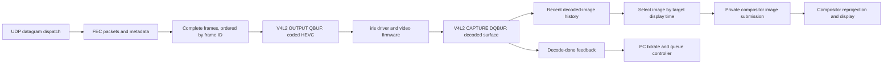

# Frame receiver, decoding and presentation map

Investigation date: 2026-10-13. This is an evidence map of the installed ARM64
receiver, not a claim that every instruction in Valve's stack has been recovered.
Addresses below are ELF virtual addresses before the runtime relocation base.

The principal result is that the receiver's reported decode time is **submission
completion to userspace capture completion**, and its reported “Submit
Illumination” timestamp is a **selected display target**. Neither is a direct
hardware execution or photon timestamp. These distinctions matter when deciding
which delays to override.

## Provenance and confidence

The analyzed `vrlink` SHA-256 is
`31addef0c9553d3770b5570487699e96d70271d4073cd6c03b080fdee6ae2153`.
The private IDA database is `artifacts/BitrateTrace/client.i64`; private extracts,
cross-references and instruction listings are in `artifacts/BitrateTrace/client/`.
The final byte comparison covered 220 extracted functions and found no differences
between those IDA function chunks and the corresponding input ELF bytes. This is
provenance validation, not evidence that every extracted function is understood.

The private compositor-client boundary was then traced in `vrclient.so`, SHA-256
`19b2b9a2b512eb2cb25f0de9c60c20c6b82c78f29384e2fcec4487c507a4e8b0`.
Read-only hashing of `/opt/steamvr/bin/linuxarm64/vrclient.so` on the paired Frame
matched the copied binary. The offline database is
`artifacts/Multistream/integration-research/frame-vrclient.so.i64`; 40 extracted
functions' instruction chunks matched the copied ELF with no differences.
Addresses explicitly labeled `vrclient` below belong to that second binary.

The compositor process itself was subsequently copied through the existing
paired SSH connection without changing the stream. Installed and local
`/opt/steamvr/bin/linuxarm64/vrcompositor` SHA-256 matched:
`0bb148eda6b5e54e2fbed09d475a43671f5ff6fcb6c2b4f48345b1a9fe8d6f96`.
The running compositor's executable link named that installed path. The new
offline database and private evidence are under
`artifacts/Multistream/integration-research/compositor-server/`; 138 extracted
function chunks matched the copied ELF with no differences. Addresses explicitly
labeled `compositor` below belong to this third binary.

“Verified” below means the call, condition, value or store is visible in those
instructions, often supported by Valve's embedded diagnostic names. “Inferred”
means a consequence of that flow rather than a directly observed hardware event.
The kernel/firmware and compositor boundaries are identified explicitly.
The initial static mapping and compositor trace collection made no live receiver,
network or SteamVR setting changes. Later explicitly identified experiments used
bounded receiver instruction leases and host workload/settings trials, with
restoration verified separately from performance results.
No proprietary binary or decompiled source is distributed with this document.

## The connected path

The shipping client creates **one** `SVLCodecV4L2` instance in renderer
initialization at `0x35B48`. It opens one video device descriptor, starts one media
thread, and decodes one packed HEVC elementary stream. Sixteen image surfaces,
sixteen transport receive slots, multiple transport links and encoder multipass
are different concepts; none establishes sixteen or multiple decoder sessions.

## Packet receive, repair and ordering

| Address | Verified role | State or limit that matters |
| --- | --- | --- |
| `0x41720` | Dispatches protocol messages; video type 5 goes to the FEC receiver. Video-description messages update clock/FEC information first. | Audio and control messages take separate branches. A negotiated FEC change is not a decoder count change. |
| `0x53EF8` | `AcceptVideoPacket`: chooses receive slot from frame ID modulo 16, initializes a new slot, dispatches description or data, and asks for repair of skipped preceding frames. | Its submitted/accepted-history duplicate check is conditional on the RX metadata flag. Failed buffer initialization sets an unrecoverable flag. |
| `0x52650` | Initializes a receive frame and acquires the codec's encoded-data buffer through the codec virtual interface. | Rejects expected size above 4 MiB. That allocation guard is not a per-second bitrate cap. |
| `0x52A78` | Accepts the video description and copies the 340-byte frame metadata; establishes the present-ID to transport-frame-ID mapping. | Metadata carries source pose, projections, geometry and target time needed by the renderer, not just coded video. |
| `0x533D0` | Deduplicates and copies 1024-byte coded chunks directly into the acquired input buffer; stores parity separately and invokes group recovery. | Data IDs are 0–2047; parity IDs occupy the following range through 4095. Unknown/out-of-range IDs are rejected. |
| `0x542D0` | Checks available data/parity for a group, reconstructs missing chunks, marks recovery and advances frame completion. | Repair needs the negotiated group geometry and enough independent chunks; parity cannot repair arbitrary loss. |
| `0x52BD0` | Builds retransmission requests from missing chunk IDs. | Timed retry requires roughly 4 ms since the previous retry. Collection aborts before a 513th missing ID; only afterward does the timed path truncate the outgoing request to 20 IDs. |
| `0x53D18` | Requests repair when a later frame exposes an entirely or partly missing earlier frame. | Frame-skip repair is distinct from the timed-retry path. |
| `0x53958` | `InternalAcceptFrameFromRX`: marks a complete frame, queues receive feedback and submits consecutively ready frames to the decoder. | A frame beyond the five-frame backtrack window sets a reset flag. An unresolved predecessor stops ordered submission. |
| `0x53E10` | Consumes an unrecoverable flag, asks the PC for an I-frame, flushes codec state and clears completed pointers/lengths and RX identities. | It retains the completed/submitted ID history arrays. This is a distinct interruption path before the decoder's 330/800 ms watchdog thresholds. |

The direct copy into a codec-acquired mapping avoids an additional full-frame copy
between FEC completion and decoder submission. It does not eliminate the packet
copy, FEC reconstruction, kernel work or codec queues.

Complete frame arrival is not enough to guarantee immediate decode submission:
ordering waits for preceding frames. Consequently the interval between receive
and decode-start feedback can expose a repair/order delay or a slow synchronous
submission call. In the current ordinary-frame measurements that interval is
small; occasional transport spikes remain a separate question.

The receive-feedback producer has one direct entry path:
`0x541E0` checks positive expected byte count and contiguous received-data index
at least `ceil(expectedBytes / 1024)`, then calls `0x53958`. This is assembled-frame
acceptance, including repaired data. Metadata need not have arrived: `0x533D0`
can learn the expected size from a short final data chunk. Acceptance queues
receive feedback before backtrack/order validation, moves the acquired data
pointer into the completed-frame table and clears the receive slot's pointer.
`0x52BD0` immediately returns for a null data pointer. A frame with receive
feedback but no host-recorded decode pair can be blocked on a predecessor,
rejected by backtrack, or already submitted and then flushed before completion
feedback. The host writes both start and end only when the completed-decode ACK
arrives. A zero host start field therefore does **not** prove that submission
never occurred.
A same-ID receive acknowledgement and later repair overflow require checking
identity, timestamps and slot reinitialization before asserting a race.

In the 2026-10-13 live normal-400 trial, the receiver logged a retransmission-list
overflow for transport frame 47646 at 20:33:45.213, followed by decoder reset
about one second later. The list-capacity branch aborts before the timed request's
20-ID truncation; it is not merely a 20-packet repair budget being exhausted.
The timed scan budget grows with inactivity since the last accepted chunk after
a 4 ms allowance, using 104 microseconds per additional scanned data position and
a parity scan delayed by another 20 positions. `0x533D0` refreshes both receive
slot offset 36 (last chunk) and 40 (retry gate) on packet acceptance; frame
initialization time is offset 32. This is not simply total frame age. New repair
packets therefore reset the inactivity allowance before the next timed batch.
Both timed and group-boundary paths can reach the
512-entry collection guard. These code facts identify the abort mechanism, not
the reason that this particular frame's missing list grew. The capture did not
retain raw remote receive timestamps needed to resolve whether frame 47646
completed after the reset; an earlier in-flight frame may also have been flushed.
Do not infer the ordering of receive, abort and reset solely from populated host
ring fields after the trial.

A subsequent 180-second capture instrumented only the two overflow destinations,
after the timer arithmetic and failure decision. It recorded a timed overflow for
frame 17326: 477,589 expected bytes, 467 data positions, 118 parity positions and
a collected count of 512. The preserved parity allowance register was 41,297,703,
so the preceding division result was 41,297,723. Reversing the integer division
by 104 and the subtraction of 4,000 identifies the sampled clock minus the
last-chunk clock used by that calculation as **between −104 and −1 microseconds**.
The receive timestamp read by the timer was newer than its sampled `now`.
Unsigned subtraction expanded that small negative interval into an enormous
scan allowance. This is direct evidence of a timer-underflow failure in this
captured event, rather than evidence that 512 packets had genuinely remained
lost for a long time. The later bitmap snapshot already contained 214 data and
48 parity positions, including IDs still in the collected request; packet
acceptance continued concurrently, so the fields are not one atomic snapshot.

The focused prototype changes the timer's unsigned multiply/logical
shift at `0x52EEC`/`0x52EF0` to signed multiply/arithmetic shift. For ordinary
nonnegative intervals it preserves the division result. For a negative or
too-young interval, the existing downstream tests skip both data and parity
scanning; the missing-metadata case can still request metadata alone. This
preserves the original request-capacity guard and addresses the observed
arithmetic fault before collection. Any live instruction change must also avoid
stopping a thread between this multiply and shift; attach/restore pauses are
excluded from performance comparisons. The observation establishes this failure
mechanism, not every earlier interruption or an overall radio throughput limit.

A loaded 150-second SteamVR Home trial subsequently exercised this exact
two-instruction change at a requested 400 Mbps. The active setup was HEVC Main10,
1664-pixel stream width, 90 Hz, CBR without filler, quarter-resolution multipass
and the existing quality offsets. It measured **306.255 Mbps of encoded payload
at 89.883 frames/s**. One-second encoded-payload samples ranged from 250.088 to
334.296 Mbps; this is not sustained 350 Mbps, 400 Mbps or constant-rate output.
The adaptive controller's sampled budget averaged 347.014 Mbps and ranged from
177.114 to 400 Mbps even with the 400 Mbps requested target.

The Frame Waterfall counter averaged 373.615 and reached a minimum of 307.980
in its binary-Mbps units, with no samples below 300 on that counter. Its unit and
accounting scope differ from encoded payload, so these numbers must not be
reported as 373.615 Mbps of encoded video. The receiver reported four
presentation timeouts and zero dropped frames. The isolated overflow-only
observer ran for 155.098 seconds and recorded no overflow events or trace drops;
its cleanup left the original tracing configuration intact. Zero events in this
short run does not establish the long-term failure rate or prove the fix removes
every reset cause.

The private per-thread ptrace backend bounded the first-interrupt-to-cleanup
interval at 4.016 ms when applying and 8.898 ms when restoring. These are
conservative stop-window bounds, including final status checks, not every
thread's exact pause time. Both original instructions and detachment were
verified afterward. The earlier GDB-based loaded trial incurred about 183 ms of
operation time and a subsequent reset/backtrack cascade; it cannot be treated as
an equivalent low-perturbation measurement. The successful short trial supports
the arithmetic hypothesis under a real workload while leaving the throughput
target unmet. Private evidence is retained as
`artifacts/RepairTrial/timer-trial-3-stream.json`,
`timer-trial-3-overflow.json` and `timer-trial-3-lease.json`.

The two-instruction experiment is not fully equivalent for arbitrarily old
slots: genuine unsigned inactivity of at least `2^31 + 4000` microseconds
(35 minutes 47.487648 seconds) also produces a negative numerator and skips data
and parity repair. Active sixteen-slot reuse is much faster, but the traced
retry walker does not enforce an explicit slot-age expiry. Decoder watchdogs
alone do not prove that every stale FEC slot is cleared across standby.
A permanent implementation should serialize timer state with packet acceptance,
snapshot the frame generation and both clocks before sampling `now`, validate
both unsigned deltas against the allowance, and retain the original request
bounds. Full-width clocks avoid inventing an idle-frame deadline merely to fix
this arithmetic; stale-frame/resume recovery remains a separate policy.
Snapshotting before the clock sample addresses the observed future-clock read;
without serialization it does not also solve every concurrent state change or
retry-clock overwrite. The short leased trial tests the arithmetic fix,
not this complete lifecycle design.

For a complete implementation, the serialization must include frame creation,
packet and metadata acceptance, FEC bitmap/reconstruction updates, completed-frame
handoff, reset and destruction. A mutex used only by the timer does not coordinate
the existing unmodified writers. A source-level implementation can snapshot a
stream epoch, slot generation, revision, clocks and repair bitmap under a shared
lock; sample the clock after that snapshot; build a bounded request from the copy;
then reacquire the same lock and reject any changed epoch/generation/revision.
At commit it must sample again, recheck age and gate eligibility, update the retry
clock and enqueue an owned request together. This prevents the timer from
overwriting a newer packet timestamp or emitting a request for a reused slot.
Later packets may make already queued requests redundant, which is different
from reading mutable frame state through an obsolete pointer.

Use full 64-bit monotonic time internally and truncate only where the wire format
requires it. Slot expiry also needs a clock that advances during suspend or an
explicit suspend/resume epoch; monotonic-raw timing alone does not account for
time spent suspended, whereas Linux `CLOCK_BOOTTIME` includes it
([clock semantics](https://man7.org/linux/man-pages/man2/clock_gettime.2.html)).
A maximum useful repair lifetime and the existing ordered
frame window should drive explicit expiry/resynchronization rather than allowing
old slots to re-enter the arithmetic after resume. The lifetime value remains a
policy to validate, not a newly established Valve constant.

This is feasible with ownership of the receiver source. In the current binary,
the small arithmetic patch is experimentally feasible, but a complete fix needs
more instructions plus synchronization and lifecycle instrumentation at every
relevant writer. The ownership audit below identifies an existing receive mutex,
but it currently omits the timed walk and one reset entry. There is no proven
spare object storage or code space, and no existing exported setting for this
transaction. A detour that only
resamples the clock can reduce the observed arithmetic race without proving slot
lifetime or retry-clock correctness. No production hook for the complete design
has been implemented.

### Owning lock, actual expiry checks and the permanent alternative

The ordinary Uber receive path does have a concrete owner: `0x48580` holds
**link +1112** while calling `0x47EE8` → `0x41720` → `0x53EF8`. It therefore
serializes normal frame initialization, packet and metadata handling,
reconstruction, progress repair, completion and in-packet reset. The per-slot
mutex at +16968 only protects metadata; initialization releases it before
writing the clocks and bitmap, so using that mutex for timed repair would not
coordinate the relevant writers.

The root event at `0x5B190` schedules its case-1 work approximately every
millisecond. It calls link maintenance, then calls FEC virtual +32 at
`0x5B448`, reaching `0x52890`. Maintenance only briefly uses +1112 and releases
it before this timer call. The sixteen-slot timer walk itself checks an
initialized ID and nonnull coded buffer, with no frame-age expiry.

There is also an uncovered reset entry: UDP receive error at `0x45FDC` calls
`0x471D8` → `0x41700` → FEC virtual +40 → `0x53E10`, outside +1112. A permanent
ownership repair must coordinate this entry as well as the timer. Locking inside
`0x53E10` unconditionally would recursively acquire the normal packet caller's
nonrecursive mutex. The legacy standalone UDP path also calls `0x41700`, so an
exact-build Uber shim must check the actual owner type and layout.

The 800 ms decoder watchdog is **not** a FEC expiry guarantee. `0x31940` is
called during certain buffer-acquisition failures and decoder-submission paths;
it is not an independently scheduled scan of incomplete slots. A metadata-known
1 KiB frame missing its one data and two parity chunks produces only three
requests and cannot trip the 512-entry guard. If control traffic continues but
no new video acquisition/submission occurs, the recovered checks allow that
active slot to survive beyond the signed arithmetic boundary. This is a static
counterexample, not a claim that this idle state occurred in the gameplay tests.
The boundary is per-frame inactivity, not the age of a healthy active session.

The smallest defensible complete design reuses the receive owner for timer and
error-reset state, loads a consistent identity/clock/bitmap snapshot before
sampling time, uses full-width last-chunk and retry clocks, and commits against
the same generation. With `chunkAge < 4000`, allowance is zero; otherwise use
unsigned 64-bit `(chunkAge - 4000) / 104`, bounded by real geometry. Preserve the
512-entry collection limit and 20-entry timed transmission limit. Full-width
time can continue bounded repair of an old active frame without selecting an
arbitrary expiration deadline or misclassifying it at 35 minutes.

Copied request descriptors should leave the receive lock before potentially
blocking send work. Existing progress repair already takes receive +1112 then
send-assembler +1224, but the assembler can sleep for its configured rate limiter.
Serializing an entire sixteen-slot timer walk would extend RX exclusion and
needs its own latency measurement. Read option 26 before entering the receive
lock to avoid introducing an extra option-cache lock order. Shutdown must stop
new timer callbacks and retire descriptors before FEC deletion; joining RX
threads while holding their required receive lock would be unsafe.

A clock-after-load trampoline with an unsigned age guard is a narrower useful
candidate, but repeated identity reads alone do not prevent reset between the
last check and retry-clock write. Nor does a 32-bit timestamp identify arbitrary
ages across a full wrap. No permanent binary shim is implemented. Fifteen new
offline lifetime/admission tests and the existing nineteen transaction tests
pass, including full-width repair without an artificial deadline, reset
generation rejection, and the concrete signed-age counterexample.

### A separate ordering failure and the reset cascade

A later 150-second Home trial with the signed timer repair and an experimental
matched 380 Mbps host budget averaged **327.442 Mbps of encoded video at 89.652
frames/s**. One-second encoded samples ranged from 301.451 to 337.090 Mbps.
Waterfall averaged 398.341 and reached a minimum of 355.663 in its separate
binary-Mbps accounting. There were six presentation timeouts and zero reported
dropped frames, but the receiver logged an ordering reset and four retransmission
overflows. It therefore did **not** pass as uninterrupted or constant-rate
streaming. The overflow-only observer recorded four progress/RX events and no
timed-overflow event; this is a different failure path from the clock underflow.

The saved remote receive timestamps resolve the first fault without assuming
host and receiver wall clocks are identical:

| Transport ID | Assembled receive, receiver time on 2026-10-13 | Relevant result |
| --- | --- | --- |
| 12384 | 21:35:17.402167 | Last clean submitted predecessor; ordinary 18.381 ms callback interval. |
| 12386 | 21:35:17.484660 | Complete, waiting behind missing 12385. |
| 12387 | 21:35:17.490139 | Complete, waiting behind missing 12385. |
| 12388 | 21:35:17.496474 | Complete, waiting behind missing 12385. |
| 12389 | 21:35:17.503705 | Complete, waiting behind missing 12385. |
| 12390 | 21:35:17.509601 | Six ahead of last submitted 12384; backtrack error logged three microseconds later. |
| 12385 | 21:35:17.524965 | Finally complete after 117.141 ms measured transport time, after the reset. |

`0x53958` queues the receive ACK and transfers the completed buffer before its
backtrack guard. Thus 12390 legitimately has receive feedback despite triggering
the reset. The four subsequent progress-overflow events occur at
21:35:17.510221–17.512056. Each captured slot again identifies frame 12390, but
has no metadata and a provisional expected size of 4 MiB. Each contains only one
late parity position: 2160, 2162, 2161 or 2163 respectively. These are repeated
reset/reinitialization states, not four independent large lost frames.

The exact progression is visible in the code. Recovery at `0x53E10` sets last
submitted to −1, flushes the codec, clears the completed-pointer and length
tables, and resets the sixteen RX identities/metadata flags. It does not clear
the completed-ID table at FEC offset 284 or submitted-ID table at 2336. At the
next packet, `0x53EF8` skips its history duplicate check because the metadata flag
is false. A late video payload then initializes that slot with the 4 MiB unknown-
size placeholder. A full-length parity chunk does not refine that size.

The first parity chunk belongs to progress group 7. With the captured data/parity
strides of 64/16, the retry builder requests metadata sentinel 65535, then 448
data positions and 112 parity positions for earlier groups: 561 possible entries.
It aborts while attempting entry 513, ID 2111. This exactly matches the captured
count, next-ID register and request head/tail. The oversized request is a
**consequence of the backtrack reset and provisional state**, not the cause of
the first interruption. The signed timer repair does not address this path.

The retained completed IDs also explain a second recovery hazard. Ordered
submission checks the ID, but does not first require a non-null completed
pointer, and it advances submission history even if the codec rejects the call.
A replay of the original five-frame logic predicts four empty submission
attempts when late 12385 drains the retained identities of 12386–12389. Four
empty-buffer errors were logged at 21:35:17.525031–17.525130. The errors do not
name those four frame IDs, so the individual identities remain a model-supported
attribution rather than a directly logged fact. Buffer-index mismatch errors
follow for 12390 and 12406.

The 1.004 ms callback interval reported for 12385 after reset is **not proof of a
successful 1 ms hardware decode or a displayed image**. It has no reported
selected display target and belongs to this recovery/empty-submission interval.
`0x32878` calls the decoded callback after successful CAPTURE dequeue without
checking the returned buffer's flags or plane payload length on that path.
Conversely, an empty submission error does not itself synthesize that callback:
its `0x3FA00` helper updates codec sequence state. Classifying the post-flush
dequeued output requires the returned buffer status and frame identity; the
current feedback pair alone is insufficient.

### A bounded window candidate, with explicit limits

Two instructions, rather than one, govern the relevant behavior:

| Address | Current behavior | Bounded candidate |
| --- | --- | --- |
| `0x53A4C`, branch at `0x53A50` | Compare unsigned 16-bit distance from last submitted against 5; reject greater. | Compare against 6. |
| `0x53A70` | Set the exclusive forward-drain end to incoming frame ID + 5, modulo 128. | Set that end to incoming frame ID + 6. |

Changing only the guard accepts 12390, but when 12385 arrives the old exclusive
drain end is 12390: that last completed frame waits for another completion to
invoke the drain. Changing both constants to six submits 12385 through 12390 in
order in the fixed-arrival replay. A seven/seven replay also succeeds, but this
event does not require that additional allowance. No live window change was
made for this analysis.

The host's remaining `Q > 6` admission rule explains why the sixth future frame
can enter this pipeline. Host `0x1809ECD40` calls admission before the current
encoder submission and TX-ID allocation. In the direct case with no pending
encoder work, Q = next TX ID − last decoded ACK, so Q = 6 admits the frame six
ahead, then advances the next-ID cursor. That is consistent with 12390 versus
12384. However, the value excludes encoder work not yet handed to FEC, and the
host's last decoded ACK differs from the receiver's last submitted ID. This is
not a proof that every stream's maximum distance is six, or that seven is a
complete bound. See the [host map](host-stream-map.md) for that admission path.

The six-ID cohort fits six distinct entries of the sixteen RX slots and
sixteen per-frame codec mappings, including 16-bit rollover. Completed history
and pointers have 128 entries. No five-element allocation was found along this
path, and the strict successor-ID test remains unchanged. Fourteen offline
checks cover the observed replay, both ring and ID rollover, duplicate and older
IDs, a missing middle frame, exact and exceeded limits, and the overflow request
geometry. These establish bounded control-flow behavior, **not sufficient live
codec capacity**. Each assembling or completed-but-unsubmitted frame already
owns an input buffer; queued older inputs also consume the actual V4L2 pool
until OUTPUT dequeue. The client requests sixteen inputs but honors the driver's
returned count. Accepted count, state occupancy and pending host work must be
observed before treating the candidate as safe under load.

Extra allowed future frames do not introduce mandatory steady-state buffering:
ready successors are still submitted immediately. Under loss, however, the
receiver retains more work while waiting, then can submit a burst of stale
pictures. Its separate renderer rejects images more than five decode completions
behind the newest. Avoiding a reset therefore does not imply every queued image
will be displayed, or eliminate the original 117 ms transport delay. The host's
sixteen-frame retransmission cache still retained 12385 at this point; host
request arrival/send timestamps and receiver chunk arrivals are needed to
partition the 44.419 ms between the 49-packet retry log and completed repair.

A live implementation needs exact-build checks, coordinated changes to both
instructions, short all-thread stop windows, known-word rollback and verified
detachment. Forward application from five/five to six/six is monotonic under
fully stopped writes and instruction-cache synchronization: an already executed
comparison retains flags from the stricter five-frame guard, while its subsequent
drain uses either a previously consumed five or the new six. A comparison first
executed after resume sees six, and its later drain instruction also sees six.
Thus no enlarged mixed bound requires stack unwinding just for forward apply.
An old guard may already have decided to reject a sixth frame, however, and an
old drain end may defer the last completed frame until another arrival. Exclude
settling from the measurement and reject continuing faults.

An invocation can be inside metadata helper `0x538A0` between consuming the
guard and drain limits; its return address is `0x53BAC`. The other helper on this
branch, `0x3FA20`, returns to `0x53BC4`. A strict single-version-invocation check
would need to include this call/return state, rather than just the two modified
PCs. Restoring six/six to five/five is different: a sixth buffered frame can be
stranded or cause the old guard to reset at the next completion. The restoration
lease must still restore the originals; a controlled reconnect outside the
measurement is an explicit recovery policy. A prior quiet sample cannot promise
seamless restoration. These are transition constraints, not a claim that a live
window trial has already passed.

Separate, narrow recovery changes deserve evaluation:

- While metadata and real frame extent are unknown, the progress path can request
  only its existing metadata sentinel instead of scanning the provisional 4 MiB.
  The sentinel is already inserted at `0x52C1C`; the common request emitter starts
  at `0x52D20`. Preserve the timed path's 4 ms gate and arrange repeated metadata
  requests/expiry if the reply is lost. A blanket early branch for every
  metadata-missing call would bypass that gate and is not the proposed change.
  Metadata acceptance at `0x52A78` supplies real size and resumes completion;
  ordinary packet/group or timed repair must resume afterward. A short final
  data chunk can also reveal real size before metadata, so metadata absence and
  unknown extent should be distinguished. This mitigates the secondary cascade;
  it does not fix the first ordering reset.
- Make reset identity, buffer ownership and submission history agree. Merely
  advancing over a null buffer can invalidate inter-frame decoding. A coherent
  reset/resynchronization epoch is required.
- A payload-only duplicate-history check independent of the metadata flag could
  stop late parity recreating an already completed frame. Preserve acceptance of
  genuinely missing metadata, which carries pose/projection information, and
  validate history lifetime and ID rollover before changing the check.

The subsequent cumulative socket-drop count does not attribute this earlier
event. Future capture needs interval drop deltas and repair timing; interface
drop counters alone do not cover socket receive-queue drops. Overflow or receiver
fault logs invalidate a smoothness pass even when average Mbps and the dropped-
frame counter look good. Private evidence and the offline replay are retained
under `artifacts/RepairTrial/coherent380-matched-3-*`,
`backtrack_replay.py`, `test_backtrack_replay.py`,
`backtrack-replay-summary.json` and `backtrack-window-design.md`.

The link publishes `cRXpass`, `cRXerr` and `cRXpps` about once per second at
`0x42618`. Assembly at `0x427F8` compares incoming and previous packet sequence,
masks the difference to the sequence width, caps the accounted gap at 1,000, and
adds the implied missing packets to link offset 76 and cumulative RX errors at
offset 116. Offset 72 accounts for the sequence advance. `cRXpass` is
`100 × (counter72 − counter76) / counter72`, a sequence-gap success measure before
FEC, not a percentage of successfully decoded frames. `0x42F98` can also add an
explicit RX-error count to the missing/error counters. Video
descriptions independently advertise FEC configuration in byte 21, consumed by
`0x41720`. Review of every direct cross-reference to client option registration
`0x616C8` and option getter `0x60950` found no explicit option 31 or 36 consumer.
That bounded negative result does not establish what indirect consumers or other
builds do. A host control being serialized is not proof that this receiver applies
it, and a FEC mode name is not proof that all parity has been removed.

## Decoder and buffer ownership

| Address | Verified operation |
| --- | --- |
| `0x35B48` | Allocates one codec object and initializes it before starting the renderer thread. Requires `IVRClientInternal_XXX`. |
| `0x33248` | Resolves `vrdevice_path video_decode`, opens the device, requests display-delay enable and a delay of zero, subscribes to source-change events, enables OUTPUT and registers the device with epoll. |
| `0x32E38` | Configures coded OUTPUT with HEVC, initial dimensions 1536×6144, requests 16 MMAP input buffers, queries and maps returned buffers. The initial dimensions are not a fixed stream-resolution ceiling. |
| `0x31B00` | Acquires a free coded buffer, changing its state from free (0) to acquired (1); records its index against frame ID modulo 16. |
| `0x31CC0` | Validates that mapping, sets compressed byte count and frame identity, calls OUTPUT `VIDIOC_QBUF`, then marks the input queued (2). |
| `0x32878` | Media thread: blocks in epoll, processes source changes and dequeues OUTPUT/CAPTURE independently. OUTPUT completion frees the coded buffer; CAPTURE completion identifies a decoded image and invokes the renderer callback. |
| `0x32328` | On source change, negotiates capture dimensions/format, requests 16 CAPTURE DMA-buffer slots and initializes corresponding renderer surfaces. Uses Qualcomm compressed 8-bit/10-bit layouts. |
| `0x34740`, `0x342D0` | Create a 16-image renderer pool, allocate Vulkan backing, export DMA-buffer descriptors and register shared textures with the private compositor interface. |
| `0x31040` | Queues a decoded destination surface to CAPTURE, marks its state queued (2), and increments the available queued-destination count. |
| `0x311B0`, `0x31230` | Recycle the oldest completed destination when the queued-destination count falls to four or fewer, topping the queue up to five. |

Startup queues the initially allocated capture surfaces. After enough completions,
the refill policy maintains five queued destinations while retaining recent
completed surfaces for image selection. Those five destinations are **not five
coded frames waiting to decode**. The actual amount of submitted-but-incomplete
video must be measured independently. Reducing allocation or refill counts without
understanding reference-picture and compositor ownership can cause starvation or
overwrite a surface still being consumed.

### Read-only observation of the accepted buffer pools

The private `receiver_queue_observer` reads the actual populated buffer vectors
without attaching a debugger, stopping threads, injecting probes, sending
signals or issuing ioctls. It verifies the explicit PID/starttime, exact receiver
ELF hash and all mapped executable backing files, then locates the codec in a
bounded heap scan. The codec, renderer, client and FEC pointers must form the
expected bidirectional graph, with matching vtables and a real video descriptor.
The first successful observation identified `/dev/video22` in receiver PID 155281,
starttime 1115410.

The actual OUTPUT count is `(codec[144] - codec[136]) / 8`; CAPTURE count is
`(codec[240] - codec[232]) / 8`. These populated vectors follow the driver's
returned allocation count in `0x32E38` and `0x32328`, rather than merely showing
the request for sixteen buffers or vector capacity. Coded-input states are free
(0), acquired (1) and queued (2). CAPTURE state 0 means not queued to the decoder;
it can be a decoded image retained for rendering and must not be called a free
display surface. State 2 means queued. The independently maintained capture
queued counter at codec offset 256 is checked against these records.

An initial two-second, 10 Hz smoke capture contained twenty samples, of which
six passed repeated-value consistency checks. Those six showed actual pools of
**sixteen OUTPUT and sixteen CAPTURE buffers**, with thirteen free coded inputs,
two acquired inputs, one queued input and five queued capture destinations.
They showed at most one frame ahead of last submitted and no FEC fault. One
acquired input, index 0, had no current RX/completed-pointer or frame-map
attribution in those samples. The other acquired input belonged to the current
assembling frame. This is an unattributed acquisition to follow across fresh
sessions, not sufficient evidence of a leak.

Samples remain non-atomic: the receiver runs throughout. The observer repeats
codec/FEC state and buffer reads, excludes visibly changing samples from its
occupancy histogram and retains the raw diagnostic rows. Equal repeated values
still cannot exclude an intervening ABA transition. The initial maximum read
duration was 9.313 ms. Subsequent implementation replaced linear map searches
with binary searches and coalesced nearby allocator records into bounded reads;
its narrow gate omits RX-header clocks. Prefer a bounded 2 Hz full capture to
avoid making queue observation a significant competing workload.

The narrow pre-trial gate requests two consecutive consistent samples within
two seconds at 2 Hz. Its conservative experimental conditions are actual pools
of sixteen, at least eight free coded inputs, at most two acquired and four
queued inputs, at least four queued capture destinations with agreeing counter,
no FEC fault/shutdown, valid last submitted, and no live completed frame more than
five ahead or forward completed identity with a missing buffer. These thresholds
are trial policy, not recovered Valve constants. The gate does not sample all
RX-header-only distances and cannot establish atomic readiness for a later
patch. Fresh identity checks and the codec's allocation/ownership checks remain
necessary. Private implementation, thirteen parser/policy tests and the original
smoke evidence are under `artifacts/RepairTrial/receiver_queue_observer*` and
`receiver-queue-smoke.json`.

After a controlled reconnect, the gate successfully sampled receiver PID 156040,
starttime 1238896. Both samples were repeat-consistent: sixteen buffers in each
pool, fourteen free coded inputs, one acquired, one queued, five queued capture
destinations, no completed frame waiting and no FEC fault. The two read durations
were 0.641 and 0.931 ms; the gate finished after 0.501 seconds. Process identity,
mapped backing files, object graph, original timer/window words and zero tracer
PIDs were verified. This is evidence of sampled pre-trial headroom and lower
observer cost, not a result of the subsequent window trial. The artifact is
`artifacts/RepairTrial/coherent380-window6-1-receiver-gate.json`.

The media thread's successful CAPTURE dequeue records the returned frame identity,
updates the completion sequence, decrements queued destinations, updates watchdog
progress and then calls `DecodeDoneHandler`. The coded OUTPUT dequeue is an
independent event and does not mean that a decoded picture was presented.

The current client **requests** display-delay enable and delay zero; accepted
state differs. During the live reset at 2026-10-13 20:33:46.257, the driver rejected
both `DISPLAY_DELAY_ENABLE` and `DISPLAY_DELAY` with `EINVAL`. Therefore the
initialization code is not evidence that a zero-delay hardware mode was enabled.

The driver below this boundary is the installed Qualcomm `iris` V4L2 driver. Prior
capability and module analysis established H.264/HEVC/VP9 exposure and no installed
AV1 format selection; see [the codec investigation](../encoder-and-codec-research.md).
The client analysis here does not identify exact firmware scheduling time, hardware
engine occupancy or the time a picture first becomes ready inside the kernel.

## What the timing feedback measures

The receiver clock helper `0x39028` uses `CLOCK_MONOTONIC_RAW`, converted to
microseconds. Wire fields are 32-bit, so interval calculations need wrap handling.
Compare remote events to remote events; cross-machine values need the protocol's
clock conversion. `0x5AC60` updates clock/latency estimates, and `0x5AE28` converts
host metadata targets to the receiver clock.

| Reported event | Exact producer | What it does and does not measure |
| --- | --- | --- |
| Receive | `0x53958` obtains the clock and queues it through `0x432F8` before frame ordering/submission. | A complete frame accepted by FEC. It is not the first arriving packet or a radio receive timestamp. |
| Decode Start (remote) | After the codec virtual submit call returns, `0x53958` obtains the clock and stores it with `0x41950`. The actual implementation is `0x31CC0`. | Post-submission timestamp. The coded `VIDIOC_QBUF` call and preceding ordering work have already happened. The caller stamps it even if submission returns failure; correlate with matching completions and errors. |
| Decode End (remote) | `0x34EB0` obtains the clock inside `DecodeDoneHandler`, entered by `0x32878` after CAPTURE dequeue and bookkeeping. | Userspace output callback. For ordinary valid outputs, includes queue residence, firmware/driver work, epoll wakeup and scheduling after submission. This path does not validate dequeued buffer flags/payload length; recovery callbacks need separate qualification. It is not a direct hardware duration or proof of display. |
| Submit Illumination | Renderer `0x35B40` computes a display target from private compositor timing and passes it to `0x43788` before image submission. `vrclient` `0x1CAB50` identifies its source as next-scanout illumination. | Predicted/selected display target. Despite the CSV label, it is not an observed submit, panel illumination or photon timestamp. |
| DecodeQuery | The renderer passes `t[1]` from the timing query to `0x43788`; `vrclient` reads it from shared offset 53076, written by compositor `0x147018`. | Scheduled compositor running-start time. It is neither a decode event nor the observed time the query returned. |
| Predicted Display | Host's original frame metadata target. The receiver uses metadata offset 224 when choosing the decoded image. | The original scheduling target, distinct from the receiver's selected display target. |

### Display-target evidence

At `0x35510` the renderer samples its microsecond clock, then calls
`IVRClientInternal_XXX` vtable offset 464 at `0x35530`. For the returned 64-bit
timing array `t`, it derives:

- selected target: `now_us + (t[3] - t[0]) / 1000`, clamped to `now_us` if
  `t[3] <= t[0]`;
- scheduled running-start time: `now_us + (t[1] - t[0]) / 1000`;
- display interval argument: `t[2] / 1000`.

At `0x35974` it queues these targets with `0x43788`. Its own diagnostic compares
target minus query and target minus decode completion. Actual `SubmitImage`
(`0x34A08`) comes afterward. The matching `vrclient` implementation resolves the
prediction further: private slot 464 calls `0x1CAB50`, whose diagnostic names
`t[3]` as next-scanout illumination and `t[2]` as scanout interval. It computes
`t[3]` from a scanout base, illumination offset and a frame-index difference.
`WaitGetPoses` at `vrclient` `0x1CB280` copies these inputs from compositor shared
memory into the client object; the timing query does not measure a new scanout.

`t[1]` is converted from the shared-memory double at offset 53076. Compositor
`0x147018` writes that from its signal-thread object's offset 104. `UpdateAsync`
(`0x14D248`) calculates this scheduling value; the signal thread (`0x147570`)
explicitly waits until it under its running-start scope, then predicts/publishes
poses. In the active texture-set-owner branch, the value is the app-data target
minus 2 ms. Other branches account for prior work and synchronization. It is a
scheduled running-start value, even if the thread actually wakes later.
`t[0]` is the query's sampled monotonic-raw clock. The code converts compositor
absolute seconds into that clock domain before `vrlink` converts returned deltas
into its own microseconds.

`0x41960` serializes feedback. Packet offsets 8/12 carry decode-end/receive,
offset 20 carries selected display target, offset 28 scheduled running-start time,
and offset 40 decode-start. IDs accompany separate event groups. The host
`0x1809DF5F0` maps packet offset 20 into frame-ring DWORD 25 (remote) and DWORD 10
(host clock); packet offset 28 becomes DWORD 26 and DWORD 12. Thus a positive
“Submit Illumination minus Predicted Display” measures a difference between display
targets. It is **not evidence of submission after a deadline**. Missing such
feedback also does not by itself prove that the panel failed to present a frame.

### Decode feedback also controls the sender

The verified chain is:

`0x32878` CAPTURE dequeue → `0x34EB0` callback → `0x43540` decode-done queue →
`0x41960` feedback packing → `0x269B0` pose/control send → PC feedback processing
at `0x180A4A510` and timestamp mapping at `0x1809DF5F0`.

`0x43540` uses metadata to translate a present ID back to the transport frame ID.
The receive/decode/display feedback queues are bounded: insertion clears an
oversized queue above 64 entries; serialization removes one older entry when more
than one is present and retains the final entry for repeated reporting. A 64-entry
timestamp ring holds decode starts. These histories are not decoder capacity.
The host timestamp handler `0x1809DF5F0` consumes decode start (packet offset 40)
and end (offset 8) together under the completed-decode frame ID. As a result,
host-side intervals exclude submitted frames whose completion ACK was lost,
superseded or prevented by a decoder reset.

Because decode completion reaches the PC through feedback, delayed receiver work
can reduce the sender's bandwidth budget even if Wi-Fi has spare capacity. This
is a causal connection established by the code. Determining which receiver stage
caused a particular delay still requires measurements.

The current normal 400-Mbps-target/1664-width Home observation reported roughly
17 ms median post-submit-to-callback latency while delivering about 90 encoded
frames/s. These are compatible: multiple frames can be in flight simultaneously.
An event sweep of 2,774 matched remote start/end pairs over a clipped 28.83-second
interval measured a mean 1.6145 submitted-but-incomplete frames among frames with
received completion feedback: one frame for
39.7% of the interval, two for 58.5%, three for 1.45% and four for 0.068%.
This is reconstructed post-QBUF-return to callback occupancy, not the count of
hardware engines executing simultaneously. It omits unacknowledged or flushed
in-flight frames, but demonstrates overlap among completed frames within the
existing single decoder session. The measurements and their limitations are in the
[dated live investigation](../encoder-and-codec-research.md).

## Image selection, foveation and compositor handoff

`0x34EB0` looks up matching frame metadata, queues decode feedback and stores frame
ID, callback time and a monotonically increasing completion sequence in the
corresponding decoded-surface record. The renderer is a separate thread.

The render loop (`0x35B40`, with its main body at `0x353C8`) calls public
`IVRCompositor_029::WaitGetPoses`, then queries the private compositor timing.
Its feature-dependent paths are:

- For the root generation field at offset 31800 at most eight, `0x35040` selects
  the newest eligible completed image. Its writer is `0x298A8`, which stores the
  peer's bookend/control DWORD at offset 32. Other thresholds enable pose and
  control-path features; this is an advertised feature-generation level, not an
  independent latency setting. It must not be confused with strict wire protocol
  version 10, which is checked separately on the host.
- Above eight, `0x35150` (`GetBestImage`) scans the 16 surfaces. It excludes images
  older than the previously selected completion sequence, more than five decode
  completions behind the newest, missing valid metadata, or excluded by the
  codec's recovery frame-ID filter (`0x3F9C0`).
- It chooses the eligible image whose host metadata target, converted to the
  receiver clock, is nearest the upcoming compositor display target. If the best
  image's target lies more than half a display interval in the future, it submits
  no new image on that iteration. It does not blindly show the newest completion.

`0x34A08` validates the packed geometry and accepts spatial encoding mode 2. It
derives per-eye texture bounds and gaze-region rectangles from packed dimensions
and per-frame metadata, preserving pose and projection matrices. It calls the
private interface at vtable offset 320 with the selected texture and the pool's
16 registered texture handles, then public `PostPresentHandoff`.

The private interface is resolved in the current `vrclient.so`, extending the map
beyond the receiver executable. Constructor `vrclient` `0x1B9438` registers
`IVRClientInternal_XXX` at object offset 24 using vtable `0x6174E8`:

| Interface slot | Current implementation | Verified operation |
| --- | --- | --- |
| 40 | `0x1C31A8` | Returns the IPC resource-manager interface, backed by vtable `0x620ED0`. |
| 320 | `0x1B4870` → `0x1B46A0` → `0x1C8700` | `SubmitTextureSetInfo`: validates index/count, per-eye descriptors and bounds; publishes the selected index, up to 16 texture handles, poses and target information to compositor shared memory. |
| 464 | `0x1B44D0` → `0x1B44C0` → `0x1CAB50` | Returns the predicted scanout timing described above. |
| 480 | `0x1B44E8` → `0x1B44D8` → `0x1D3918` | Registers/initializes the Vulkan device context used by compositor-client GPU timing and shared textures. |
| 568 | `0x1B51A8` → `0x1B5130` | Writes the current monotonic-raw nanosecond clock into shared memory at offset 50212 under the mapping lock. It does not wait for scanout or GPU completion. |

Slot 568 is called both from the receiver's decode-done path and from its render
path before submission. Its shared timestamp is overwritten by both; observing
that value alone cannot distinguish a decoded frame from a submitted frame.

The shared-resource interface's slot 56 resolves to `vrclient` `0x362178`. It
duplicates the image-plane descriptors, sends them through the shared-FD channel,
serializes image/plane metadata and performs IPC request 565 to obtain a shared
texture handle. Slot 24 (`0x362CE8`) references the resource through IPC request
551. This proves cross-process DMA-buffer resource sharing. It does not by itself
prove the exact downstream acquire/release fence behavior.

`SubmitTextureSetInfo` at `0x1C8700` requires the expected scene-focus process,
copies the submitted texture set and per-eye matrices, serializes composition data
through `0x1D07A0`, then signals the compositor event. It subsequently calls
`0x1C8020` to collect timing and publish frame bookkeeping. Thus shared-memory
publication/signaling and subsequent client return are separate observable
points; neither is the selected illumination target sent to the PC.

### GPU synchronization that can affect the renderer thread

The called timing collector `vrclient` `0x1D0428` checks for a timeline semaphore
and, when present, waits for the last-signaled frame index with a 100 ms timeout.
It then invokes `0x33F370`, which retrieves GPU query-pool results and retries a
not-ready result. This is a concrete conditional wait after submission signaling,
outside the receiver's decode-start/end interval. The code establishes a possible
renderer delay; no live observation yet establishes that it waits significantly
in the measured stream.

The shared-texture implementation allocates/recycles command buffers in
`0x1D2780`, obtains reusable fences through `0x1D0EC0`, and checks completed fences
before recycling associated command-buffer state. `0x1D2C58` finishes and submits
the command buffer with its fence and any configured binary/timeline semaphores;
an optional synchronous branch waits up to 100 ms and reports a GPU timeout.
`WaitGetPoses` can generate GPU-timing command buffers through `0x1D3A50` and
`0x1D31D8`. These findings identify concrete synchronization operations rather
than inferring an active path from generic Vulkan loader strings.

### Compositor consumption and the display boundary

The current compositor closes the shared-memory handoff at `0x7E290`, identified
by its `UpdateCachedTextures` scope. It waits for the new-texture-set event when
configured, locks the shared mapping, compares texture-set owner 53128 against
scene-focus owner 1076, clears the set if they differ, and copies the 2,936-byte
set into local state. It reads the selected index at 53132 and imports/updates the
16 handles beginning at 53136. The helper `0x24E708` releases the prior cached
texture wrapper when a handle changes and asks the renderer to import the new
one; unchanged handles reuse the cache. The per-eye composition data is copied
into a renderer buffer and the selected texture is bound. This is the concrete
consumer of `vrclient`'s submitted index, poses, transforms and texture handles.

The Vulkan importer `0x2BC868` resolves a shared image, caches its handle, creates
the image view and records the imported resource object. Cache reference release
is not equivalent to releasing a surface to the V4L2 decoder on every frame. The
compositor has additional conditional synchronization: `AcquireSync` (`0x71600`
→ `0x2BE0A0`) opens named client/compositor sync objects, imports their shared
semaphores, and queues a Vulkan wait; `ReleaseSync` (`0x75EA0` → `0x2BDE90`)
queues the corresponding signal and signals the shared event when that acquire
state is active. The available code does not establish that this optional global
sync path is the ownership guard for every decoded DMA-buffer slot. A verified
per-surface release-to-CAPTURE relationship remains a stopping point.

`Present` at compositor `0x8C620` calls `UpdateCachedTextures`, performs the
configured GPU synchronization, then dispatches to the display backend. For the
Vulkan swapchain branch, `0x811D8` → `0x2C6870` hands rendered work and semaphores
to the HMD window. `CHmdWindowVulkanWSI` at `0xB5650` increments the present ID,
builds the Vulkan present request and calls `vkQueuePresentKHR`. This active
backend is supported by the current startup log and by live markers from
compositor PID 2540: texture indices 4 and 5 were consumed, followed respectively
by Vulkan present IDs 546005 and 546006. These are observed queue submissions,
not observed photons.

The compositor's `WaitForPresent` (`0x80730`) calls the renderer/backend wait and
queries the latest vblank/frame counter through `0x759A8`. The Vulkan WSI wait
(`0xB5F60`) can call `vkWaitForPresentKHR` for the current present ID with a 15 ms
timeout, or use its configured presentation worker and timing fallback.
`0x2BDCD8` also contains the renderer's fence-based fallback when the HMD window
does not support presentation waiting. These are distinct completion semantics;
a queue-present call, a GPU fence and a vblank estimate must not be collapsed into
one display timestamp. The remaining exact presentation boundary is the Vulkan
WSI/Mesa and kernel display implementation, plus panel illumination timing. This
map does not claim an optical latency measurement.

### Existing observability, with a bounded live check

No hooks are required for the first measurement. In `vrclient`, scope begin/end
helpers `0x250870`/`0x250958` route through `0x2506B0` and `0x250398` to the kernel's
existing `trace_marker`. They emit a context ID, thread/process identity, source
site and detail string. The outer `GetFrameTiming` scope encloses the whole
collector; its nested scope contains the semaphore-wait detail when that branch
runs. `WaitGetPoses`, decode callbacks, image selection, texture-set submission,
compositor texture consumption and Vulkan queue-present markers also exist.

The paired Frame already had tracing enabled with the `nop` tracer, local clock
and a small per-CPU buffer. A 20.01-second check collected 80 non-consuming
`trace` snapshots at four per second, without changing the tracer, buffer or
stream and without reading `trace_pipe`. It deduplicated 859 selected markers
from one persistent receiver process (PID 99487):

| Scope | Complete same-CPU pairs | Observed median | Observed maximum | Coverage caveat |
| --- | ---: | ---: | ---: | --- |
| `GetFrameTiming` | 79 | 2 microseconds | 4 microseconds | One unmatched end excluded; no nested semaphore-wait markers. |
| `WaitGetPoses` | 26 | 11.052 ms | 11.330 ms | 55 missing begins, 58 missing ends and one cross-CPU pair excluded. |
| `DecodeDoneHandler` | 68 across two media-thread IDs | About 6 microseconds | 65 microseconds | Five unmatched ends excluded; these are callback bodies, not whole decoder intervals. |

These are sampled retained windows, not a continuous latency distribution. The
local trace clock warrants excluding cross-CPU pairs; missing boundaries are not
long waits. The observation rules out a significant GPU-timing wait in the
79 complete sampled calls, while leaving rare unsampled stalls unclassified.
It also distinguishes the expected roughly 11 ms pose synchronization from the
reported decode interval and predicted display lead.

Private raw samples and reproducible parsing are saved with
`trace-sample-20261013-203430.json` and its summary beneath the compositor evidence
directory. Further observation can use the same existing markers with frame IDs,
texture handles and present IDs. Increasing capture coverage would need a
separately bounded tracing plan; no such changes were made for this map.

This explains why changing packed image layout or layering a second output image
cannot be treated as a transport-only modification. Both eyes' frame identity,
source pose, projections, gaze rectangles and surface lifetime have to agree with
the compositor. The independent prototype's source explicitly describes itself
as separate from Valve's decoder/protocol; see
[`Frame/Multistream/receiver.cpp`](../../Frame/Multistream/receiver.cpp).

## Controls and where an override would act

| Control or candidate | Verified scope | Status and next validation |
| --- | --- | --- |
| Stream width, 8/10-bit mode, encoded bitrate | Changes incoming coded workload; source change configures capture surfaces accordingly. | Available host-side controls. Check actual encoded dimensions and rate, completion latency and presentation behavior together. |
| `vrlink.targetPhaseInFrame` | Receiver float read at `0x2ACB8`; constructor default approximately 0.7. | Existing setting consumer, not a tested tuning recommendation. A receiver restart/settings reread and accepted-state observation are needed for a controlled trial. |
| Internal `sFramePhase` / `cFramePhase` | Main loop `0x29EA0` prefers `sFramePhase` when present, otherwise `cFramePhase`, and updates the active phase. | Internal numeric-map keys, not interchangeable with ordinary OpenVR setting names. A server override can supersede the local value. |
| Decode-completion phase correction | `0x27F60` computes desired phase×frame interval minus elapsed time since frame sync; `0x27E28` wraps/updates standoff. `0x29EA0` and `0x27110` schedule subsequent pose/control sends. | Candidate for input/frame synchronization work. It is not a hardware decode-speed control or a display-delay setting. |
| Hardware display delay | `0x33248` requests enable=true and delay=0. | Both controls were rejected with `EINVAL` in the current live reset. No confirmed zero-delay override is established by these calls. |
| Input/capture buffer counts | Requests 16 each; renderer pool is also fixed at 16; steady refill threshold is five queued capture destinations. | Constants with several ownership dependencies, not independent safe sliders. Count occupied coded inputs before changing pool sizes. |
| Decoder reset/flush | Flush `0x313A8`; hard reset `0x33810`; “soft” reset `0x30CC0` invokes hard reset. | Recovery actions, not throughput controls. A reset requests an I-frame and changes decoder state. |
| Watchdog thresholds | `0x31940`: checks both last OUTPUT and CAPTURE progress; asks for an I-frame after 330 ms, rate-limits requests to roughly 100 ms, resets after 800 ms. | The “300ms” log is rounded. Lower thresholds may amplify keyframe/reset bursts rather than cure the cause. |
| Decoder sessions | Exactly one allocated by stock renderer initialization. | No stock multi-decoder selector found on this path. Requires a new stream/session layout and coordinated reconstruction, not merely a buffer-count increase. |
| Relative FOV map key `dRelFOV` | Renderer reads it, divides by 100, default 1.0, and passes a scale to image submission. | Does not independently expand the encoded gaze region or add quality. Full compositor effect should be validated before labeling it a quality control. |

The phase path has a concrete effect: `0x27110` schedules four pose/control events
separated by one quarter of the frame interval, plus another event 500 μs after
the base time. A complete scheduling override must preserve this relationship
and the host's time conversion; changing just one timestamp can create poor image
selection even when bytes arrive promptly.

### Unattended measurements require active headset tracking

Compositor rendering, screen power and tracking-driver activity are separate
states. During the first bounded retransmission-timer trial, the stream kept
reporting roughly 90 frames/s but encoded only about 0.9 Mbps. The moving native
test scene reported successful submissions and invalid real head poses. Changing
host fade controls did not restore the scene. Frame's own `vrserver.txt` recorded
device 0 entering standby at 20:57:02 on 2026-10-13, following tracking-world changes
and an IMU fallback transition. That trial cannot establish performance under the
earlier roughly 323 Mbps Home workload, even though its patch restoration was
verified.

The installed Steam UI supplies a legitimate activity extension through its
existing native interface. In the paired Frame's
`/home/steamos/.local/share/Steam/steamui/sp.js`, the VR-dialog effect at character
offset 11324793 invokes `SteamClient.OpenVR.ExtendActivityTimeout(0, 60)` and its
cleanup invokes `SteamClient.OpenVR.ExtendActivityTimeout(0, 0)`. This is the
observed HMD/device-0 activity-extension call, using a 60-second request and a
zero-duration cleanup. The native binding exposes no JavaScript parameter names;
the installed call pattern and live effect are evidence here, rather than a claim
to have recovered every native timeout/arbitration rule.

A bounded host-side lease repeated the 60-second request every 25 seconds for up
to 240 seconds, with the zero-duration call in cleanup. The driver log independently
records device 0 leaving standby at 21:06:24.229 and entering `StateNormal` at
21:06:24.285. Real poses began returning, and the same synthetic moving scene's
encoded output rose from about 0.9 to 245 Mbps. This validates an unattended wake
mechanism for this installed build; the 245 Mbps observation belongs to the
synthetic scene and is not a controlled comparison with SteamVR Home.

Activity extension does not synthesize a pose or guarantee physical tracking.
Tests must still check real pose validity and visible moving content, because
tracking-world resets, obscured cameras or an unsuitable environment can leave
the driver awake without a usable pose. Disabling `power.pauseCompositorOnStandby`
or extending screen-off time alone does not establish that the tracking driver
is awake. Preserve a bounded lease and cleanup instead of permanently changing
power behavior. Private source-call evidence and the read-only driver-log
snapshot are saved as `artifacts/RepairTrial/frame-wake-api-details.json` and
`artifacts/RepairTrial/frame-wake-after.json`.

## Multiple decoders: measured capability versus benefit

The hardware interface can run multiple independently opened sessions, as the
local decoder experiments demonstrated. That does not establish additional total
hardware throughput. The controlled Main10 comparison held aggregate image area
at 2048×8192 and source rate near 300 Mbps:

| Sessions | Source Mbps | Whole-image equivalents/s | Result |
| --- | ---: | ---: | --- |
| One 2048×8192 | 305.37 | 84.33 | All frames drained, paced 90 Hz failed. |
| Two 2048×4096 | 302.94 | About 84.35 | No meaningful throughput gain. |
| Four 2048×2048 | 300.09 | About 78.8 | Slower aggregate result. |

Those were difficult synthetic clips read from Frame-local storage, excluding
wireless and display. Queue-inclusive p99 completion was about 105 ms under
overload, not pure hardware time. The compressed QC10C output was checked for
identity/errors but not independently pixel-verified. These results support one
decoder for the measured HEVC path; they do not prove a universal hardware ceiling
or reveal the firmware's engine topology. Full methodology and source are in
[Frame/HEVC/README.md](../../Frame/HEVC/README.md#one-versus-multiple-hardware-decoders).

## Remaining traces with concrete stopping points

1. **Separate codec queue, kernel and wakeup time.** Match OUTPUT QBUF enter/exit,
   OUTPUT completion, firmware response, CAPTURE completion, epoll return and
   `0x34EB0` by frame identity. The current feedback only bounds this combined
   interval. Existing remote timestamps reconstruct overlap only among frames
   with received completion feedback; include uncompleted submissions with an
   exact-build observer before altering queue sizes.
2. **Close per-surface ownership and display completion.** The shared timestamp
   writer, texture-set consumer and active Vulkan queue-present path are resolved
   above. Establish which acquire/release primitive protects each decoded DMA
   buffer before it returns to CAPTURE, and tie Vulkan present-ID completion to
   kernel display feedback. Existing traces show no significant client timing
   wait in 79 sampled calls; prioritize a loss/reset-correlated capture rather
   than assuming this conditional wait causes the current stalls.
3. **Confirm active feature negotiation.** The writer of receiver field 31800 is
   resolved to bookend DWORD 32. Record its live advertised value and the peer's
   corresponding producer before considering an alternate image-selection path.
   Changing this field also changes other protocol behavior.
4. **Measure phase feedback and overrides.** Capture active `sFramePhase`,
   `cFramePhase`, target phase, standoff and selected display target. A bounded
   phase trial should compare actual presentation timeouts and target mismatches,
   not claim a hardware latency reduction from a prediction timestamp.
5. **Attribute each interruption.** Correlate the failed transport frame, FEC
   retry/reset event, coded-input occupancy, decoded callback and image-selection
   decision. A missed predecessor, a busy decoder and a rejected future image
   lead to different changes even if they all look like an image jump.

We have identifiable override points for transport, encoder policy, client
scheduling and image selection. An address or writable field supplies an
intervention point; it does not establish that the layer below it obeys that
request, or that removing its feedback preserves smooth delivery.

## Windows producer stalls can precede receiver work

The [PC texture-handoff map](pc-texture-handoff.md) now traces the active Windows
compositor → private direct interface → server submit thread → VRLink
Present/PostPresent chain. Both DXGI acquisition functions can continue protected
work after failing to acquire ownership, then call ReleaseSync on an unowned
mutex. This explains a verified secondary failure path; the initial long owner
stall remains unresolved. The separate five-millisecond DriverDirect_Acquired
event is signaled only when driver Present returns and is not a keyed-mutex
result. Its frequent warning is diagnostic, not an automatic smoothness failure.

In the first paired 380/window-six test, pre-encoder producer gaps coincided with
actual DXGI timeout/invalid-release logs even though no repair-list overflow or
ordering reset was captured. Receiver watchdog recovery can therefore be a
consequence of a PC producer interruption. Do not assign every CheckStuck event
to wireless loss or decoder capacity. A validated read-only compositor scope
sampler now supplies paired captures without debugger stops; its samples are
current labels, never standalone proof of a continuous call duration.

The subsequent endpoint-only normal-controller run showed a different sequence:
receiver retransmission-list overflow for TX 42610, then host admission holdoff
and reset recovery. It had no captured DXGI failures and no sampled GetDeltas
scope. All producer gaps exceeding 40 ms followed the first host reset request;
ACK 42608 remained fixed while Q rose and the encoder/FEC/sender queues were
empty. The overflow occurred 5.323 ms before that frame's complete-receive event
on the receiver's own clock. Its log does not identify the timed versus progress
branch, because no overflow operand probe was active. This capture must not be
assigned the earlier texture-timeout cause or the earlier proven timer-underflow
cause solely from a shared symptom.

## Short fixed-400 attempt: receiver completion backlog

The later `coherent400-passive-scope-1` attempt passed initial settling, then its
guard stopped the fixed-400 measurement after two consecutive intervals with
high decoder turnaround. The encoded-counter interval was **1.99936 seconds**:
340.837 Mbps of useful video at 84.027 fps, with zero reported encoder, output
lock or rejected-API errors. The accepted request remained HEVC Main10,
1664×6656, 400 Mbps average; this was a failed short trial, not a sustained-rate
result. The normal controller resumed after cancellation.

The retained AFTM history is a different window: 320 completed feedback records
cover 3.735626 seconds of producer-release stamps, including time before the
first encoded-counter endpoint. Its progression is useful, but its aggregate
must not be labelled a two-second hardware benchmark:

| Retained TX cohort | Median post-QBUF-to-callback interval | Callback rate within cohort | Mean overlapping acknowledged decode intervals |
| --- | --- | --- | --- |
| 1972–2016 | 14.782 ms | 89.04 fps | 1.34 |
| 2017–2039 | 30.302 ms | 83.40 fps | 2.49 |
| 2040–2291 | 43.205 ms | 84.02 fps | 3.63 |

Complete receive to the post-QBUF timestamp was 20 microseconds median and
139 microseconds maximum. Callback order matched TX order. Across the retained
history, transport was 6.975 ms median and 17.814 ms maximum; callback spacing
never exceeded 15.113 ms. The long per-frame intervals therefore developed as
overlapping backlog between accepted coded input and completion, rather than a
single 40–50 ms callback pause. The original controller's target fell toward
32 Mbps while the experiment continued overriding the accepted target to 400;
ordinary admission holdoffs remained active.

This localizes the observed backlog without identifying a hard decoder-engine
limit. The interval includes firmware/driver queues, dequeue scheduling and
userspace callback work. No matching per-stage V4L2 occupancy or firmware clock
capture distinguishes those causes here. The encoder's changing nominal frame
rate also remains coupled to requested bits per picture; the trial does not
isolate that effect. Its longer host queue/scope observer tails mostly ran under
the restored normal controller and must not be presented as a 120-second
fixed-400 test. No sustained 350/400 Mbps smoothness claim follows from this run.
